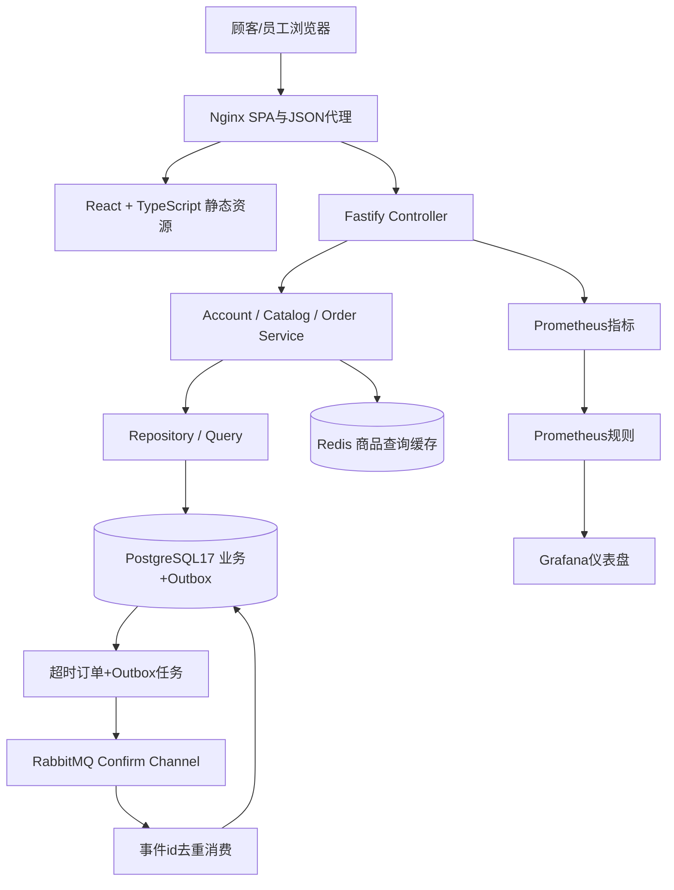
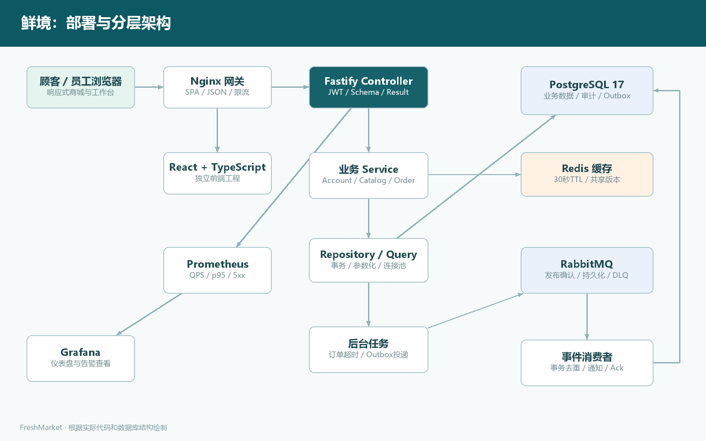
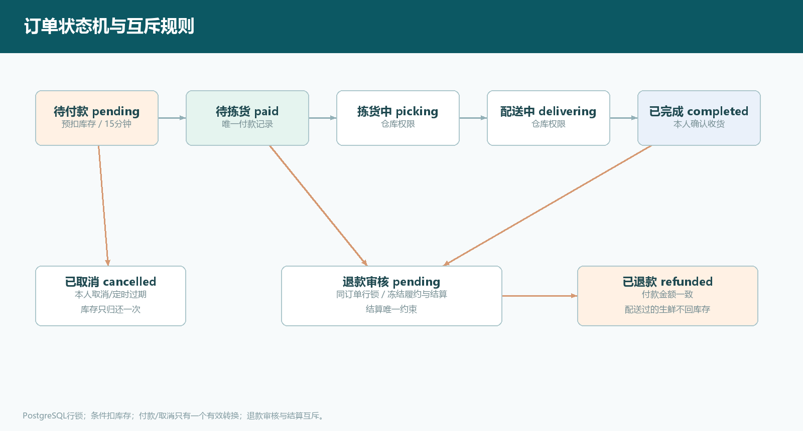

# 鲜境 FreshMarket 设计文档

## 1. 总体架构

采用前后端分离、模块化单体架构。React工程只调用JSON接口；Fastify控制器负责鉴权/参数/响应，Service负责业务不变量，Repository与统一Query接口负责数据库访问。通过单数据库事务保持购物核心一致性，用Outbox处理业务与消息队列之间的最终一致性。

## 2. 技术选型

| 层 | 采用 | 原因 | 替代方案/风险 |
| --- | --- | --- | --- |
| 开发语言 | TypeScript；Node24 | 当前环境已有Node；前后端共享类型表达，便于复现 | Java/Spring Boot成熟但需JDK/Maven；TS仍需要运行时校验 |
| 前端 | React、Vite、React Router | 组件化、独立构建、响应式商城与管理工作台 | Vue可替代；大型应用需继续拆包 |
| API | Fastify5 | JSON Schema、JWT、OpenAPI、注入测试与结构化日志 | Nest/Spring提供更强约束；本项目显式分层 |
| 主数据库 | PostgreSQL17 | 事务、行锁、条件更新、索引、唯一约束、连接池 | MySQL可替代；没有实现跨区域多主 |
| 本地数据库 | Node内置SQLite | 无外部服务可立即运行；WAL、持久化 | 仅开发/演示，不作为生产高并发部署 |
| 缓存 | Redis7.4 | 商品查询30秒TTL+共享版本失效 | 不缓存付款或库存决策；故障回源数据库 |
| 队列 | RabbitMQ4.3.6 | 持久化队列/消息、发布确认、消费ack、DLQ | Kafka适合大吞吐事件流，本规模无需额外复杂度 |
| 网关 | Nginx1.28 | 静态资源、SPA路由、JSON代理、登录限流 | 教学部署仅本机HTTP；公网需TLS终止 |
| 监控 | Prometheus3.13.4、Grafana13.2.3 | RT/QPS/5xx/进程指标、可配置告警与仪表盘 | 不包含短信/邮件告警通道及独立Alertmanager |
| 工程化 | npm workspaces、GitHub Actions、Docker Compose | 锁定依赖、可复现构建、测试、角色化部署 | CI文件已交付，GitHub上运行结果单独验收 |

教材使用Java/若依/Vue/MySQL，实验任务书将技术栈列为建议，允许按团队与环境选型。本项目保留教材的首页、购物车、支付、订单及权限分层思路，采用已有环境易复现的TS模块化架构。当前没有微服务拆分，因此不部署Nacos/Consul；配置由环境变量承担，模块间为进程内调用。详见 `docs/adr.md`。

依赖精确版本由 `package-lock.json` 锁定，使用 `npm ci` 安装；可查询 `docs/evidence/dependencies.txt`。容器版本来自对应项目发布文档，生产可进一步锁定镜像digest。

## 3. 模块与分层

| 模块 | Controller | Service | Repository/数据库职责 |
| --- | --- | --- | --- |
| Accounts | 注册/登录/购物车/地址/消息 | 密码校验、购物车数量、地址默认、评价资格 | 通过统一Query接口参数化读写用户、购物车与地址 |
| Catalog | 分类/列表/详情 | 缓存、动态筛选、商品维护、库存调整 | Query接口读写产品/分类；唯一排序枚举 |
| Orders | 创建/查询/付款/取消/收货/退款/评价 | 状态机、事务、幂等、快照、售后/结算约束 | OrderRepository统一订单行锁、审计、Outbox与回库存 |
| Admin | 经营数据、商品、履约、售后、财务、角色、审计 | 调用领域Service，限制RBAC | 聚合查询与脱敏；权限变更同时审计 |
| Core | 全局异常/Result/JWT/指标/Schema | Runtime负责缓存和消息，定时任务调度 | PostgreSQL连接池与SQLite事务串行互斥 |

Accounts/Catalog的数据访问集中于统一数据库适配器，不使用生成的Mapper层；OrderRepository单独封装跨操作复用的一致性逻辑。后台聚合只读取当前数据库的实际数据，零订单时显示真实空状态。

## 4. 一致性设计

### 4.1 下单事务

1. PostgreSQL先锁定当前用户行，串行化同一用户的购物车修改和下单，解决首笔幂等插入竞争。
2. 查询 `(user_id,idempotency_key)`；存在则比较SHA256请求摘要，摘要相同返回原订单，不再扣库存。
3. 验证地址归属、购物车商品状态和数量，从服务端读取价格。
4. 商品按id排序执行条件扣减：`UPDATE products SET stock=stock-quantity WHERE stock>=quantity AND active=1`。
5. 任一商品更新行数不是1则抛409，整个事务回滚；所有商品库存、购物车、订单和Outbox回到提交前状态。
6. 写订单金额/地址/商品快照，清理本人的购物车，写审计及Outbox，同一事务提交。

不使用“先查库存再无条件更新”的方式，也不把Redis库存作为账务依据。金额与原价以整数分保存；下单后修改售价和地址不影响已创建订单快照。

### 4.2 订单状态机

待付款→待拣货→拣货中→配送中→已完成。待付款可取消；付款/取消在同一订单行锁下争抢，只有一个有效转换。15分钟过期订单由2秒轮询任务处理，锁内再次验证是否过期且仍待付款，防止刚付款就被取消。

### 4.3 沙箱支付

只能本人访问沙箱支付接口；服务端从订单快照读取应付金额，客户端不能提交修改后的金额。订单行锁与 `payments.order_id UNIQUE` 限制单次记账；重试返回原业务结果，销售数量只增加一次。支付并非真实第三方回调，不把其当作具备支付签名验证的生产渠道。

### 4.4 退款与结算

申请退款和财务结算均锁定订单行；售后pending时禁止履约/结算，已结算订单在本版本进入人工客服处理。退款审核成功更新订单与沙箱支付状态，扣回销售数量；未发出的商品归还可售库存，已配送/完成的生鲜不回库存。

`refunds.order_id` 与 `settlements.order_id` 均为唯一约束。结算只处理completed且无pending/approved售后的订单；重复批次跳过已经结算订单，避免双重账务。当前没有商家多主体、佣金、税费和实际资金清分。

### 4.5 Outbox与队列

业务提交时在同事务写Outbox，不在业务事务里调用远程RabbitMQ。后台任务每次最多领取20条pending事件；PostgreSQL使用 `FOR UPDATE SKIP LOCKED`；领取状态processing，60秒租约超时会重新入队。事件通过confirm channel发出，收到发布确认后才标记sent。

消费者在数据库事务中先写 `processed_events.id`，冲突说明重复消息，直接ack；新事件和顾客消息同事务提交后才ack。消息处理异常进入 `fresh.dead` 死信队列，供人工检查和重放。声明了AMQP配置但队列断开时保留Outbox，并每30秒重连，不切换到另一套传输造成乱序。发布确认与数据库标记之间崩溃可能重复发布，消费端去重保证业务效果一次。

## 5. 安全设计

- 会员通过 `/api/auth/login` 登录，员工通过 `/api/admin/auth/login` 登录；身份查询分别为 `/api/auth/me` 和 `/api/admin/auth/me`。登录入口拒绝另一类账号。JWT包含主体id与账号类型，有效期2小时；每次请求读取数据库角色并核对令牌类型，客户端不能自报角色，旧版未分类型令牌需重新登录。
- 商城与员工控制台使用独立页面布局和两份sessionStorage令牌，分别登录与退出。购物车、地址、个人订单、支付、取消、收货、售后申请、评价及消息接口只允许会员；后台接口只允许员工并继续检查岗位权限，下单事务还会复核会员身份。
- 公开注册仅创建会员；管理员通过 `/api/admin/users`、`/api/admin/members` 分别新增、搜索、查看、编辑及删除员工/会员。更新可重置密码或启停账号，员工岗位仅在员工类型内调整，会员不能通过提交role越权。
- 删除权限使用独立能力 `products.delete`、`users.delete`、`orders.delete`，仅管理员持有；订单配送维护及后台取消使用 `orders.manage`。前端按能力显示按钮，API再次校验。禁止当前管理员自删、自停用、自降级；账号更新/删除事务按固定顺序锁定管理员记录并复核操作者及有效管理员数量，避免并发操作移除最后一位管理员。
- 用户表补充 `active`、`session_version`、`deleted_at`；JWT携带登录时的会话版本，每次请求核对启用状态、删除状态和版本。重置密码、启停、删除递增版本，旧令牌无法继续使用；客户端收到401仅清理对应的员工或会员会话。登录令牌使用已验证密码对应的版本，避免密码重置并发期间签发新版令牌。
- 用户、商品、错误订单采用 `deleted_at` 逻辑删除，列表和详情排除已删除记录，数据库外键和交易快照保留。商品删除同事务清理购物车、使缓存失效，种子数据按已有ID跳过，重启不会恢复删除项。账号删除前检查未完成订单/待审核售后，删除后清理购物车；历史订单、结算操作人及审计保留。
- 管理员仅能修改待付款/待拣货且无待审核售后的订单配送信息。脱敏电话号码不会写回订单，未提供新号码时保留原号。取消待付款订单复用订单行锁和归还库存逻辑，审计记录实际管理员。删除订单要求已取消且无支付、退款或结算记录；退款、结算、审计不开放任意编辑/删除。SQLite和PostgreSQL启动时均为旧库幂等补列，无需清库。
- scrypt + 随机salt + timingSafeEqual，不保存明文密码；日志与审计不包含密码或JWT。
- 订单/地址/评价使用用户归属校验；越权订单返回404，避免泄露对象是否存在；职能越权返回403。
- SQL使用绑定参数；动态排序来自固定映射。正文以React文本节点显示，不使用dangerouslySetInnerHTML渲染顾客输入。
- Bearer令牌保存在当前浏览器sessionStorage；采用Authorization头，不自动携带会话Cookie。没有实现HttpOnly Cookie/refresh token，不能将该实验认证包装为完备生产认证体系。
- API统一输入校验、64KiB请求体上限、全局限流300次/分钟、登录10次/分钟、注册8次/分钟；Nginx有额外登录限制。应用限流为单实例内存计数，多个副本需共享计数存储或统一边缘限流。
- 客服/仓库查看订单手机号脱敏；审计记录操作者、对象、事件、时间与traceId。订单地址仍受权限控制，未接入业务级字段加密。
- 教学Compose只绑定127.0.0.1，指标接口在Nginx阻止外部访问，数据库与缓存无公开端口。公网部署按运维文档配置HTTPS。

## 6. 缓存、性能与可观测性

商品列表缓存30秒，key包含Redis共享版本、查询条件与是否后台；订单/商品/库存变更使版本递增。Redis失败回源数据库，不影响核心业务提交。缓存中的库存可能短暂落后；实际加购与下单以数据库校验为准。商品详情不缓存，及时读取评价与库存。

PostgreSQL池最大15连接、连接等待5秒、空闲30秒；订单用户/时间索引、过期状态索引、Outbox状态索引支持常见操作。SQLite采用WAL与互斥队列，读写不会看到同连接的未提交状态；该模式不作为横向扩展方案。

Fastify结构化JSON日志每个请求分配UUID traceId，同时出现在响应体和 `x-trace-id` 头。Prometheus导出请求计数、响应直方图、内存和事件循环指标，route标签使用路由模板，避免订单id造成高基数。Grafana展示QPS、p95、错误率等；Prometheus已提供服务掉线、5xx超过1%、p95超过500ms的告警规则，未接外部通知渠道。

## 7. 工程与风险

单元/接口集成使用Node test与Fastify inject；端到端使用Playwright；类型检查与生产构建在GitHub Actions串行门禁；PostgreSQL测试在独立schema隔离。锁文件、配置示例、SQL、Docker镜像构建、监控配置、备份/恢复/回滚脚本随源码交付。

本版本主要边界：没有真实支付/物流、部分退款、多商户、优惠券、实时地理围栏、商品批次溯源、自动退款资金渠道、生产高可用和灾备演练。没有为了技术清单堆入Kubernetes、服务发现或跨数据库Saga/TCC。横向扩展前还需验收集群限流、种子数据并发初始化和队列消费者的故障注入。

## 8. 主要官方参考

- [Node24 SQLite API](https://nodejs.org/download/release/latest-v24.x/docs/api/sqlite.html)
- [Fastify参数校验](https://fastify.dev/docs/latest/Reference/Validation-and-Serialization/)
- [PostgreSQL版本维护](https://www.postgresql.org/support/versioning/)
- [RabbitMQ版本生命周期](https://www.rabbitmq.com/release-information)
- [Prometheus下载与版本](https://prometheus.io/download/)
- [Grafana官方下载](https://grafana.com/grafana/download)

教材及实验原始文件保留在工作区，未将教材扫描页复制进公开交付包。
