# 鲜境 FreshMarket 系统设计说明书

## 文档控制

| 项目 | 内容 |
| --- | --- |
| 文档编号 | FM-SDD-001 |
| 文档名称 | 鲜境 FreshMarket 生鲜电商平台 系统设计说明书 |
| 版本 | 3.0 |
| 日期 | 2026-10-21 |
| 状态 | 正式稿 |
| 适用版本 | main 分支当前代码（api/src、web/src、database、infra、scripts） |
| 编制 | FreshMarket 项目组 |
| 审核 | ________ |
| 批准 | ________ |
| 关联文档 | FM-SRS-001 软件需求规格说明书；FM-STR-001 系统测试报告 |

修订记录：

| 版本 | 日期 | 修订内容 |
| --- | --- | --- |
| 1.0 | 2026-10-06 | 初稿 |
| 2.0 | 2026-10-18 | 企业级重写 |
| 3.0 | 2026-10-21 | 按现有代码精简合并；补充营销、搜索推荐、链路追踪设计；更新数据库脚本与部署脚本设计 |

## 1. 引言

### 1.1 编写目的

本文档描述鲜境 FreshMarket 的架构、模块、数据库、关键业务、接口、前端、安全、部署与可观测性设计，作为开发、测试、运维与评审的共同基线。所述设计均可在源码与脚本中找到对应实现；需求见 FM-SRS-001，验证结果见 FM-STR-001。

### 1.2 适用范围

| 范围 | 主要位置 |
| --- | --- |
| 后端服务：Fastify API、业务模块、后台任务、指标与追踪 | api/src |
| 前端：顾客商城与员工工作台单页应用 | web/src |
| 数据库：表结构、索引、演示数据、迁移 | database/schema.sql、database/seed.sql、api/src/core/database.ts |
| 基础设施：镜像、网关、监控、告警、编排 | infra、compose.yaml、compose.test.yaml |
| 运维脚本：环境初始化、部署、回滚、备份、恢复及其测试 | scripts |
| 持续集成 | .github/workflows/ci.yml |

不在设计范围：真实支付与物流、多商户、跨地域容灾、Kubernetes 编排。

### 1.3 设计原则

| 目标 | 设计手段 |
| --- | --- |
| 交易数据强一致 | 下单、支付、取消、退款、结算在单个数据库事务内完成；库存、券、秒杀名额条件扣减；订单行锁；业务唯一约束 |
| 重复请求安全 | 下单幂等键与请求摘要；支付、退款、结算以 order_id 唯一；事件消费按事件 ID 去重 |
| 外部组件可降级 | Redis 不可用回源数据库；RabbitMQ 不可用时事件留在 Outbox；本地开发不依赖任何外部服务 |
| 权限最小化 | 会员与员工账号类型隔离；员工按岗位能力授权；删除类能力仅管理员；每次请求重新读取身份 |
| 可追溯 | W3C traceId 贯穿 HTTP、SQL、审计与异步事件 |
| 简单优先 | 模块化单体；不引入 ORM；JSON Schema 校验；同一套 SQL 兼容 SQLite 与 PostgreSQL |

### 1.4 术语

| 术语 | 说明 |
| --- | --- |
| 会员 / 员工 | 角色 member 的顾客账号 / operator、warehouse、support、finance、admin 五类岗位账号 |
| 能力（capability） | 员工授权标识，如 products、stock、orders.delete，定义于 core/security.ts |
| 分 | 金额单位，所有金额以整数分存储 |
| 幂等键 | 请求头 Idempotency-Key，识别重复下单 |
| Outbox | 与业务数据同事务写入的待发布事件表 |
| 逻辑删除 | 以 deleted_at 标记删除并保留数据行 |
| 会话版本 | users.session_version，与令牌携带值不一致时令牌失效 |

## 2. 架构设计

### 2.1 架构风格

系统采用“前后端分离 + 模块化单体 + 事务性 Outbox”：

- 前端为独立构建的 React 单页应用，只通过 /api 访问后端；部署时由 Nginx 提供静态资源并反向代理 API。
- 后端为单个 Node.js 进程内的模块化单体，分为 accounts、catalog、orders、promotions、admin 五个业务模块。库存、支付、退款、结算等不变量都能在一个数据库事务内保证，无需分布式事务。
- 异步通知通过 Outbox 表与 RabbitMQ 实现最终一致：业务事务只写本地表，后台任务负责可靠投递。
- 数据访问层以统一 Query 接口屏蔽 SQLite 与 PostgreSQL 差异：开发零依赖启动，部署使用 PostgreSQL。

### 2.2 逻辑架构

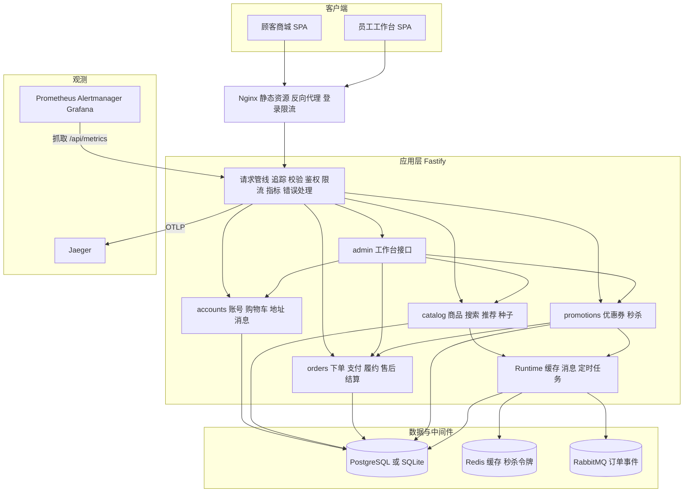

### 2.3 部署拓扑

compose.yaml 定义 9 个服务，位于同一 Compose 网络；只有网关与管理界面向宿主机发布端口，且默认绑定 127.0.0.1。

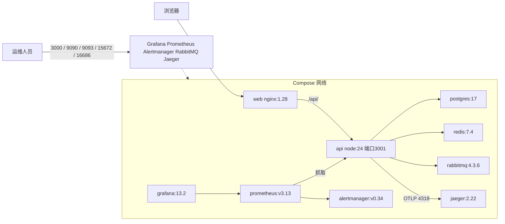

### 2.4 技术栈

| 层次 | 组件 | 用途 |
| --- | --- | --- |
| 运行时与语言 | Node.js 24（内置 node:sqlite）、TypeScript 5.9 strict | 前后端开发与运行 |
| Web 框架 | fastify 5，@fastify/jwt、helmet、cors、rate-limit、swagger | HTTP、校验、认证、安全头、限流、OpenAPI |
| 数据与中间件客户端 | pg 8、redis 5、amqplib 0.10 | PostgreSQL 连接池、Redis、RabbitMQ Confirm Channel |
| 可观测性 | prom-client 15；@opentelemetry/sdk-trace-node 与 OTLP HTTP 导出器 | 指标与链路追踪 |
| 前端 | react 19、react-router 7、lucide-react、vite 7 | 组件化 UI、路由、构建 |
| 测试 | node:test + tsx、@playwright/test 1.63 | API 与端到端测试 |
| 基础设施 | PostgreSQL 17、Redis 7.4、RabbitMQ 4.3.6、Nginx 1.28、Prometheus 3.13、Alertmanager 0.34、Grafana 13.2、Jaeger 2.22 | 部署组件 |

### 2.5 代码组织

| 路径 | 职责 |
| --- | --- |
| api/src/server.ts | 进程入口：构建应用、监听端口、SIGINT/SIGTERM 优雅关闭 |
| api/src/app.ts | 应用装配：配置校验、插件、指标、错误处理、鉴权守卫、路由注册、后台任务 |
| api/src/core/database.ts | SQLite 与 PostgreSQL 统一接口、事务、迁移 |
| api/src/core/runtime.ts | Redis 缓存、RabbitMQ 连接、Outbox 投递、事件消费、周期任务 |
| api/src/core/tracing.ts | OpenTelemetry 提供者、HTTP 根 span、SQL 与 Redis 子 span、上下文传播 |
| api/src/core/security.ts | 角色、账号类型、能力矩阵、密码哈希、用户脱敏、手机号掩码 |
| api/src/core/http.ts、errors.ts、context.ts | 统一响应与分页、业务异常、依赖注入上下文 |
| api/src/modules/accounts | 注册登录、购物车、地址、消息、员工与会员账号管理 |
| api/src/modules/catalog | 商品查询、模糊搜索（search.ts）、联想、热搜、推荐、商品维护、库存调整、演示数据（seed.ts） |
| api/src/modules/orders | OrderRepository（行锁、审计、事件、回库存、退券、退名额）与 OrderService（状态机、售后、结算、超时） |
| api/src/modules/promotions | coupons.ts（试算、分摊、领取、核销、管理）、seckill.ts（令牌闸门、秒杀下单、管理） |
| api/src/modules/admin | /api/admin 下的工作台接口 |
| web/src、web/src/admin | 商城页面、全局状态、API 客户端；工作台各功能页 |
| database | schema.sql 结构与索引；seed.sql 演示数据 |
| infra | Dockerfile、Nginx、Prometheus、告警、Alertmanager、Grafana 预置 |
| scripts | 环境初始化、部署、回滚、备份、恢复、运维脚本测试、冒烟、压测、文档生成 |

### 2.6 运行模式与降级

| 模式 | 数据库 | 缓存 | 消息 | 触发条件 |
| --- | --- | --- | --- | --- |
| 本地开发 | SQLite 文件（WAL） | 关闭，进程内版本号 | 进程内消费 Outbox | 未设置 DATABASE_URL、REDIS_URL、AMQP_URL |
| 自动化测试 | 内存 SQLite 或 PostgreSQL 临时 schema | 关闭 | 不启动后台任务 | buildApp 传入 db 且 workers=false |
| 容器部署 | PostgreSQL 17 | Redis | RabbitMQ | compose.yaml 注入连接串，NODE_ENV=production |
| Redis 故障 | 不受影响 | 回源数据库；秒杀直接由数据库判定；约 30 秒尝试重连 | 不受影响 | 健康检查 cache 为 degraded |
| RabbitMQ 故障 | 不受影响 | 不受影响 | 事件留在 Outbox，约 30 秒重连并重建拓扑，恢复后补发 | 健康检查 queue 为 degraded |

## 3. 后端设计

### 3.1 应用装配

buildApp(options) 是生产进程与测试共用的唯一构造入口：

1. NODE_ENV=production 时校验生产配置（见 8.8），不满足即抛出 CONFIG_INVALID 拒绝启动。
2. initTracing() 注册进程级 OpenTelemetry 提供者（配置 OTEL_EXPORTER_OTLP_ENDPOINT 时导出）。
3. 创建 Fastify：结构化日志并脱敏 authorization、password、password_hash；genReqId 启动 HTTP 根 span，请求 ID 即 W3C traceId；按 TRUST_PROXY 决定是否信任代理；请求体上限 64 KiB；Ajv 不移除未声明字段，使 additionalProperties:false 产生 400。
4. 创建数据库并以 traceDatabase() 包装，执行 migrate()；SEED_DEMO 不为 false 时执行 seed()。
5. 构建服务：OrderRepository、OrderService（ORDER_TTL_MINUTES 默认 15，SECKILL_TTL_MINUTES 默认 5）、Runtime、AccountService、CatalogService、CouponService、SeckillService。
6. 注册 CORS、Helmet、JWT（2 小时）、全局限流（300 次/分钟）、Swagger（/api/docs），以及指标与统一错误处理。
7. 定义鉴权守卫并组装 Context，传给各模块的路由注册函数。
8. 启用后台任务时 runtime.connect() 并 runtime.start(orders)；onClose 依次停止运行时、清理指标、关闭数据库。

### 3.2 请求处理管线

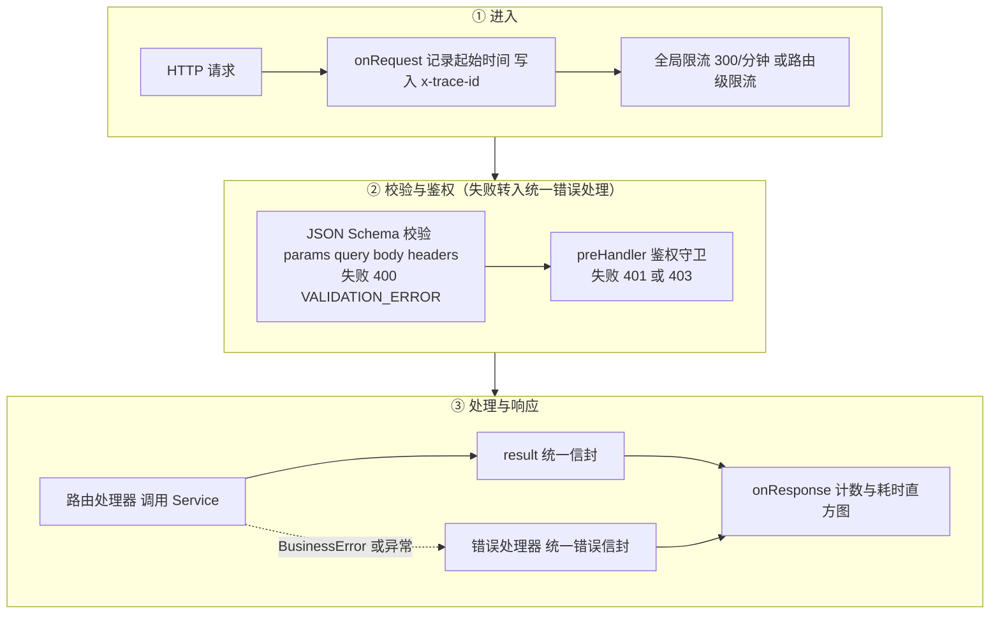

### 3.3 鉴权守卫

| 守卫 | 行为 | 失败结果 |
| --- | --- | --- |
| authenticate | 校验 JWT；按 sub 读取未删除用户；要求 active=1；令牌 sessionVersion 等于 users.session_version；令牌 accountType 等于角色推导的账号类型；写入 req.actor | 401 UNAUTHORIZED / ACCOUNT_DISABLED / SESSION_CHANGED |
| memberOnly | authenticate 后要求 role=member | 403 MEMBER_ONLY |
| staffOnly | authenticate 后要求账号类型为 staff | 403 STAFF_ONLY |
| permit(cap) | staffOnly 后要求当前角色的能力包含 cap | 403 FORBIDDEN |
| viewer | 公开接口可选识别会员，令牌无效时按游客处理 | 不报错 |

角色与能力每次请求按数据库当前角色计算，岗位调整无需等待令牌过期。

### 3.4 统一响应与错误

成功响应 {code:0, message:"success", data, traceId}；失败响应 {code, message, data:null, traceId}。业务代码用 ensure(cond, status, CODE, '中文消息') 抛出 BusinessError，由全局处理器转为信封；Schema 校验失败为 400 VALIDATION_ERROR，限流为 429 RATE_LIMITED，未知路由为 404 NOT_FOUND，其他异常为 500 INTERNAL_ERROR 并记录 request_failed 日志。

### 3.5 模块设计

| 模块 | 主要方法 | 关键规则 |
| --- | --- | --- |
| accounts | register、login、createStaff、createMember、updateAccount、removeAccount、cart、setCart、saveAddress、review | 注册固定为会员；未知账号也执行一次哑哈希比较；入口与账号类型不符返回 403；改密、启停、删除时 session_version 加 1；保留至少一名启用管理员；删除默认地址后下一个地址成为默认 |
| catalog | list、detail、suggest、hot、related、forYou、save、stock、remove | 商城只见上架未删除商品；搜索与推荐结果按缓存版本缓存 30 秒；库存调整条件更新且不为负；删除商品同时清除购物车 |
| orders | create、seckill、pay、cancel、transition、updateDelivery、remove、requestRefund、decideRefund、settle、expire | 见第 5 章；create 与 seckill 共用 begin（锁会员、幂等检查）、address、insert（金额、快照、审计、Outbox） |
| promotions | CouponService（center、claim、mine、checkout、list、save）与 quote、lockCoupon、markCouponUsed；SeckillService（list、acquire、order、adminList、save） | 试算为纯函数；核销与名额扣减在下单事务内完成；已领取的券、已成交的活动限制修改 |
| admin | /api/admin 路由 | 写操作委托各服务；列表与统计为只读聚合 SQL；员工可见订单经 hidePhone 掩码手机号并移除原始地址快照；LIKE 查询转义 %、_ 与 ! |

OrderRepository 提供共享一致性原语：get(tx,id,lock) 读取订单并在 PostgreSQL 下追加 FOR UPDATE；audit() 写审计；emit() 写 Outbox 并保存当前 W3C 链路上下文；restock() 按商品 ID 顺序归还库存；releaseCoupon() 在取消与整单退款时退券；releaseSeckill() 仅在未付款取消时归还秒杀名额。

### 3.6 后台任务

Runtime 每 2 秒执行一轮（定时器 unref，上一轮未结束则跳过）：

1. 已配置但未连通的 Redis 或 RabbitMQ，距上次尝试超过 30 秒时重连。
2. orders.expire() 取消已过期的待付款订单；有订单被取消时使商品缓存失效。
3. runtime.flush() 投递最多 20 条待发布事件。
4. 任一步骤异常记录 worker_failed，不影响下一轮。

## 4. 数据库设计

### 4.1 方言适配层

core/database.ts 提供统一接口：Query 含 all、one、run，占位符一律为问号；Database 另含 dialect、transaction(fn)、migrate()、close()。

| 设计点 | SQLite（开发、测试） | PostgreSQL（部署） |
| --- | --- | --- |
| 驱动 | node:sqlite DatabaseSync，单连接 | pg Pool，最多 15 连接，获取超时 5 秒 |
| 占位符 | 原生问号 | 执行前按顺序替换为 $1、$2 |
| 并发 | 全部语句与事务经 Promise 队列串行 | 连接池并发，事务独占连接 |
| 事务 | BEGIN IMMEDIATE | BEGIN / COMMIT / ROLLBACK |
| 行锁 | 不需要 | 业务在 postgres 方言下追加 FOR UPDATE、FOR UPDATE SKIP LOCKED |
| 连接参数 | foreign_keys=ON、journal_mode=WAL、busy_timeout=5000 | 连接池错误写 postgres_pool_error 日志 |
| 聚合结果 | 数值 | COUNT、SUM 返回字符串，调用方显式 Number() 并用 COALESCE 处理空值 |

约束：SQL 字面量中不得出现问号；PostgreSQL 专有子句只在 dialect 为 postgres 时追加。

### 4.2 数据类型约定

| 约定 | 说明 |
| --- | --- |
| 主键 | TEXT；业务记录用 UUID；种子数据用可读 ID（u-admin、p01、a-demo、c-welcome、sk-cherry）；订单号为 FM + 毫秒时间戳 + 8 位随机串 |
| 金额 | INTEGER，单位分 |
| 时间 | BIGINT，Unix 毫秒 |
| 布尔 | INTEGER 0/1，以 CHECK 约束 |
| 结构化数据 | TEXT 存 JSON（地址快照、事件载荷、审计详情） |
| 逻辑删除 | users、products、orders 的 deleted_at，为空表示有效 |

### 4.3 实体关系

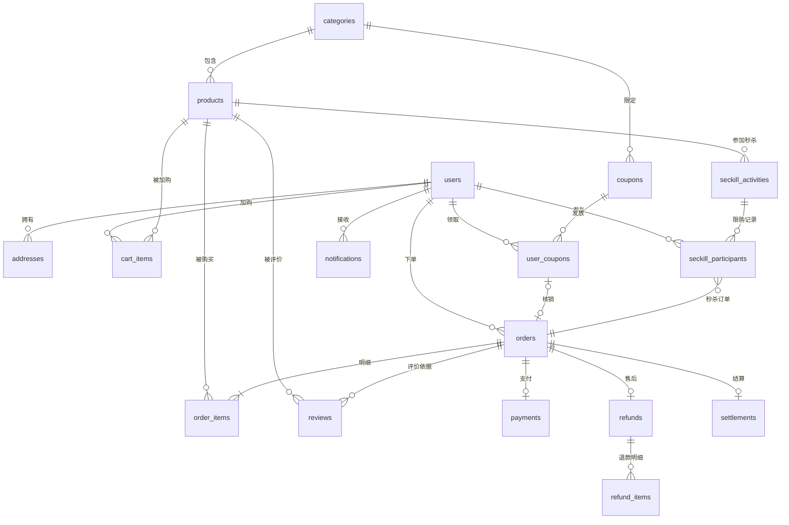

outbox 与 processed_events、audit_logs 与 users、search_logs 与商品之间为逻辑关联，不建外键：便于事件重放，并允许 system 等非用户操作者。orders.coupon_id 与 orders.seckill_id 同样为逻辑引用。

### 4.4 表结构

schema.sql 按领域分为六段，每张表与关键列均带中文注释。

| 分组 | 表 | 关键列与约束 |
| --- | --- | --- |
| 账号 | users | username UNIQUE（含已删除）；role 默认 member；active CHECK 0/1；session_version；deleted_at |
| 账号 | addresses | user_id FK；name、phone、detail；is_default（每人至多一个为 1，应用保证） |
| 账号 | notifications | user_id FK；title、body；由事件消费者写入 |
| 商品目录 | categories | 6 个固定分类，id 为分类标识 |
| 商品目录 | products | category_id FK；price CHECK > 0；stock CHECK ≥ 0；sales、views；active；deleted_at |
| 商品目录 | cart_items | PK(user_id, product_id)；quantity CHECK 1–99 |
| 商品目录 | search_logs | keyword、results、created_at；热搜统计来源 |
| 订单与资金 | orders | status；subtotal、discount、delivery_fee、total；address_snapshot JSON；idempotency_key、request_hash，UNIQUE(user_id, idempotency_key)；expires_at；coupon_id、seckill_id；deleted_at |
| 订单与资金 | order_items | 名称、图片、规格、成交单价快照；discount 为行优惠分摊；UNIQUE(order_id, product_id) |
| 订单与资金 | payments | order_id UNIQUE；provider 默认 sandbox；status success/refunded |
| 订单与资金 | refunds / refund_items | refunds.order_id UNIQUE；status pending/approved/rejected；original_status；refund_items 记录按商品部分退款，quantity CHECK > 0 |
| 订单与资金 | reviews | rating CHECK 1–5；UNIQUE(order_id, product_id, user_id) |
| 订单与资金 | settlements | order_id UNIQUE；amount 为净额；operator_id FK |
| 营销 | coupons | kind CHECK amount/percent；threshold、value、max_discount；category_id 可空；issued CHECK 0 ≤ issued ≤ total；valid_from、valid_to；active |
| 营销 | user_coupons | UNIQUE(coupon_id, user_id)；status CHECK unused/used；order_id 记录核销订单 |
| 营销 | seckill_activities | price CHECK > 0；stock CHECK > 0；sold CHECK 0 ≤ sold ≤ stock；start_at、end_at；active |
| 营销 | seckill_participants | PK(activity_id, user_id)，保证每人每场一件；order_id FK |
| 可靠消息与审计 | outbox | topic、payload；status pending/processing/sent；attempts；published_at 兼作租约时间；trace_context |
| 可靠消息与审计 | processed_events | id PK，消费去重 |
| 可靠消息与审计 | audit_logs | actor_id、action、entity_id、detail、trace_id；只增不改 |

### 4.5 索引设计

| 类别 | 索引 | 服务的查询 |
| --- | --- | --- |
| 隐式 | 各表主键与唯一约束 | 主键访问、防重校验、按订单查明细与流水 |
| 业务查询 | idx_products_category(category_id, active) | 分类筛选 |
| 业务查询 | idx_orders_user(user_id, created_at)、idx_orders_expiry(status, expires_at) | 会员订单列表、超时扫描 |
| 业务查询 | idx_refunds_status(status, created_at) | 售后待审核列表与计数 |
| 业务查询 | idx_payments_created(created_at) | 经营概览近 7 日收款 |
| 业务查询 | idx_outbox_pending(status, created_at)、idx_audit_created、idx_search_logs_created | Outbox 领取、审计分页、热搜统计 |
| 业务查询 | idx_user_coupons_user(user_id, status)、idx_seckill_window(active, end_at)、idx_notifications_user、idx_reviews_product | 我的优惠券、进行中秒杀、消息与评价列表 |
| 外键列 | addresses、cart_items、order_items、refunds、refund_items、reviews、settlements、coupons、user_coupons、seckill_activities、seckill_participants 的外键列 | PostgreSQL 不自动为外键建索引；按用户、商品查询及删除父记录时避免全表扫描 |

数据库脚本测试（api/test/database-scripts.test.ts）遍历全部外键，确认每个外键列都是某个索引（含主键与唯一约束）的首列。

### 4.6 迁移策略

1. 每次启动执行 schema.sql；全部语句为 CREATE ... IF NOT EXISTS，对新库建表，对旧库无副作用，新表自动创建。
2. 旧表新增列登记在 database.ts 的 additions 映射（users.active/session_version/deleted_at，products.views/deleted_at，orders.deleted_at/discount/coupon_id/seckill_id，order_items.discount，outbox.trace_context）。PostgreSQL 用 ADD COLUMN IF NOT EXISTS；SQLite 先读 PRAGMA table_info 再按需添加。新增列必须同时写入 schema.sql 与 additions。
3. PostgreSQL 迁移在会话级咨询锁 pg_advisory_lock(7303052026) 内执行，多副本同时启动时串行化。
4. 迁移只增不删，旧版本镜像回滚后仍能读写新库；不兼容变更须使用发布前备份恢复。

### 4.7 并发控制与防重

| 场景 | 机制 |
| --- | --- |
| 超卖 | UPDATE products SET stock=stock-? WHERE id=? AND active=1 AND deleted_at IS NULL AND stock>=?，影响行数不为 1 即整单回滚；按商品 ID 顺序扣减 |
| 券超发与重复领取 | UPDATE coupons SET issued=issued+1 WHERE ... AND issued<total；UNIQUE(coupon_id, user_id) |
| 秒杀超卖与重复参与 | UPDATE seckill_activities SET sold=sold+1 WHERE ... AND sold<stock AND 时间窗内，同时扣商品库存；seckill_participants 主键 |
| 重复下单 | UNIQUE(user_id, idempotency_key) + 请求摘要比较 |
| 重复支付、售后、结算 | payments、refunds、settlements 的 order_id UNIQUE，并在订单行锁内先查后返回 |
| 同一会员并发下单 | PostgreSQL 下事务先锁会员行，使幂等插入、购物车修改与下单串行 |
| 支付与取消竞争 | 均先锁订单行，状态检查在锁内完成；超时取消在锁内再次确认 |
| 降级或删除最后一名管理员 | 按 ID 顺序锁全部管理员行后统计 |
| Outbox 多实例领取 | PostgreSQL 下 FOR UPDATE SKIP LOCKED 领取并置 processing |
| 重复消费 | processed_events 主键，INSERT ... ON CONFLICT DO NOTHING |

### 4.8 逻辑删除

| 对象 | 前置条件 | 删除动作 | 保留内容 |
| --- | --- | --- | --- |
| 账号 | 非本人；非最后一名启用管理员；无未完成订单与待审核售后 | active=0、deleted_at、session_version 加 1、清空购物车 | 历史订单、结算操作人、审计；账号名继续占用 |
| 商品 | 未删除 | active=0、deleted_at、清除购物车中的该商品、缓存失效 | 订单明细、售后明细、评价；种子不会重建 |
| 订单 | cancelled 且无支付、退款、结算记录 | deleted_at | 审计记录 |

所有业务查询带 deleted_at IS NULL 条件；外键始终指向保留的行，不产生悬空引用。

### 4.9 数据库脚本

| 脚本 | 用途 | 设计 |
| --- | --- | --- |
| database/schema.sql | 全量结构 | 两种方言通用，可重复执行，不含 DROP；头部注释说明运行方式、加列规则、类型与逻辑删除约定；按表依赖顺序分段创建，索引集中在末段 |
| database/seed.sql | 实验演示数据 | 由 export-seed.mjs 生成，不手工编辑；BEGIN/COMMIT 包裹；全部 ON CONFLICT(id) DO NOTHING；按分类（6）、商品（48）、账号（6）、地址（1）、优惠券（3）、秒杀（1）分段；含公开默认密码哈希，禁止导入公网环境 |
| scripts/export-seed.mjs | 生成 seed.sql | 读取 api/dist 中的 seed.ts 数据，需先执行 npm run build -w api；文件头记录生成时间与有效期基准 |

手工初始化命令：`sqlite3 freshmarket.sqlite < database/schema.sql`，或 `psql "$DATABASE_URL" -v ON_ERROR_STOP=1 -f database/schema.sql`，随后以同样方式导入 seed.sql。Docker 部署无需导入 seed.sql，API 首次启动时由 seed.ts 写入，并使用 .env.docker 中的 DEMO_PASSWORD。

### 4.10 种子数据策略

| 数据 | 写入规则 |
| --- | --- |
| 分类、商品、优惠券、秒杀活动 | 每次启动 INSERT ... ON CONFLICT(id) DO NOTHING，只补齐缺失记录，不覆盖已有价格、库存与状态；逻辑删除的商品行仍存在，不会重建；券有效期 365 天、秒杀 7 天，均从首次写入起算 |
| 6 个演示账号与 1 个地址 | 仅当 users 表为空时写入；密码取 DEMO_PASSWORD，未设置时为本地默认密码 |
| 关闭 | SEED_DEMO=false 时跳过 |

## 5. 关键业务设计

### 5.1 订单状态机

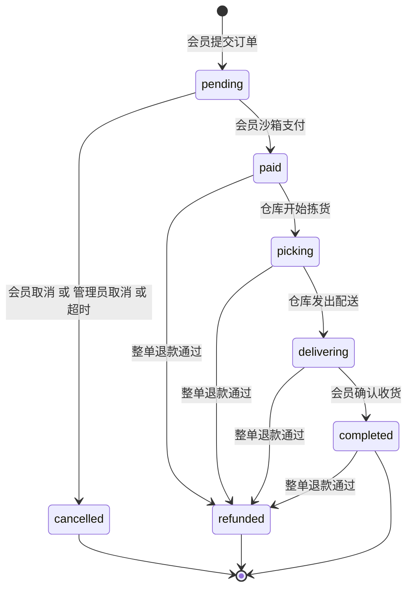

| 转换 | 操作者 | 前置条件 | 副作用 | 事件 |
| --- | --- | --- | --- | --- |
| 创建为 pending | 会员 | 地址属本人；购物车非空；库存充足；所选券可用 | 扣库存；核销券；写订单与明细快照；清空购物车；expires_at = 当前 + TTL | order.created |
| pending → paid | 会员本人 | 未过期；无支付流水 | 写支付流水；累加销量 | order.paid |
| pending → cancelled | 会员本人、orders.manage、系统任务 | 仍为 pending；系统任务另需已过期 | 归还库存、退券、归还秒杀名额 | order.cancelled |
| paid → picking → delivering | fulfillment | 无待审核售后 | 无 | order.picking、order.delivering |
| delivering → completed | 会员本人 | 无待审核售后 | 无 | order.completed |
| 已付款状态 → refunded | refunds | 整单退款通过且未结算 | 见 5.6 | order.refunded |

### 5.2 幂等下单与预扣库存

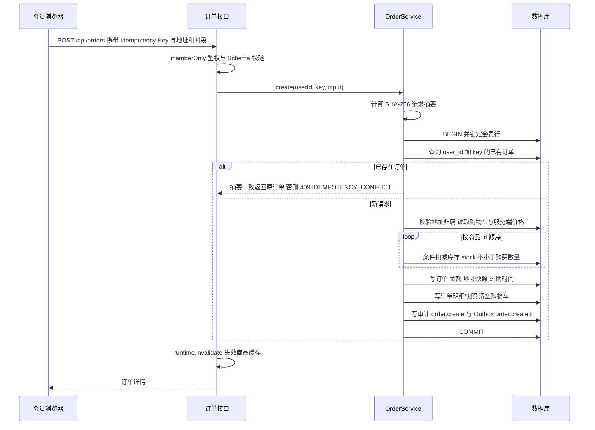

- 请求摘要覆盖 addressId、deliverySlot、note 与所选 couponId；前端在这些内容变化时重新生成幂等键。
- 选择优惠券时，读取购物车后、扣减库存前在同一事务内调用 lockCoupon 校验券的归属、状态、有效期与适用性并计算分摊；写订单后以 markCouponUsed 条件核销（仅当 status 仍为 unused 时改为 used），并发重复使用只有一单成功。
- 金额由服务端计算：小计 − 优惠 + 配送费；配送费按优惠后金额计算，≥ 9900 分免运费，否则 600 分。
- 任一步骤失败事务整体回滚，库存、券、购物车、订单与 Outbox 均恢复原状。

### 5.3 优惠券

| 环节 | 设计 |
| --- | --- |
| 试算 quote | 纯函数：按券的分类筛选适用行，适用金额低于门槛时不可用；满减券优惠 = min(value, 适用金额)，折扣券优惠 = floor(适用金额 × (100 − value) / 100) 并受 max_discount 封顶 |
| 分摊 | 按行金额比例 floor 分配，余数逐分补到各行，保证分摊合计等于优惠额且每行不超过行金额；结果写入 order_items.discount |
| 领取 claim | 条件更新 issued<total 且在有效期内，再插入 user_coupons；唯一约束防止重复领取；按会员令牌主体限流 30 次/分钟 |
| 结算页 checkout | 按当前购物车对本人全部未使用券试算，优惠最多的在前 |
| 退券 | 取消与整单退款调用 releaseCoupon，把 used 恢复为 unused；部分退款不退券，退款额扣回 ceil(行分摊 × 退款数量 ÷ 购买数量) |
| 管理 save | 校验规则（满减额小于门槛、折扣 10–99 等）；已有会员领取后只允许修改名称、总量（不少于已领数）、结束时间与启停 |

### 5.4 限时秒杀

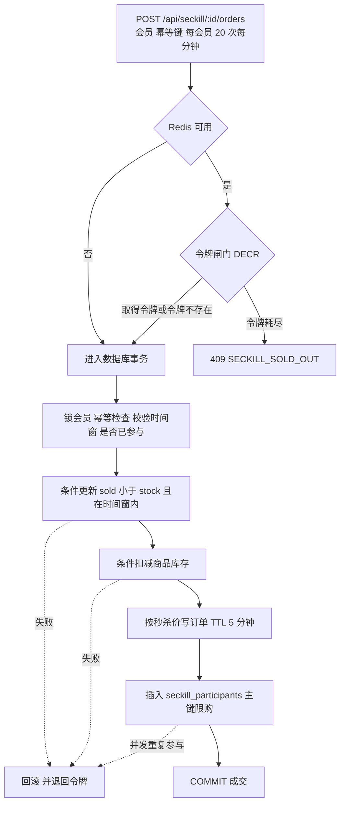

- 令牌数取活动剩余名额，60 秒过期后按数据库重新校准；活动保存后删除令牌。令牌只用于削峰，成交始终以数据库条件更新为准。
- 秒杀订单不经购物车、不可用券，discount 为 0；未付款取消或超时时 releaseSeckill 归还名额并删除参与记录，付款后的退款不归还名额。
- 活动管理：秒杀价须低于商品当前售价，结束时间晚于开始时间；已有成交时不能修改商品与秒杀价，名额不能少于已售。

### 5.5 支付、取消与履约

- 支付不接受客户端金额：在订单行锁内校验归属、pending 与未过期，写入金额等于 total 的 sandbox 流水，置为 paid 并累加销量；重复请求返回原结果。
- 后台任务每 2 秒取消已过期的 pending 订单，cancel() 在行锁内再次确认“仍为 pending 且已过期”，避免与刚完成的支付竞争；重复取消不重复归还。
- 仓库只能推进 paid → picking → delivering，会员只能把本人 delivering 订单确认为 completed；其余组合返回 409 INVALID_STATE；存在待审核售后时拒绝推进。

### 5.6 售后退款

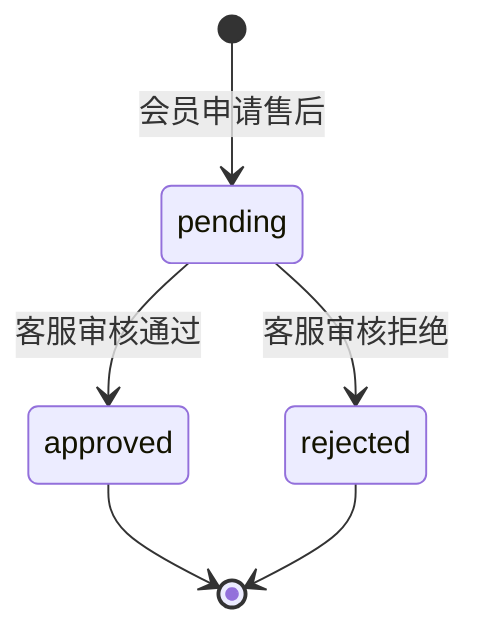

订单须为本人且处于 paid、picking、delivering 或 completed，未结算；每单只有一条售后记录。

| 申请方式 | 金额 | 审核通过后的处理 |
| --- | --- | --- |
| 整单（不传 items 与 amount） | 订单 total | 订单与支付置 refunded；扣回全部销量；退券；paid 或 picking 时归还全部库存，已配送生鲜不回库存；事件 order.refunded |
| 按商品（items，最多 50 项） | Σ(单价 × 数量 − ceil(行分摊 × 数量 ÷ 购买数量)) | 订单状态不变；扣回所选销量；未发货时只归还所选库存；事件 order.partially_refunded |
| 按金额（只传 amount） | 1 分至 total | 订单状态不变，不调整库存与销量；事件 order.partially_refunded |

审核在订单行锁内进行，重复提交相同结论直接返回，已处理的售后不可改判，已结算订单不可同意。售后待审核期间，履约、确认收货、配送信息修改与结算均被冻结。

### 5.7 财务结算与评价

- 结算为批量操作：一个事务内锁定全部 completed 订单，跳过已结算与售后待审核的订单；净额 = total − 已通过退款金额，净额 ≤ 0 时跳过；每单写 settlements，最后写一条 entity_id 为 batch 的审计。重复执行不会重复入账。
- 评价要求订单属本人且为 completed、商品在明细中、该订单该商品尚未评价；详情页展示最近 30 条，评价人只显示首字。

### 5.8 账号生命周期与会话失效

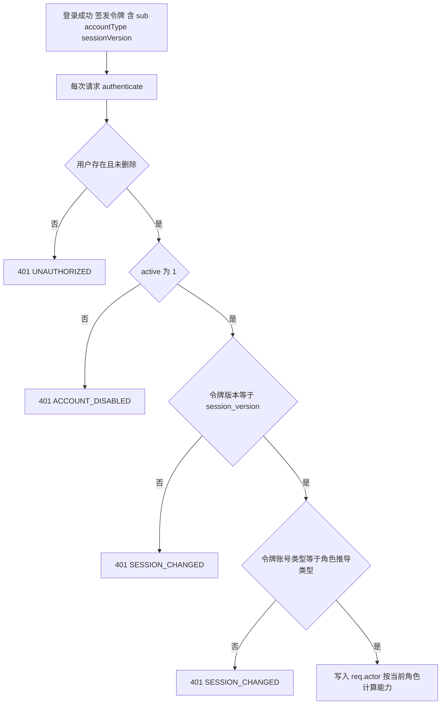

重置密码、停用或启用、删除使会话版本加 1，旧令牌全部失效；调整岗位与修改姓名不改变会话版本，下一次请求即按新岗位授权。禁止会员与员工互转，禁止管理员调整本人岗位、停用或删除本人，系统始终保留至少一名启用的管理员（LAST_ADMIN）。

### 5.9 搜索与推荐

| 功能 | 设计 |
| --- | --- |
| 模糊搜索 | search.ts：关键词与字段做 NFKC 归一化与小写；按空白分词，每个词都须命中；名称、产地、副标题精确命中分别得 100、80、60 分；整个查询最多一个词放宽：≥ 3 位字母数字词允许与名称片段相差一次编辑，单个中文词允许字面重合（两字命中一字，更长须覆盖 75% 不同汉字）；精确、错字、重合三档依次排序，重合结果最多 6 款；先过滤评分再分页 |
| 匹配高亮 | web/src/search-highlight.ts：中文逐字、非中文按连续片段在归一化文本中定位后映射回原文位置；不依赖浏览器与 React，同时被 API 测试导入 |
| 综合推荐排序 | 销量 × 0.5 + 浏览量 × 0.3 + 新品（30 天内）× 0.2，ID 为次序键 |
| 搜索联想 | 复用模糊匹配，最多 8 款上架商品 |
| 热搜 | 统计近 7 天商城搜索第一页且有结果的关键词（search_logs），取前 8，不足用热销商品名补齐 |
| 买了又买 | 同一已付款订单中共同出现的订单数排序，不足 6 款用同类综合推荐补齐 |
| 猜你喜欢 | 会员：已购与购物车品类偏好 × 0.6 + 归一化热度 × 0.4，排除购物车内商品；游客只按热度 |

### 5.10 商品缓存

| 设计点 | 说明 |
| --- | --- |
| 对象 | 商品列表与搜索结果（商城、工作台分开）、联想、热搜、买了又买；详情不缓存 |
| 键 | 命名空间:catalog:名称:版本号:参数，过期 30 秒 |
| 失效 | 版本号递增使旧键失效；Redis 可用时版本号存于 Redis 并在多实例间共享，否则为进程内计数 |
| 触发 | 下单、支付、取消（含超时）、退款审核、商品增改删、库存调整、秒杀下单 |
| 故障 | Redis 读写异常视为未命中；加购与下单始终以数据库库存为准 |

### 5.11 Outbox 与消息投递

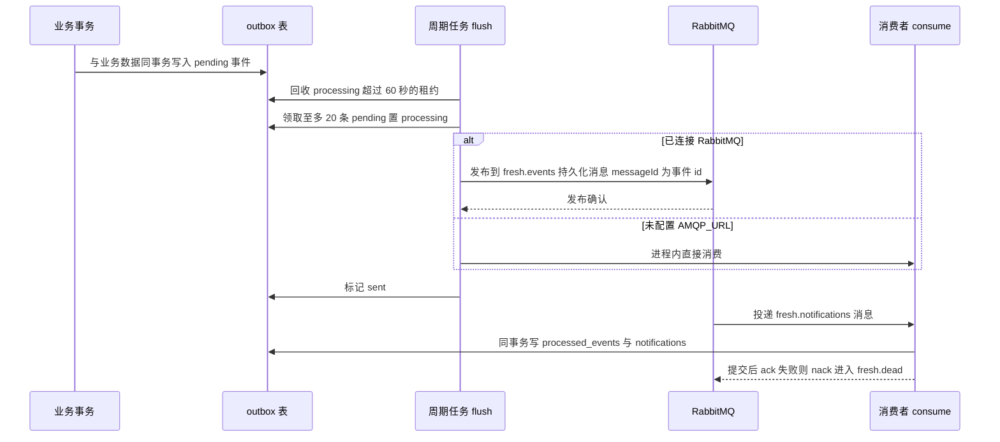

| 设计点 | 说明 |
| --- | --- |
| 拓扑 | 主题交换机 命名空间.events；队列 命名空间.notifications 绑定 order.*，死信交换机与队列 命名空间.dead；均持久化，预取 20 |
| 可靠发布 | Confirm Channel + mandatory：收到正向确认才标记 sent；不可路由退回、负向确认、5 秒无确认、通道断开均保留 pending 并关闭通道，等待重连重建 |
| 不切换传输 | 已配置 AMQP_URL 但未连接时 flush 直接返回，事件留在库内，避免进程内消费与队列消费混用 |
| 至少一次 | 确认与标记之间崩溃可能重复发布，由 processed_events 去重 |
| 链路 | emit() 保存当前 traceparent，发布与消费 span 延续同一条链路 |
| 消息标题 | 订单提交成功、付款成功、订单已取消、商品正在拣货、商品配送中、已确认收货、退款已完成、部分退款已完成 |
| 约束 | attempts 只计数，未设置最大重试次数与退避 |

### 5.12 经营概览

返回未删除订单数、有效销售额（paid、picking、delivering、completed 的 total 之和）、待拣货数、会员数、待审核售后数、低库存商品（库存 < 20 的上架商品前 8 个）、各状态订单数、近 7 日沙箱支付成功笔数与金额（按服务器本地时区自然日，容器 TZ 为 Asia/Shanghai）、未发送事件数。全部聚合值显式转为数值并以 COALESCE 处理空值，两种数据库返回类型一致。

## 6. 接口设计

### 6.1 通用约定

| 约定 | 说明 |
| --- | --- |
| 路径 | 全部位于 /api；员工接口位于 /api/admin |
| 格式 | JSON；请求体上限 64 KiB；未声明字段一律拒绝 |
| 鉴权 | Authorization: Bearer；会员令牌与员工令牌互不通用 |
| 幂等 | POST /api/orders 与 POST /api/seckill/:id/orders 必须携带 8–100 位 Idempotency-Key |
| 分页 | page ≥ 1；pageSize 1–100（商城商品默认 12，其余 20）；返回 items、total、page、pageSize |
| 响应 | {code, message, data, traceId}；响应头 x-trace-id 与 traceId 一致；可携带 traceparent 延续上游链路 |
| 越权语义 | 访问他人订单、地址返回 404；岗位越权返回 403 |
| 文档 | /api/docs（Swagger UI）、/api/openapi.json |

### 6.2 主要错误码

| HTTP | 错误码 |
| --- | --- |
| 400 | VALIDATION_ERROR、ADDRESS_INVALID、ADDRESS_LIMIT、CART_EMPTY、INVALID_CATEGORY、INVALID_STOCK、INVALID_PRODUCT、PRODUCT_NOT_FOUND、INVALID_REFUND_AMOUNT、INVALID_REFUND_QUANTITY、INVALID_COUPON、COUPON_INVALID、INVALID_SECKILL、INVALID_NAME、INVALID_STAFF_ROLE、ACCOUNT_TYPE_IMMUTABLE、SELF_DELETE、SELF_DISABLE、SELF_ROLE_CHANGE |
| 401 | UNAUTHORIZED、INVALID_CREDENTIALS、SESSION_CHANGED、ACCOUNT_DISABLED |
| 403 | ACCOUNT_DISABLED（登录时）、ACCOUNT_TYPE_MISMATCH、MEMBER_ONLY、STAFF_ONLY、FORBIDDEN |
| 404 | NOT_FOUND、ORDER_NOT_FOUND、PRODUCT_NOT_FOUND、ADDRESS_NOT_FOUND、REFUND_NOT_FOUND、USER_NOT_FOUND、COUPON_NOT_FOUND、SECKILL_NOT_FOUND |
| 409 | OUT_OF_STOCK、IDEMPOTENCY_CONFLICT、INVALID_STATE、ORDER_EXPIRED、ORDER_REFUNDED、REFUND_PENDING、ALREADY_SETTLED、ALREADY_REVIEWED、ORDER_HAS_TRANSACTIONS、USERNAME_EXISTS、LAST_ADMIN、ACCOUNT_IN_USE、INVALID_STOCK、INVALID_COUPON、INVALID_SECKILL、COUPON_CLAIMED、COUPON_SOLD_OUT、COUPON_EXPIRED、COUPON_USED、COUPON_NOT_APPLICABLE、COUPON_LOCKED、SECKILL_NOT_STARTED、SECKILL_ENDED、SECKILL_LIMIT、SECKILL_SOLD_OUT、SECKILL_LOCKED |
| 429 | RATE_LIMITED |
| 500 | INTERNAL_ERROR、CONFIG_INVALID（启动阶段） |

### 6.3 端点清单

| 分组 | 端点 | 访问者 |
| --- | --- | --- |
| 会员认证 | POST /api/auth/register（8 次/分钟）、POST /api/auth/login（10 次/分钟）、GET /api/auth/me | 公开 / 会员 |
| 商品 | GET /api/categories、/api/products、/api/products/:id | 公开 |
| 搜索推荐 | GET /api/search/suggest、/api/search/hot、/api/products/:id/related、/api/recommendations | 公开（携带会员令牌时个性化） |
| 营销 | GET /api/promotions、/api/coupons、/api/seckill | 公开 |
| 会员营销 | POST /api/coupons/:id/claim；GET /api/my/coupons、/api/cart/coupons；POST /api/seckill/:id/orders | 会员 |
| 购物车与地址 | GET/POST /api/cart、PUT /api/cart/:id；GET/POST /api/addresses、PUT/DELETE /api/addresses/:id | 会员 |
| 订单 | POST/GET /api/orders、GET /api/orders/:id；POST /api/orders/:id/pay、/cancel、/receive、/refund、/reviews | 会员 |
| 消息 | GET /api/notifications | 会员 |
| 员工认证 | POST /api/admin/auth/login（10 次/分钟）、GET /api/admin/auth/me | 公开 / 员工 |
| 经营概览 | GET /api/admin/dashboard | dashboard |
| 商品与库存 | GET /api/admin/products、/:id（catalog.read）；POST、PUT（products）；DELETE（products.delete）；POST /api/admin/products/:id/stock（stock） | 员工 |
| 营销管理 | GET/POST /api/admin/coupons、PUT /api/admin/coupons/:id；GET/POST /api/admin/seckill、PUT /api/admin/seckill/:id | promotions |
| 订单 | GET /api/admin/orders、/:id（orders）；PUT /:id、POST /:id/cancel（orders.manage）；DELETE /:id（orders.delete）；POST /:id/status（fulfillment） | 员工 |
| 售后与结算 | GET /api/admin/refunds、/:id，POST /:id/decision（refunds）；GET/POST /api/admin/settlements（settlements） | 员工 |
| 账号 | GET/POST /api/admin/users、/api/admin/members；GET/PUT 对应 /:id（users）；DELETE 对应 /:id（users.delete）；PUT /api/admin/users/:id/role（users） | 管理员 |
| 审计 | GET /api/admin/audit | audit |
| 运维 | GET /api/health、/api/metrics、/api/openapi.json、/api/docs | 公开；网关屏蔽 metrics 与文档 |

## 7. 前端设计

### 7.1 结构与路由

前端为 Vite 构建的 React 19 单页应用，不使用 UI 组件库，样式集中在 style.css（商城）与 staff.css（工作台）。开发模式下 Vite 运行在 5173 端口并把 /api 代理到 3001。

| 路径 | 页面 | 访问要求 |
| --- | --- | --- |
| / | 首页：轮播、领券与秒杀、分类栏、商品网格、排序、分页、搜索结果、猜你喜欢 | 公开；URL 参数 category、q、sort、page |
| /products/:id | 商品详情、评价、买了又买 | 公开 |
| /checkout | 结算：地址、配送时段、优惠券、备注、金额汇总 | 会员 |
| /orders | 我的订单：状态页签、支付倒计时、支付、取消、收货、售后、评价 | 会员 |
| /account | 个人中心：资料、地址、优惠券、消息 | 会员 |
| /admin/login、/admin/* | 员工登录与工作台 | 员工；未登录跳转登录页 |

App.tsx 按路径拆分布局：/admin 下渲染独立的工作台布局，其余页面带商城头部（配送地址、搜索框与联想、账号、订单、购物车抽屉、主导航）与页脚。主导航与图标分类栏共同读取 URL 中的 category 参数，选中状态始终一致。

### 7.2 全局状态与 API 客户端

| 设计点 | 说明 |
| --- | --- |
| 全局状态 | store.tsx 的 StoreProvider 提供会员与员工用户、购物车、地址、当前配送地址（持久化到 localStorage）与消息提示；未登录加购先弹出登录框，登录后自动补加 |
| 令牌 | sessionStorage 分别保存 fresh-member-token 与 fresh-staff-token；api() 按路径是否以 /admin/ 开头选择令牌，同一浏览器可同时登录两类账号 |
| 会话恢复 | 启动时分别调用 /auth/me 与 /admin/auth/me 校验，失败清除对应令牌 |
| 401 | api() 派发 fresh-session-expired 事件；仅当存储中的令牌仍是触发请求的令牌时才清除对应会话 |
| 链路 | 每次请求生成 traceparent 头，与服务端 traceId 对应 |
| 错误 | 非 0 业务码抛出 ApiError（message、code、traceId），页面以提示条或表单错误展示 |
| 请求量控制 | 首页营销数据用一次 /api/promotions 获取；推荐区滚动到可视区才加载，避免触发全局限流 |

### 7.3 员工工作台

| 菜单 | 所需能力 | 主要功能 |
| --- | --- | --- |
| 经营概览 | dashboard | 指标卡、近 7 日成交趋势、待办、低库存预警、服务健康状态 |
| 商品管理 | products | 查询、详情、新建、编辑、上下架；具备 products.delete 时显示删除 |
| 库存管理 | stock | 入库与损耗调整并填写原因 |
| 营销活动 | promotions | 优惠券与秒杀活动的查询、新增、编辑、启停 |
| 订单履约 | orders | 搜索、详情；fulfillment 推进拣货与配送；orders.manage 修改配送与取消；orders.delete 删除错误订单 |
| 售后服务 | refunds | 搜索、详情、审核 |
| 财务结算 | settlements | 结算记录与生成结算批次 |
| 账号管理 | users | 员工与会员分别管理；users.delete 时显示删除 |
| 审计日志 | audit | 搜索与详情 |

菜单与按钮按登录返回的 capabilities 渲染，直接访问无权页面显示“当前账号没有此页面权限”；服务端始终再次校验，前端隐藏不作为安全边界。

### 7.4 关键交互

- 结算页用 crypto.randomUUID() 生成幂等键，地址、时段、备注或优惠券变化时重新生成；提交期间按钮禁用。
- 商品卡片显示库存，低于 20 提示库存紧张，为 0 显示暂时售罄并禁用加购；已加购商品显示数量步进器。
- 订单页每 15 秒刷新，待付款订单显示倒计时；秒杀列表按服务器时间倒计时。
- 通用 Modal 实现焦点循环、Esc 关闭与焦点归还，并以 ref 保存回调，避免父组件重渲染导致输入框失焦。
- 首页轮播每 5 秒切换，悬停、聚焦、页面隐藏或“减少动态效果”时暂停。

## 8. 安全设计

### 8.1 认证与授权

- 会员入口 /api/auth/login 与员工入口 /api/admin/auth/login 分离，入口与账号类型不符时拒绝。
- JWT 以 JWT_SECRET 签名，有效期 2 小时，载荷仅含 sub、accountType、sessionVersion；角色不写入令牌，每次请求从数据库读取。
- 令牌经 Authorization 头发送，不使用 Cookie，不受 CSRF 自动携带影响。

| 角色 | 能力 |
| --- | --- |
| member | 无员工能力 |
| operator 运营 | dashboard、catalog.read、products、orders、promotions |
| warehouse 仓库 | dashboard、catalog.read、stock、orders、fulfillment |
| support 客服 | dashboard、orders、refunds |
| finance 财务 | dashboard、settlements |
| admin 管理员 | 全部能力，含 products.delete、orders.manage、orders.delete、users、users.delete、audit |

会员数据访问在 SQL 中附带 user_id 条件或在服务层比对归属；员工无法调用购物车、地址、领券、下单、秒杀、支付、收货、售后、评价接口；会员无法调用任何 /api/admin 接口。下单事务内再次确认下单人为启用的会员。

### 8.2 密码与凭据

密码使用 scrypt（64 字节）加 16 字节随机盐存储，以 timingSafeEqual 比较；登录时对不存在的账号也执行一次哈希比较。密码要求 10–128 位且含字母与数字。日志屏蔽 authorization、password、password_hash；审计详情与链路数据不记录密码、令牌和 SQL 参数值。前端产物不包含任何密码：构建只接收 VITE_DEMO，演示按钮只填入账号名。

### 8.3 输入校验与注入防护

全部路由声明 JSON Schema，拒绝未声明字段并限制长度、枚举与数值范围；SQL 全部参数绑定，排序表达式来自固定分支，LIKE 查询转义通配符；商品图片路径受正则约束；前端以文本节点渲染用户输入。

### 8.4 限流

| 层次 | 规则 |
| --- | --- |
| API 全局 | 每客户端 300 次/分钟（单实例内存计数） |
| API 路由 | 注册 8 次/分钟；会员登录、员工登录各 10 次/分钟 |
| 会员级 | 领券 30 次/分钟、秒杀下单 20 次/分钟，按验签后的 JWT sub 计数，无效令牌退回按 IP |
| Nginx | 登录与注册路径每客户端 5 次/分钟，突发 10 |

TRUST_PROXY 未设置时 API 忽略转发头；Docker 部署设为 1，只信任 Nginx 一跳，Nginx 以 $remote_addr 覆盖 X-Forwarded-For，因此限流按真实客户端计数，伪造的转发头无效。

### 8.5 响应头与传输

安全响应头（CSP、X-Frame-Options、X-Content-Type-Options、Referrer-Policy）由 Nginx 统一下发，代理时隐藏 API（helmet）的同名头，避免重复与冲突。网关对外屏蔽 /api/metrics、/api/docs 与 /api/openapi.json。教学部署为 HTTP 并只绑定本机；公网部署须在网关或负载均衡终止 TLS 并启用 HSTS。

### 8.6 隐私与审计

员工接口中的手机号掩码为前 3 位加 **** 加后 4 位，修改配送信息时未填新号码则保留原号；评价只展示姓名首字；用户对象对外输出时剔除密码哈希。账号、商品、库存、营销、订单、支付、售后、结算、评价的关键写操作在同一事务内写入 audit_logs，记录操作者、动作、对象、详情与 traceId，审计不提供修改与删除接口（附录 A）。

### 8.7 生产配置校验

NODE_ENV=production 时启动即校验：JWT_SECRET 不少于 32 位且不是本地开发密钥；必须提供 DATABASE_URL；未关闭演示数据时 DEMO_PASSWORD 不少于 12 位且不同于本地默认密码。任一不满足即以 CONFIG_INVALID 终止。

## 9. 部署设计

### 9.1 环境划分

| 环境 | 组成 | 配置来源 | 用途 |
| --- | --- | --- | --- |
| 本地开发 | npm run dev 并行启动 API（tsx watch，3001）与 Vite（5173）；SQLite 文件库 | 可选 .env（参考 .env.example） | 开发与演示，仅需 Node.js 24 |
| 自动化测试 | 内存 SQLite，或 TEST_DATABASE_URL 指向的 PostgreSQL（每个用例独立 schema） | 环境变量 | API 测试 |
| 端到端测试 | Playwright 自动启动开发环境，或经 E2E_BASE_URL 指向已部署站点 | 环境变量 | 浏览器测试 |
| 容器部署 | compose.yaml 九个服务，NODE_ENV=production | .env.docker（init-env 生成） | 完整组件演示 |
| 容器内测试 | compose.test.yaml 的 tests 服务（profile test） | .env.docker | 在容器网络内对 PostgreSQL 回归 |

### 9.2 Compose 服务

| 服务 | 镜像 | 关键配置 | 健康检查 / 依赖 |
| --- | --- | --- | --- |
| postgres | postgres:17-alpine | 库与用户 freshmarket，密码 DB_PASSWORD | pg_isready |
| redis | redis:7.4-alpine | AOF，maxmemory 128mb，allkeys-lru | redis-cli ping |
| rabbitmq | rabbitmq:4.3.6-management-alpine | 用户 freshmarket，密码 MQ_PASSWORD | rabbitmq-diagnostics ping |
| api | freshmarket-api:${APP_VERSION} | NODE_ENV=production、三项连接串、JWT_SECRET、DEMO_PASSWORD、SEED_DEMO、TRUST_PROXY=1、OTLP 地址 | fetch /api/health；依赖 postgres、redis、rabbitmq 健康及 jaeger 已启动 |
| web | freshmarket-web:${APP_VERSION} | 构建参数 VITE_DEMO；端口 ${WEB_BIND}:8080 | wget /healthz；依赖 api 健康 |
| jaeger | jaegertracing/jaeger:2.22.0 | 内存存储，UI 16686 | — |
| prometheus | prom/prometheus:v3.13.4 | 只读挂载配置与告警规则，保留 7 天 | — |
| alertmanager | prom/alertmanager:v0.34.1 | 只读挂载 alertmanager.yml | — |
| grafana | grafana/grafana:13.2.3 | 管理员密码 GRAFANA_PASSWORD，禁止注册，预置 Prometheus 与 Jaeger 数据源及仪表盘 | — |

全部服务 restart: unless-stopped。数据卷：postgres-data、redis-data、rabbit-data、prometheus-data、grafana-data、alertmanager-data；常规停止使用 stop 或 down，不带 -v。项目名取 .env.docker 中的 COMPOSE_PROJECT_NAME，同机多套部署互不共用数据卷。

### 9.3 网络与端口

| 端口 | 绑定 | 说明 |
| --- | --- | --- |
| 8080 | WEB_BIND（默认 127.0.0.1） | 商城与工作台入口 |
| 3000、9090、9093、15672、16686 | 127.0.0.1 | Grafana、Prometheus、Alertmanager、RabbitMQ 管理、Jaeger |
| 3001、5432、6379、5672 | 仅容器网络 | API、PostgreSQL、Redis、AMQP 不对宿主机发布 |

### 9.4 启动顺序

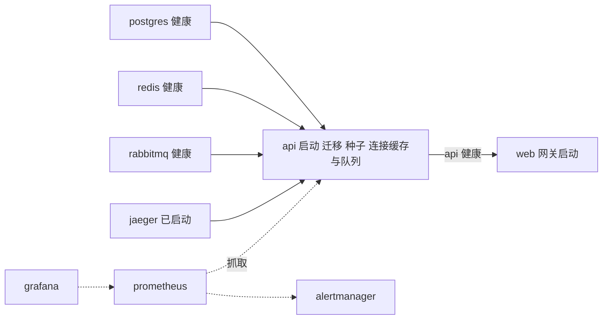

### 9.5 镜像与网关

| 对象 | 设计 |
| --- | --- |
| API 镜像 | 多阶段：node:24-alpine 中 npm ci，复制 api 与 database，构建后 npm prune --omit=dev；运行阶段只含 node_modules、api/dist、database，以 node 用户运行 |
| Web 镜像 | 多阶段：node:24-alpine 构建前端（只接收 VITE_DEMO），nginx:1.28-alpine 运行 |
| 测试镜像 | node:24-alpine，复制 api、database 与 web（测试引用 web/src/search-highlight.ts），默认命令 npm test |
| Nginx | /assets 一年强缓存，/images 缓存一天，其余回退 index.html；/api/ 代理到 api:3001（连接 5 秒、读取 15 秒），覆盖 X-Forwarded-For；登录与注册限流；屏蔽 metrics 与接口文档；/healthz 返回 200；统一安全头 |

.dockerignore 排除依赖、构建产物、运行数据、环境文件、文档与交付物，避免密钥与本地数据进入构建上下文。

### 9.6 配置项

| 变量 | 默认值 | 作用 |
| --- | --- | --- |
| NODE_ENV | development | production 时启用生产配置校验 |
| HOST / PORT | 127.0.0.1 / 3001 | 监听地址与端口（容器内 0.0.0.0） |
| JWT_SECRET | 本地开发密钥 | 令牌签名密钥，生产必须替换 |
| DATABASE_URL / SQLITE_PATH | 空 / .runtime/freshmarket.sqlite | 设置前者使用 PostgreSQL，否则使用 SQLite 文件 |
| REDIS_URL / AMQP_URL | 空 | 启用 Redis 与 RabbitMQ |
| MQ_NAMESPACE / CACHE_NAMESPACE | fresh | 队列与缓存命名空间 |
| CORS_ORIGIN | http://localhost:5173 | 允许的跨域来源，逗号分隔 |
| ORDER_TTL_MINUTES / SECKILL_TTL_MINUTES | 15 / 5 | 普通订单与秒杀订单的待付款时限 |
| TRUST_PROXY | 空 | 信任的代理跳数或地址列表 |
| SEED_DEMO / DEMO_PASSWORD | 启用 / 本地默认密码 | 演示数据开关与演示账号初始密码 |
| VITE_DEMO | 显示 | 前端构建时决定是否显示演示账号入口 |
| OTEL_EXPORTER_OTLP_ENDPOINT / OTEL_SERVICE_NAME | 空 / freshmarket-api | 链路导出地址与服务名 |
| LOG_LEVEL | info | 日志级别 |
| APP_VERSION | local | 镜像标签，由 deploy 脚本写入 |
| COMPOSE_PROJECT_NAME、WEB_BIND、DB_PASSWORD、MQ_PASSWORD、GRAFANA_PASSWORD | 由 init-env 生成 | Compose 项目名、网关绑定地址与组件密码 |

### 9.7 运维脚本

每个脚本同时提供 POSIX sh（Linux、macOS）与 PowerShell（Windows，.ps1 只用 ASCII 字符以兼容 Windows PowerShell 5.1）两个版本，参数与行为一致，均先切换到项目根目录并读取 .env.docker。

| 脚本 | 设计 |
| --- | --- |
| init-env | 生成 .env.docker：JWT_SECRET、DB_PASSWORD、MQ_PASSWORD、GRAFANA_PASSWORD 为 24 字节随机数，DEMO_PASSWORD 为固定前缀加 16 位随机串，COMPOSE_PROJECT_NAME 带随机后缀；显式写出 SEED_DEMO、VITE_DEMO、CORS_ORIGIN、WEB_BIND、APP_VERSION；sh 版本以 umask 077 创建；文件已存在时拒绝覆盖 |
| deploy [版本] | 预检 docker、.env.docker 与 compose config；以“提交号-时间”或指定版本构建 api/web 镜像（版本号只允许字母、数字、点、下划线、连字符）；up -d --wait 等待全部健康检查，再经网关容器请求 /api/health；成功后写回 APP_VERSION 并追加 .deploy-history |
| rollback [版本] | 默认取 .deploy-history 的上一条；确认 api 与 web 两个镜像都在本机；up -d --no-build --no-deps --wait 只替换应用容器；成功后写回版本并记录 |
| backup [目录] | 容器内 pg_dump -Fc 到临时文件，pg_restore --list 校验可读，docker compose cp 复制到 backups/freshmarket-时间.dump，检查非空；无论成败删除容器内副本 |
| restore 文件 确认 | 须显式确认（sh 为 --yes，ps1 为 -Force）；先备份当前库到 backups/pre-restore（当前库无法导出时可用 --no-pre-backup / -SkipPreBackup 跳过）；停 api，单事务 pg_restore --clean --if-exists，FLUSHDB 清空专用 Redis，up -d --wait 启动 api |

部署流程：

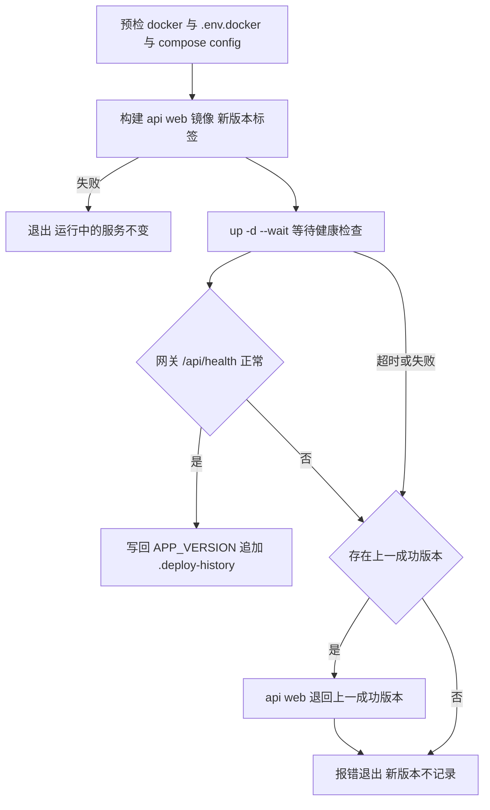

设计约束：

- .deploy-history 只记录健康的发布与回滚，最后一行即当前版本；连续两次回滚会在最近两个版本之间切换，回到更早版本需显式指定版本号。
- 迁移只增不删，回滚应用镜像不需要回退数据库；不兼容的结构变更必须用发布前备份恢复。
- 恢复流程中任一步失败都不启动 API，避免在数据不完整时对外服务；FLUSHDB 只适用于本 Compose 专用的 Redis，共享 Redis 须改为按命名空间清理。
- 未提供定时备份与保留策略；Redis 与 RabbitMQ 不在备份范围（业务事实以数据库为准）。
- scripts/test-ops.sh 与 scripts/test-ops.ps1 在临时目录中运行脚本副本，用 docker 替身验证上述成功与失败分支（19 项与 18 项），不触及真实容器；CI 执行 sh 版本。

### 9.8 持续集成

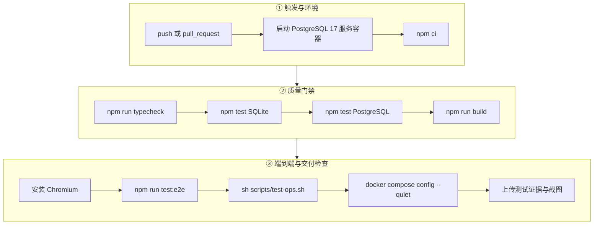

流水线运行于 ubuntu-latest、Node 24，任一步骤失败即中止，无论成败均上传 docs/evidence、docs/screenshots 与 test-results。流水线不含镜像构建、镜像漏洞扫描与部署步骤。

### 9.9 部署验证工具

| 工具 | 说明 |
| --- | --- |
| scripts/infra-smoke.mjs | 在 API 容器内运行；以随机命名的 schema、队列与缓存命名空间验证 Redis、缓存失效、事务下单、发布确认、消费、重复事件去重与取消回库存，结束后清理 |
| scripts/load-test.mjs | 对商品列表接口按指定并发与请求数压测，输出 QPS、p50、p95、p99 与错误率 |
| compose.test.yaml | 在容器网络内运行 API 测试并连接部署的 PostgreSQL |

## 10. 可观测性设计

### 10.1 日志与链路追踪

- Fastify 输出 JSON 结构化日志；5xx 以 request_failed 记录；外部组件降级、Outbox 重试、消费失败、周期任务失败分别记录 redis_degraded、broker_degraded_outbox_will_wait、outbox_retry、event_consume_failed、worker_failed 等事件。
- genReqId 启动 HTTP 根 span：有合法 traceparent 时沿用其 trace，否则新建；traceId 写入响应体、x-trace-id 响应头、日志与审计 trace_id。
- traceDatabase() 包装 Query 接口，在存在父 span 时为每条 SQL 创建子 span，只记录语句模板不记录参数；Redis 操作同样创建子 span。
- Outbox 事件保存 traceparent，发布与消费 span 延续同一条链路，消费端可从 RabbitMQ 消息头恢复上下文。
- 配置 OTEL_EXPORTER_OTLP_ENDPOINT 时以 OTLP/HTTP 批量导出到 Jaeger；未配置时只在本地生成 traceId。健康检查返回追踪模式 otlp 或 local。

### 10.2 指标

| 指标 | 类型 | 说明 |
| --- | --- | --- |
| fresh_http_requests_total | Counter | 按 method、route（路由模板）、status 计数 |
| fresh_http_duration_seconds | Histogram | 响应耗时，桶 0.01–5 秒共 9 档 |
| fresh_dependency_up{dependency} | Gauge | database 每次抓取实际查询；cache、queue 表示已配置连接的就绪状态 |
| fresh_outbox_oldest_pending_seconds | Gauge | 最旧 pending 或 processing 事件的等待秒数；查询失败输出非数值 |
| Node.js 默认指标 | 多种 | CPU、内存、事件循环延迟、GC |

/api/metrics 自身不计入请求指标；Prometheus 每 15 秒从 api:3001 抓取。

### 10.3 告警与仪表盘

| 告警 | 条件 | 持续 | 级别 |
| --- | --- | --- | --- |
| FreshmarketApiDown | up 为 0 | 1 分钟 | critical |
| FreshmarketDependencyDown | fresh_dependency_up 为 0 | 1 分钟 | critical |
| FreshmarketHighErrorRate | 5 分钟内 5xx 占比超过 1% | 3 分钟 | warning |
| FreshmarketOutboxDelayed | 最旧未发送事件超过 60 秒 | 3 分钟 | warning |
| FreshmarketSlowRequests | p95 超过 0.5 秒 | 3 分钟 | warning |

Prometheus 把告警推送到 Alertmanager，按 alertname、severity 分组，API 宕机时抑制 warning 级告警；默认接收器 ops 未配置外部通道，部署方需在 infra/alertmanager.yml 补充 Webhook 或邮件。Grafana 自动装载“FreshMarket · 业务服务监控”仪表盘：指标采集可达、QPS、p95 响应时间、5xx 错误率、进程内存、事件循环延迟、依赖就绪、最旧未发送事件。

## 11. 性能与容量

| 设计点 | 说明 |
| --- | --- |
| 连接池 | PostgreSQL 最多 15 连接，获取超时 5 秒 |
| 缓存 | 商品查询 30 秒缓存，版本失效；Redis 128 MB，LRU 淘汰 |
| 上限 | pageSize ≤ 100；消息与评价最多 30 条；请求体 64 KiB；售后明细最多 50 项 |
| 搜索 | 一次读取全部候选商品在内存评分，适用于当前百级商品规模；万级需改用全文检索或独立搜索引擎 |
| 后台任务 | Outbox 每 2 秒最多 20 条，单实例投递上限约每秒 10 条 |
| 秒杀削峰 | Redis 令牌耗尽时直接拒绝，不占用数据库事务 |
| 单实例限制 | 应用层限流为进程内计数；SQLite 模式串行执行，仅用于开发演示 |
| 横向扩展前提 | 共享限流存储或边缘限流；迁移咨询锁与 Outbox SKIP LOCKED 已支持多实例 |

## 12. 技术债与改进建议

| 编号 | 现状 | 建议 |
| --- | --- | --- |
| TD-01 | 综合推荐直接使用销量与浏览量原值，新品权重 0.2 相对计数几乎不起作用 | 各因子归一化或对数变换后再加权 |
| TD-02 | Outbox 只累计 attempts，没有重试上限与退避 | 增加上限、指数退避与失败状态并纳入监控 |
| TD-03 | 工作台部分聚合查询直接写在控制器中 | 下沉到查询服务或仓储 |
| TD-04 | 应用层限流为单实例内存计数 | 多实例时改用 Redis 存储计数或边缘限流 |
| TD-05 | 运维脚本只做了控制流测试 | 在测试环境定期执行真实备份、恢复与回滚演练并记录 RPO/RTO |
| TD-06 | 端到端测试运行在 Vite 开发服务上，受浏览器资源影响不稳定 | 改为针对生产构建或 Docker 网关执行 |
| TD-07 | 告警没有外部通知渠道 | 配置 Webhook 或邮件并验证触发与恢复 |
| TD-08 | 没有刷新令牌、单点登录与多因素认证；支付与配送为沙箱 | 接入真实渠道时增加回调签名、对账与资金退款 |

## 附录 A 审计动作

| 动作 | 触发场景 |
| --- | --- |
| auth.register、auth.login | 会员注册；会员或员工登录 |
| user.create、user.update、user.delete | 管理员新增、编辑、删除账号 |
| product.create、product.update、product.delete | 商品新建、编辑、删除 |
| stock.adjust | 库存调整 |
| coupon.claim、coupon.create、coupon.update | 会员领券；优惠券新增、编辑 |
| seckill.create、seckill.update | 秒杀活动新增、编辑 |
| order.create、payment.sandbox、order.cancel | 下单（含秒杀）、沙箱支付、取消 |
| order.transition、order.delivery.update、order.delete | 履约推进与确认收货、修改配送信息、删除错误订单 |
| refund.request、refund.decision | 售后申请与审核 |
| settlement.create | 结算批次 |
| review.create | 商品评价 |

## 附录 B 事件主题

| 主题 | 产生时机 | 会员消息标题 |
| --- | --- | --- |
| order.created | 下单成功 | 订单提交成功 |
| order.paid | 支付成功 | 付款成功 |
| order.cancelled | 订单取消 | 订单已取消 |
| order.picking | 开始拣货 | 商品正在拣货 |
| order.delivering | 发出配送 | 商品配送中 |
| order.completed | 确认收货 | 已确认收货 |
| order.refunded | 整单退款通过 | 退款已完成 |
| order.partially_refunded | 部分退款通过 | 部分退款已完成 |
