# 鲜境 FreshMarket 系统设计说明书

> 当前实现补充（2026-10-20）：基线已更新为 `725696a` 及本轮工作区修复。[维护记录](maintenance-2026-10-20.md)列明消息可靠性、监控、部署隔离和 DEF-01—14 的当前实现与复验边界。下文是 **bb1bde2 / 2026-10-18 的设计快照**，其中旧缺陷描述用于解释修复动机，不能当作当前实现；原版本号、历史证据保留以便追溯。

## 当前设计增量

优惠券、限时秒杀由 `modules/promotions` 提供，订单事务内核销优惠券并保存每行优惠分摊；取消和整单退款退券，部分退款按实付分摊计算。秒杀使用活动名额与商品库存双条件更新，每会员每活动唯一参与；Redis 令牌用于削峰，数据库决定成交。详见 [README](../README.md) 的业务边界和 `features.test.ts`。

搜索联想复用模糊匹配，热搜来自近七日有效商城搜索；共同购买与会员偏好推荐使用真实订单/购物车数据。OpenTelemetry 在 HTTP、SQL、Outbox 发布与消费间传递 W3C 链路上下文，SQL span 不记录参数，Jaeger 仅绑定本机。

消息发布要求持久化、mandatory 路由检查及正向确认；5 秒无确认、退回和通道故障保留 Outbox 重试并重建连接，不切换传输方式。消费者按事件 ID 去重，不能将发布成功等同于消费完成。监控区分采集可达、依赖就绪和事件积压；依赖就绪指标对 Redis/MQ 仅代表连接状态。其余约束与验证边界见维护记录。

## 2026-10-18 设计基线（历史）

## 文档控制

| 项目 | 内容 |
| --- | --- |
| 文档编号 | FM-SDD-001 |
| 文档名称 | 鲜境 FreshMarket 生鲜购物平台 系统设计说明书 |
| 版本 | 2.0 |
| 日期 | 2026-10-18 |
| 状态 | 正式稿 |
| 适用版本 | main 分支 commit bb1bde2 |
| 密级 | 内部 |
| 编制 | FreshMarket 项目组 |
| 审核 | ________ |
| 批准 | ________ |
| 关联文档 | FM-SRS-001 需求规格说明书；FM-STR-001 测试报告 |

### 修订记录

| 版本 | 日期 | 修订说明 | 修订人 |
| --- | --- | --- | --- |
| 2.0 | 2026-10-18 | 全面重写：以 commit bb1bde2 的源码、数据库脚本、部署脚本与 2026-10-18 验证结果为唯一依据重新编制 | FreshMarket 项目组 |

## 1. 引言

### 1.1 编写目的

本文档描述鲜境 FreshMarket 生鲜购物平台的总体架构、模块划分、数据库、关键业务流程、接口、前端、安全、部署与可观测性设计，作为开发、测试、运维与评审的共同基线。文档中的每一项设计均可在源码或脚本中找到对应实现，已知缺陷以 DEF 编号与测试报告 FM-STR-001 保持一致。

### 1.2 适用范围

| 范围 | 内容 | 主要位置 |
| --- | --- | --- |
| 后端服务 | Fastify API、业务模块、后台任务、指标 | api/src |
| 前端应用 | 顾客商城与员工工作台单页应用 | web/src |
| 数据库 | 表结构、索引、演示数据、迁移逻辑 | database/schema.sql、database/seed.sql、api/src/core/database.ts |
| 基础设施 | 镜像、网关、监控、告警、编排 | infra、compose.yaml、compose.test.yaml |
| 运维脚本 | 密钥初始化、备份、恢复、回滚、冒烟、压测 | scripts |
| 持续集成 | 类型检查、双数据库测试、构建、端到端测试 | .github/workflows/ci.yml |

不在本设计范围内：真实支付渠道、真实物流与骑手调度、多商户、优惠券与营销、跨地域容灾、Kubernetes 编排。支付与配送均为沙箱流程。

### 1.3 预期读者

开发工程师、测试工程师、运维工程师、架构评审人员以及项目验收方。

### 1.4 设计目标与原则

| 设计目标 | 采用的设计手段 |
| --- | --- |
| 交易数据强一致 | 下单、支付、取消、退款、结算全部在单数据库事务内完成；库存条件扣减；订单行锁；业务唯一约束 |
| 重复请求安全 | 下单幂等键与请求摘要；支付、退款、结算以 order_id 唯一约束兜底；事件消费以事件 id 去重 |
| 外部组件故障可降级 | Redis 不可用时回源数据库；RabbitMQ 不可用时事件保留在 Outbox 等待恢复；本地开发无需任何外部服务 |
| 权限最小化 | 会员与员工账号类型隔离；员工按岗位能力授权；删除类能力单独授予管理员；每次请求从数据库重新读取身份 |
| 可追溯 | 每个请求分配 traceId；关键业务写入审计日志并记录 traceId |
| 可复现与可移植 | 同一套代码同时支持 SQLite 与 PostgreSQL；依赖锁定；容器化部署；CI 双数据库回归 |
| 简单优先 | 模块化单体而非微服务；不引入 ORM；JSON Schema 校验替代手写参数检查 |

### 1.5 术语与缩略语

| 术语 | 说明 |
| --- | --- |
| 会员 | 在商城注册、可购物的顾客账号，角色 member |
| 员工 | 运营、仓库、客服、财务、管理员五类岗位账号，登录员工工作台 |
| 能力（capability） | 员工可执行的一组操作的授权标识，如 products、stock、orders.delete |
| 分 | 金额最小单位，1 元等于 100 分，系统所有金额以整数分存储 |
| 幂等键 | 客户端在请求头 Idempotency-Key 中提供的唯一标识，用于识别重复下单 |
| Outbox | 与业务数据同事务写入的待发布事件表，用于可靠投递 |
| 逻辑删除 | 通过 deleted_at 字段标记删除而保留数据行 |
| 会话版本 | users.session_version，令牌中携带的版本与数据库不一致时令牌失效 |
| SPA | 单页应用 |
| RBAC | 基于角色的访问控制 |
| DLQ | 死信队列 |

### 1.6 参考资料

| 编号 | 资料 |
| --- | --- |
| R1 | 项目源码 commit bb1bde2（api、web、database、infra、scripts、.github） |
| R2 | FM-SRS-001 鲜境 FreshMarket 需求规格说明书 2.0 |
| R3 | FM-STR-001 鲜境 FreshMarket 测试报告 2.0 |
| R4 | GB/T 8567-2006 计算机软件文档编制规范 |
| R5 | IEEE Std 1016-2009 Software Design Descriptions |
| R6 | Fastify、PostgreSQL、Redis、RabbitMQ、Prometheus、Grafana 官方文档 |

## 2. 架构设计

### 2.1 架构风格与选型理由

系统采用“前后端分离 + 模块化单体 + 事务性 Outbox”的架构风格：

- 前端为独立构建的 React 单页应用，只通过 /api 前缀的 JSON 接口访问后端，生产环境由 Nginx 提供静态资源并反向代理 API。
- 后端为单个 Node.js 进程内的模块化单体，按账号、商品目录、订单、管理后台四个业务模块划分，共享一个数据库连接与一个运行时组件。选择单体的原因是购物闭环的关键不变量（库存、支付、退款、结算）都可以在一个数据库事务内保证，避免分布式事务。
- 跨进程的异步通知通过 Outbox 表与 RabbitMQ 实现最终一致：业务事务只写本地表，后台任务负责可靠投递。
- 数据访问层通过统一 Query 接口屏蔽 SQLite 与 PostgreSQL 差异，使开发环境零依赖启动，部署环境使用 PostgreSQL。

### 2.2 逻辑架构

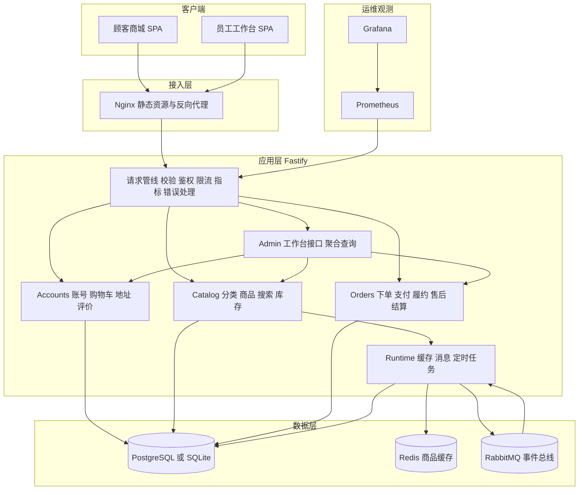

### 2.3 部署拓扑

容器化部署由 compose.yaml 定义 7 个服务，全部位于 Compose 默认网络 freshmarket_default 中，仅网关与管理界面向宿主机 127.0.0.1 发布端口。

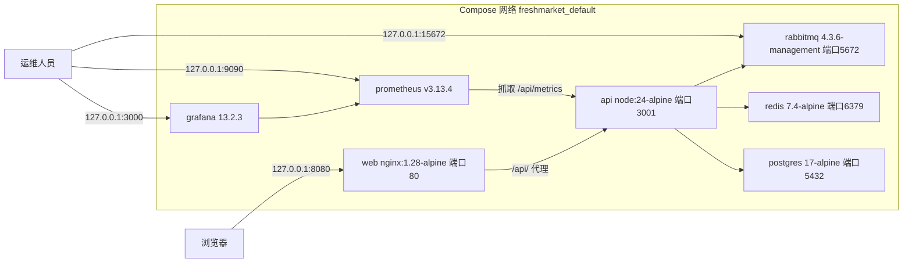

### 2.4 技术栈与版本

版本取自 package-lock.json 解析结果与 compose.yaml、Dockerfile 中的镜像标签。

| 层次 | 组件 | 版本 | 用途 |
| --- | --- | --- | --- |
| 运行时 | Node.js | 24（engines 要求 24.0.0 以上，镜像 node:24-alpine） | 后端运行与前端构建；内置 node:sqlite |
| 语言 | TypeScript | 5.9.3 | 前后端开发语言，strict 模式 |
| Web 框架 | fastify | 5.12.5 | HTTP 服务、JSON Schema 校验、注入测试 |
| 认证 | @fastify/jwt | 10.2.2 | JWT 签发与校验 |
| 安全 | @fastify/helmet / @fastify/cors / @fastify/rate-limit | 13.1.1 / 11.3.0 / 10.3.0 | 安全响应头、跨域、限流 |
| 文档 | @fastify/swagger / @fastify/swagger-ui | 9.9.1 / 6.1.1 | OpenAPI 生成与 Swagger UI |
| 数据库驱动 | pg | 8.23.1 | PostgreSQL 连接池 |
| 缓存客户端 | redis | 5.12.1 | Redis 访问 |
| 消息客户端 | amqplib | 0.10.9 | RabbitMQ Confirm Channel |
| 指标 | prom-client | 15.1.3 | Prometheus 指标 |
| 前端框架 | react / react-dom | 19.3.0 | 组件化 UI |
| 路由 | react-router-dom | 7.18.4 | 前端路由 |
| 图标 | lucide-react | 0.563.0 | 图标 |
| 构建 | vite / @vitejs/plugin-react | 7.3.7 / 5.2.0 | 开发服务器与生产构建 |
| 开发运行 | tsx / concurrently | 4.23.15 / 9.2.4 | TS 直接运行与测试、前后端并行启动 |
| 端到端测试 | @playwright/test | 1.63.0 | 浏览器自动化测试 |
| 数据库 | PostgreSQL | 17（postgres:17-alpine） | 生产主库 |
| 缓存 | Redis | 7.4（redis:7.4-alpine） | 商品列表缓存 |
| 消息队列 | RabbitMQ | 4.3.6（management-alpine） | 订单事件 |
| 网关 | Nginx | 1.28（nginx:1.28-alpine） | 静态资源、反向代理、登录限流 |
| 监控 | Prometheus / Grafana | v3.13.4 / 13.2.3 | 指标采集、告警规则、仪表盘 |

### 2.5 代码组织

| 路径 | 职责 |
| --- | --- |
| api/src/server.ts | 进程入口：构建应用、监听端口、处理 SIGINT 与 SIGTERM 优雅关闭 |
| api/src/app.ts | 应用装配：配置校验、插件注册、指标、错误处理、鉴权守卫、路由注册、后台任务启动 |
| api/src/core/database.ts | 数据库适配层：SQLite 与 PostgreSQL 统一接口、事务、迁移 |
| api/src/core/runtime.ts | 运行时：Redis 缓存、RabbitMQ 连接、Outbox 投递、事件消费、定时任务 |
| api/src/core/security.ts | 角色、账号类型、能力矩阵、密码哈希、用户脱敏输出、手机号掩码 |
| api/src/core/http.ts / errors.ts / context.ts | 统一响应、分页与通用 Schema；业务异常；依赖注入上下文与类型扩展 |
| api/src/modules/accounts | 注册登录、购物车、地址、评价、员工与会员账号管理 |
| api/src/modules/catalog | 分类与商品查询、模糊搜索、商品维护、库存调整、演示数据 |
| api/src/modules/orders | 订单仓储（行锁、审计、事件、回库存）与订单服务（状态机、售后、结算、超时） |
| api/src/modules/admin | 员工工作台全部 /api/admin 接口 |
| web/src | 商城页面、全局状态、API 客户端、通用组件 |
| web/src/admin | 工作台各功能页：商品与库存、订单、售后结算审计、账号 |
| database | schema.sql 表结构与索引；seed.sql 演示数据 |
| infra | 镜像构建文件、Nginx 配置、Prometheus 配置与告警、Grafana 预置 |
| scripts | 环境初始化、备份恢复回滚、冒烟、压测、文档与演示辅助脚本 |

### 2.6 运行模式与降级矩阵

| 运行模式 | 数据库 | 缓存 | 消息 | 触发条件 |
| --- | --- | --- | --- | --- |
| 本地开发 | SQLite 文件 api/.runtime/freshmarket.sqlite（WAL） | 关闭，内存版本号 | 进程内消费 Outbox | 未设置 DATABASE_URL、REDIS_URL、AMQP_URL |
| 自动化测试 | 内存 SQLite 或 PostgreSQL 临时 schema | 关闭 | 关闭后台任务 | buildApp 传入 db 且 workers=false |
| 容器部署 | PostgreSQL 17 | Redis | RabbitMQ | compose.yaml 注入三项连接串，NODE_ENV=production |
| Redis 故障 | 不受影响 | 自动回源数据库，30 秒尝试重连 | 不受影响 | 健康检查 cache 字段显示 degraded |
| RabbitMQ 故障 | 不受影响 | 不受影响 | 事件停留在 Outbox，30 秒尝试重连，恢复后补发 | 健康检查 queue 字段显示 degraded |

## 3. 后端设计

### 3.1 应用装配

buildApp(options) 是唯一的应用构造入口，生产进程与测试共用，装配顺序如下：

1. 读取 JWT_SECRET；当 NODE_ENV=production 时执行生产配置校验（见 8.9），不满足即抛出 CONFIG_INVALID 拒绝启动。
2. 创建 Fastify 实例：结构化日志（LOG_LEVEL，默认 info，脱敏 authorization、password、password_hash）、请求 id 使用 UUID、请求体上限 64 KiB、Ajv 关闭 removeAdditional 以使 additionalProperties:false 产生校验错误。
3. 创建数据库（传入 db 时复用），执行 migrate()；未禁用时执行 seed()。
4. 构建依赖：OrderRepository、OrderService（ORDER_TTL_MINUTES，默认 15）、Runtime、AccountService、CatalogService。
5. 注册插件：CORS（CORS_ORIGIN 逗号分隔，不携带凭据）、Helmet、JWT（有效期 2 小时）、全局限流（300 次每分钟）、Swagger 与 Swagger UI（/api/docs）。
6. 注册 Prometheus 指标与 onRequest、onResponse 钩子，设置统一错误处理与 404 处理。
7. 定义鉴权守卫 authenticate、memberOnly、staffOnly、permit，组装 Context 并注册四个业务路由模块与运维路由。
8. app.ready() 之后，若未禁用后台任务则 runtime.connect() 并 runtime.start(orders) 启动 2 秒周期任务。
9. onClose 钩子依次停止运行时、清理指标注册表、关闭自建的数据库连接。

### 3.2 请求处理管线

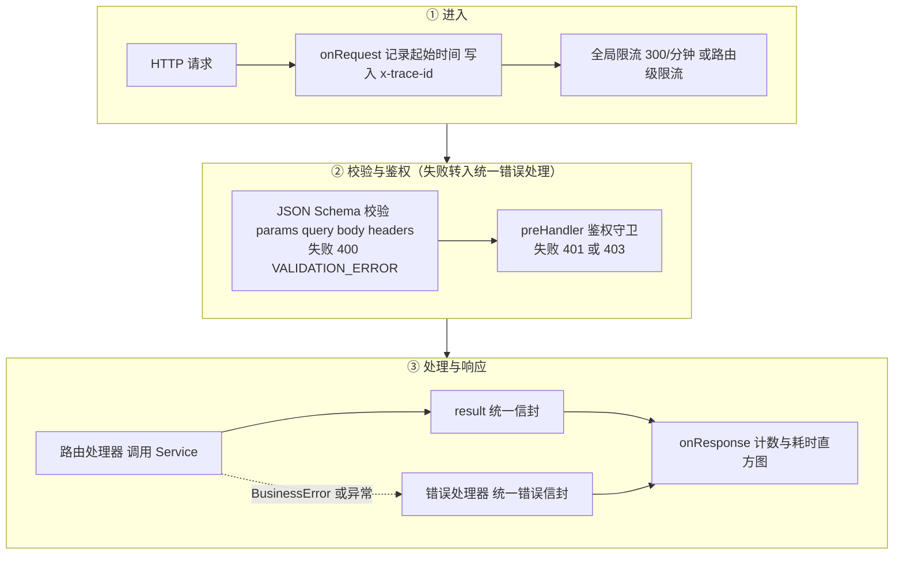

### 3.3 鉴权守卫

| 守卫 | 行为 | 失败结果 |
| --- | --- | --- |
| authenticate | 校验 JWT 签名与有效期；按 sub 查询未删除用户；检查 active=1；比较令牌 sessionVersion（缺省按 0）与 users.session_version；比较令牌 accountType 与用户角色推导出的账号类型；通过后将用户写入 req.actor | 401 UNAUTHORIZED、401 ACCOUNT_DISABLED、401 SESSION_CHANGED |
| memberOnly | authenticate 后要求 role=member | 403 MEMBER_ONLY |
| staffOnly | authenticate 后要求账号类型为 staff | 403 STAFF_ONLY |
| permit(cap) | staffOnly 后要求 capabilities[role] 包含 cap | 403 FORBIDDEN |

角色与能力在每次请求时由数据库中的当前角色计算，岗位调整无需等待令牌过期即可生效。

### 3.4 统一响应与错误处理

成功响应统一为 {code:0, message:"success", data, traceId}。错误响应统一为 {code:错误码, message:中文提示, data:null, traceId}，HTTP 状态码按下表映射。

| 异常来源 | HTTP 状态 | code | message |
| --- | --- | --- | --- |
| BusinessError（ensure 断言） | 断言指定 | 断言指定 | 断言指定的中文提示 |
| JSON Schema 校验失败 | 400 | VALIDATION_ERROR | 请检查输入内容 |
| JWT 缺失或无效 | 401 | UNAUTHORIZED | 请先登录 |
| 限流 | 429 | RATE_LIMITED | 操作太频繁，请稍后重试 |
| 未匹配路由 | 404 | NOT_FOUND | 接口不存在 |
| 其他未预期异常 | 500 | INTERNAL_ERROR | 服务暂时不可用，请稍后重试（同时记录 request_failed 错误日志） |

### 3.5 模块设计

#### 3.5.1 Accounts 模块

| 方法 | 职责 | 关键规则 |
| --- | --- | --- |
| register | 公开注册会员 | 固定角色 member；用户名唯一（含已删除账号）；写审计 auth.register |
| createStaff / createMember | 管理员创建员工或会员 | 员工角色必须属于员工岗位；写审计 user.create |
| login | 会员或员工登录 | 未知用户也执行一次哑哈希比较，统一 401 INVALID_CREDENTIALS；停用返回 403；入口与账号类型不符返回 403 ACCOUNT_TYPE_MISMATCH；写审计 auth.login；签发含 sessionVersion 的令牌 |
| updateAccount | 编辑账号、调整岗位、重置密码、启停 | 锁定全部管理员行并复核操作者；禁止会员与员工互转；禁止本人改岗与停用本人；保留至少一名启用管理员；重置密码或启停时 session_version 加 1 |
| removeAccount | 逻辑删除账号 | 禁止删除本人；存在未完成订单或待审核售后时拒绝；置 active=0、deleted_at、session_version 加 1；清空购物车 |
| cart / setCart | 购物车查询与增改删 | 数量不超过 99 且不超过库存；商品须上架且未删除；运费满 9900 分免 600 分 |
| saveAddress | 新增或编辑地址 | 每人最多 20 个；首个地址自动为默认；设默认时清除其他默认 |
| review | 订单商品评价 | 订单须为本人且已完成；商品须在订单中；每个订单商品评价一次 |

#### 3.5.2 Catalog 模块

| 方法 | 职责 | 关键规则 |
| --- | --- | --- |
| list(query, admin) | 商品列表、筛选、排序、分页、搜索 | 商城仅上架未删除商品，工作台含下架商品并可按 active 过滤；结果按缓存版本缓存 30 秒 |
| detail(id) | 商品详情 | 仅上架商品；浏览量加 1；附最近 30 条评价 |
| save(input, actor, id?) | 新建或编辑商品 | 校验分类存在；新建商品初始库存 0；写审计；失效缓存 |
| stock(id, delta, actor, reason) | 库存调整 | delta 非 0 且原因必填；条件更新保证调整后库存不为负；写审计 stock.adjust |
| remove(id, actor) | 逻辑删除商品 | 置 active=0 与 deleted_at；同事务清除所有购物车中的该商品；保留历史订单引用 |
| createProductSearch(q) | 构造搜索评分函数 | 见 5.11 |

#### 3.5.3 Orders 模块

OrderRepository 封装跨操作复用的一致性原语：get(tx, id, lock) 读取未删除订单并在 PostgreSQL 下追加 FOR UPDATE；detail(id, userId?) 组装订单、地址快照、明细、售后及评价，带 userId 时校验归属；audit 写审计日志；emit 写 Outbox；restock 按商品 id 顺序归还订单全部库存。

| 方法 | 职责 |
| --- | --- |
| create | 幂等下单、预扣库存、生成快照、清空购物车 |
| pay | 沙箱支付，单次记账，累加销量 |
| cancel | 会员取消、管理员取消、超时取消，归还库存 |
| transition | 仓库履约（paid 到 picking、picking 到 delivering）与会员确认收货（delivering 到 completed） |
| updateDelivery | 管理员修改发货前的配送信息 |
| remove | 管理员逻辑删除错误订单 |
| requestRefund / decideRefund | 售后申请与审核 |
| settle | 批量财务结算 |
| expire | 扫描超时待付款订单并逐一取消 |

#### 3.5.4 Admin 模块

Admin 模块只负责 /api/admin 前缀的接口定义、Schema 与能力绑定。写操作委托给上述 Service；列表与统计类只读查询直接使用 ctx.db 编写聚合 SQL。员工可见的订单数据统一经 hidePhone 处理：手机号掩码并移除原始地址快照字段。后台模糊查询使用 LOWER 与 LIKE，并通过 ESCAPE 叹号转义用户输入中的百分号、下划线与叹号，防止通配符注入。

#### 3.5.5 Core 运行时

Runtime 统一管理外部组件与后台任务：connect() 按配置连接 Redis 与 RabbitMQ（连接超时 3 秒，失败只记录告警日志）；cacheGet、cacheSet、version、invalidate 提供版本化缓存；flush() 投递 Outbox；consume() 幂等消费事件；start() 启动周期任务；stop() 等待当前任务结束后关闭通道、连接与缓存客户端。

### 3.6 后台任务

周期任务每 2 秒执行一次（定时器 unref，不阻止进程退出），若上一轮未结束则跳过本轮：

1. 若距上次连接超过 30 秒且已配置但未连通 Redis 或 RabbitMQ，则重新连接。
2. 调用 orders.expire() 取消所有 expires_at 已过的待付款订单。
3. 调用 runtime.flush() 投递最多 20 条待发布事件。
4. 任一步骤异常记录 worker_failed 日志，不影响下一轮。

## 4. 数据库设计

### 4.1 方言适配层

core/database.ts 定义统一接口：Query 提供 all、one、run 三个方法，参数占位符一律使用问号；Database 在此基础上增加 dialect、transaction(fn)、migrate()、close()。

| 设计点 | SQLite（开发/测试） | PostgreSQL（部署） |
| --- | --- | --- |
| 驱动 | Node 内置 node:sqlite DatabaseSync，单连接 | pg Pool，最大 15 连接，获取连接超时 5 秒，空闲 30 秒释放 |
| 占位符 | 原生问号 | 执行前将问号顺序替换为 $1、$2 |
| 并发模型 | 所有语句与事务通过 Promise 队列串行执行，避免同连接交错看到未提交状态 | 连接池并发，事务独占一个客户端连接 |
| 事务 | BEGIN IMMEDIATE 立即获取写锁，异常时 ROLLBACK | BEGIN、COMMIT、ROLLBACK，结束后释放连接 |
| 行锁 | 不需要，事务本身串行 | 业务代码在 dialect 为 postgres 时追加 FOR UPDATE 或 FOR UPDATE SKIP LOCKED |
| 连接参数 | PRAGMA foreign_keys=ON、journal_mode=WAL、busy_timeout=5000 | 连接池错误事件写入 postgres_pool_error 日志 |
| 计数返回 | 数值 | COUNT 与 SUM 结果为字符串，调用方必须显式 Number() 转换（遗漏导致 DEF-01） |

占位符替换为简单的字符替换，因此 SQL 字面量中禁止出现问号字符；这是适配层的使用约束。

### 4.2 数据类型约定

| 约定 | 说明 |
| --- | --- |
| 主键 | TEXT。账号、地址、明细等使用 UUID；种子数据使用可读 id（u-admin、p01、a-demo）；订单号为 FM 加毫秒时间戳加 8 位随机十六进制 |
| 金额 | INTEGER，单位分 |
| 时间 | BIGINT，Unix 毫秒时间戳 |
| 布尔 | INTEGER 0 或 1，并以 CHECK 约束限定 |
| 结构化数据 | TEXT 存放 JSON 字符串（订单地址快照、事件载荷、审计详情） |
| 删除标记 | deleted_at BIGINT，为空表示有效 |

### 4.3 迁移策略

1. 每次启动执行 database/schema.sql。全部语句为 CREATE TABLE IF NOT EXISTS 与 CREATE INDEX IF NOT EXISTS，对新库建表，对旧库无副作用，新增的表（如 refund_items）会被自动创建。
2. 对已存在的表补充新增列：database.ts 中的 additions 映射登记了 users.active、users.session_version、users.deleted_at、products.views、products.deleted_at、orders.deleted_at。PostgreSQL 使用 ADD COLUMN IF NOT EXISTS；SQLite 先读取 PRAGMA table_info 再按需 ADD COLUMN。
3. 迁移只增不删，保证旧版本应用镜像在回滚后仍能读写新库。新增列必须同时写入 schema.sql 与 additions。
4. 2026-10-18 已验证：以首个发布版本的 schema 建库并写入旧数据，再执行当前 migrate() 与 seed()，在两种数据库上均成功，旧数据保留，重复执行幂等。
5. 约束：迁移未使用数据库咨询锁，多个 API 副本同时首次启动时存在并发建表竞争的理论风险（DEF-11）。

### 4.4 种子数据策略

| 数据 | 写入规则 |
| --- | --- |
| 6 个分类、48 款商品 | 每次启动执行 INSERT ... ON CONFLICT(id) DO NOTHING；只补齐缺失记录，不覆盖已有商品的价格、库存、上下架状态；逻辑删除的商品行仍然存在，因此不会被重新创建 |
| 6 个演示账号与 1 个演示地址 | 仅当 users 表为空时写入；密码取 DEMO_PASSWORD，未设置时使用本地默认密码 |
| 关闭方式 | SEED_DEMO=false 时完全跳过 |
| database/seed.sql | 由 scripts/export-seed.mjs 基于构建产物 api/dist 生成，内容与 seed.ts 一致（2026-10-18 逐字段核对 48 款商品一致），使用本地默认密码，仅供实验环境手工导入 |

### 4.5 实体关系

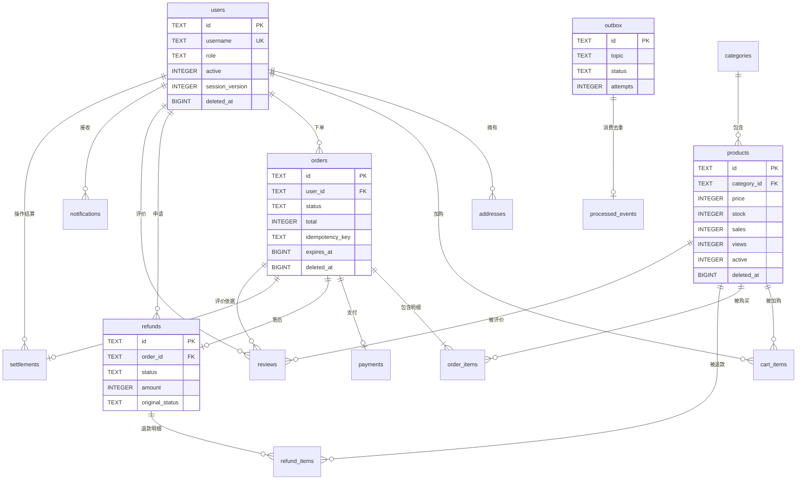

outbox 与 processed_events、audit_logs 与 users 之间为逻辑关联，未建物理外键：前者便于事件重放，后者允许 system 等非用户操作者。

### 4.6 数据字典

#### 4.6.1 users 账号

| 字段 | 类型 | 约束 | 说明 |
| --- | --- | --- | --- |
| id | TEXT | PK | 账号 id |
| username | TEXT | NOT NULL UNIQUE | 登录账号，3 至 60 位字母数字及 _ @ .；逻辑删除后仍占用 |
| name | TEXT | NOT NULL | 姓名或昵称 |
| password_hash | TEXT | NOT NULL | scrypt 哈希，格式为 salt:hash（十六进制） |
| role | TEXT | NOT NULL 默认 member | member、operator、warehouse、support、finance、admin |
| created_at | BIGINT | NOT NULL | 创建时间 |
| active | INTEGER | NOT NULL 默认 1，CHECK 0 或 1 | 启用状态 |
| session_version | INTEGER | NOT NULL 默认 0 | 会话版本，重置密码、启停、删除时递增 |
| deleted_at | BIGINT | 可空 | 逻辑删除时间 |

#### 4.6.2 categories 分类

| 字段 | 类型 | 约束 | 说明 |
| --- | --- | --- | --- |
| id | TEXT | PK | fruit、seafood、meat、vegetable、dairy、ready |
| name | TEXT | NOT NULL | 分类名称 |
| icon | TEXT | NOT NULL | 图标名 |

#### 4.6.3 products 商品

| 字段 | 类型 | 约束 | 说明 |
| --- | --- | --- | --- |
| id | TEXT | PK | 商品 id |
| category_id | TEXT | NOT NULL FK categories.id | 所属分类 |
| name | TEXT | NOT NULL | 名称，最长 80 |
| subtitle | TEXT | NOT NULL | 副标题，最长 120 |
| description | TEXT | NOT NULL | 描述，最长 3000 |
| price | INTEGER | NOT NULL CHECK 大于 0 | 售价，分 |
| original_price | INTEGER | NOT NULL | 划线原价，分 |
| stock | INTEGER | NOT NULL CHECK 不小于 0 | 可售库存 |
| sales | INTEGER | NOT NULL 默认 0 | 累计销量（支付时增加，退款时扣回） |
| views | INTEGER | NOT NULL 默认 0 | 详情浏览量 |
| image | TEXT | NOT NULL | 图片路径，限定 /images/名称.jpg |
| unit | TEXT | NOT NULL | 规格 |
| origin | TEXT | NOT NULL | 产地 |
| storage | TEXT | NOT NULL | 储存方式 |
| tag | TEXT | NOT NULL | 标签 |
| active | INTEGER | NOT NULL 默认 1，CHECK 0 或 1 | 上架状态 |
| created_at | BIGINT | NOT NULL | 上架时间 |
| deleted_at | BIGINT | 可空 | 逻辑删除时间 |

#### 4.6.4 addresses 收货地址

| 字段 | 类型 | 约束 | 说明 |
| --- | --- | --- | --- |
| id | TEXT | PK | 地址 id |
| user_id | TEXT | NOT NULL FK users.id | 所属会员 |
| name | TEXT | NOT NULL | 收货人，最长 40 |
| phone | TEXT | NOT NULL | 手机号，1 开头第二位 3 至 9 的 11 位数字 |
| detail | TEXT | NOT NULL | 详细地址，8 至 200 字 |
| is_default | INTEGER | NOT NULL 默认 0 | 是否默认地址 |

#### 4.6.5 cart_items 购物车

| 字段 | 类型 | 约束 | 说明 |
| --- | --- | --- | --- |
| user_id | TEXT | PK 组成列，FK users.id | 会员 |
| product_id | TEXT | PK 组成列，FK products.id | 商品 |
| quantity | INTEGER | NOT NULL CHECK 1 至 99 | 数量 |

#### 4.6.6 orders 订单

| 字段 | 类型 | 约束 | 说明 |
| --- | --- | --- | --- |
| id | TEXT | PK | 订单号 |
| user_id | TEXT | NOT NULL FK users.id | 下单会员 |
| status | TEXT | NOT NULL | pending、paid、picking、delivering、completed、cancelled、refunded |
| subtotal | INTEGER | NOT NULL | 商品小计，分 |
| delivery_fee | INTEGER | NOT NULL | 配送费，分 |
| total | INTEGER | NOT NULL | 应付总额，分 |
| address_snapshot | TEXT | NOT NULL | 收货人、电话、地址的 JSON 快照 |
| delivery_slot | TEXT | NOT NULL | 配送时段 |
| note | TEXT | NOT NULL | 备注，最长 200 |
| idempotency_key | TEXT | NOT NULL | 幂等键 |
| request_hash | TEXT | NOT NULL | 请求摘要 SHA-256 |
| created_at | BIGINT | NOT NULL | 创建时间 |
| expires_at | BIGINT | NOT NULL | 支付截止时间 |
| updated_at | BIGINT | NOT NULL | 最后更新时间 |
| deleted_at | BIGINT | 可空 | 逻辑删除时间 |
| (user_id, idempotency_key) | — | UNIQUE | 同一会员幂等键唯一 |

#### 4.6.7 order_items 订单明细

| 字段 | 类型 | 约束 | 说明 |
| --- | --- | --- | --- |
| id | TEXT | PK | 明细 id |
| order_id | TEXT | NOT NULL FK orders.id | 订单 |
| product_id | TEXT | NOT NULL FK products.id | 商品 |
| name / image / unit | TEXT | NOT NULL | 下单时的名称、图片、规格快照 |
| price | INTEGER | NOT NULL | 下单时单价快照，分 |
| quantity | INTEGER | NOT NULL | 数量 |
| (order_id, product_id) | — | UNIQUE | 同一订单同一商品一行 |

#### 4.6.8 payments 支付

| 字段 | 类型 | 约束 | 说明 |
| --- | --- | --- | --- |
| id | TEXT | PK | 支付流水 id |
| order_id | TEXT | NOT NULL UNIQUE FK orders.id | 每单至多一笔 |
| amount | INTEGER | NOT NULL | 金额，取订单 total |
| provider | TEXT | NOT NULL 默认 sandbox | 支付渠道 |
| status | TEXT | NOT NULL | success 或 refunded |
| created_at | BIGINT | NOT NULL | 支付时间 |

#### 4.6.9 refunds 售后

| 字段 | 类型 | 约束 | 说明 |
| --- | --- | --- | --- |
| id | TEXT | PK | 售后单 id |
| order_id | TEXT | NOT NULL UNIQUE FK orders.id | 每单至多一次售后 |
| user_id | TEXT | NOT NULL FK users.id | 申请会员 |
| reason | TEXT | NOT NULL | 原因，5 至 300 字 |
| status | TEXT | NOT NULL 默认 pending | pending、approved、rejected |
| amount | INTEGER | NOT NULL | 退款金额，分 |
| original_status | TEXT | NOT NULL | 申请时订单状态 |
| decision_note | TEXT | NOT NULL 默认空串 | 审核意见 |
| created_at / updated_at | BIGINT | NOT NULL | 创建与更新时间 |

#### 4.6.10 refund_items 退款明细

| 字段 | 类型 | 约束 | 说明 |
| --- | --- | --- | --- |
| id | TEXT | PK | 明细 id |
| refund_id | TEXT | NOT NULL FK refunds.id | 售后单 |
| product_id | TEXT | NOT NULL FK products.id | 退款商品 |
| quantity | INTEGER | NOT NULL CHECK 大于 0 | 退款数量 |
| (refund_id, product_id) | — | UNIQUE | 同一售后单同一商品一行 |

#### 4.6.11 reviews 评价

| 字段 | 类型 | 约束 | 说明 |
| --- | --- | --- | --- |
| id | TEXT | PK | 评价 id |
| order_id | TEXT | NOT NULL FK orders.id | 评价依据订单 |
| product_id | TEXT | NOT NULL FK products.id | 商品 |
| user_id | TEXT | NOT NULL FK users.id | 会员 |
| rating | INTEGER | NOT NULL CHECK 1 至 5 | 星级 |
| content | TEXT | NOT NULL | 内容，3 至 500 字 |
| created_at | BIGINT | NOT NULL | 评价时间 |
| (order_id, product_id, user_id) | — | UNIQUE | 每个订单商品评价一次 |

#### 4.6.12 settlements 结算

| 字段 | 类型 | 约束 | 说明 |
| --- | --- | --- | --- |
| id | TEXT | PK | 结算单 id |
| order_id | TEXT | NOT NULL UNIQUE FK orders.id | 每单至多结算一次 |
| amount | INTEGER | NOT NULL | 结算净额，分 |
| operator_id | TEXT | NOT NULL FK users.id | 执行结算的员工 |
| created_at | BIGINT | NOT NULL | 结算时间 |

#### 4.6.13 outbox 待发布事件

| 字段 | 类型 | 约束 | 说明 |
| --- | --- | --- | --- |
| id | TEXT | PK | 事件 id，同时作为消息 messageId |
| topic | TEXT | NOT NULL | 事件主题，如 order.paid |
| payload | TEXT | NOT NULL | JSON 载荷，至少含 orderId、userId |
| status | TEXT | NOT NULL 默认 pending | pending、processing、sent |
| attempts | INTEGER | NOT NULL 默认 0 | 领取次数 |
| created_at | BIGINT | NOT NULL | 写入时间 |
| published_at | BIGINT | 可空 | 领取时作为租约时间，发送成功后为发送时间 |

#### 4.6.14 processed_events 已消费事件

| 字段 | 类型 | 约束 | 说明 |
| --- | --- | --- | --- |
| id | TEXT | PK | 事件 id，用于消费去重 |
| processed_at | BIGINT | NOT NULL | 消费时间 |

#### 4.6.15 notifications 会员消息

| 字段 | 类型 | 约束 | 说明 |
| --- | --- | --- | --- |
| id | TEXT | PK | 消息 id |
| user_id | TEXT | NOT NULL FK users.id | 接收会员 |
| title | TEXT | NOT NULL | 标题，如“付款成功” |
| body | TEXT | NOT NULL | 正文 |
| created_at | BIGINT | NOT NULL | 生成时间 |

#### 4.6.16 audit_logs 审计日志

| 字段 | 类型 | 约束 | 说明 |
| --- | --- | --- | --- |
| id | TEXT | PK | 审计 id |
| actor_id | TEXT | NOT NULL | 操作者 id，系统任务为 system |
| action | TEXT | NOT NULL | 动作，见附录 A |
| entity_id | TEXT | NOT NULL | 对象 id，批量结算为 batch |
| detail | TEXT | NOT NULL | JSON 详情，不含密码与令牌 |
| trace_id | TEXT | NOT NULL | 请求 traceId，系统任务为 scheduler |
| created_at | BIGINT | NOT NULL | 记录时间 |

### 4.7 索引设计

| 索引 | 表与列 | 服务的查询 |
| --- | --- | --- |
| 主键与 UNIQUE 隐式索引 | 各表 id、users.username、orders(user_id, idempotency_key)、order_items(order_id, product_id)、payments.order_id、refunds.order_id、refund_items(refund_id, product_id)、reviews(order_id, product_id, user_id)、settlements.order_id、cart_items(user_id, product_id) | 主键访问、防重校验、按订单查明细与流水、按会员查购物车 |
| idx_products_category | products(category_id, active) | 商城分类筛选 |
| idx_orders_user | orders(user_id, created_at) | 会员订单列表按时间倒序 |
| idx_orders_expiry | orders(status, expires_at) | 超时订单扫描 |
| idx_outbox_pending | outbox(status, created_at) | Outbox 领取 |
| idx_audit_created | audit_logs(created_at) | 审计按时间倒序分页 |

PostgreSQL 不会自动为外键列建索引。addresses.user_id、notifications.user_id、refunds.user_id、reviews.product_id、cart_items.product_id 等外键列目前没有独立索引，数据量增长后会影响按会员查询地址与消息、按商品查询评价以及删除商品时清理购物车的性能（DEF-11）。

### 4.8 唯一约束与防重设计

| 业务风险 | 数据库兜底 | 应用层处理 |
| --- | --- | --- |
| 重复提交订单 | orders(user_id, idempotency_key) UNIQUE | 先查已有订单并比较请求摘要，一致则返回原订单，不一致返回 409 IDEMPOTENCY_CONFLICT |
| 重复支付 | payments.order_id UNIQUE | 订单行锁内检查已有流水，存在则直接返回原结果 |
| 重复售后 | refunds.order_id UNIQUE | 已有售后单时直接返回已有记录 |
| 重复结算 | settlements.order_id UNIQUE | 批次内跳过已有结算的订单 |
| 重复评价 | reviews 三列 UNIQUE | 预先检查并返回 409 ALREADY_REVIEWED |
| 重复消费事件 | processed_events.id PK | INSERT ... ON CONFLICT DO NOTHING，未插入即视为重复 |
| 账号重名 | users.username UNIQUE | 预检查与 ON CONFLICT(username) DO NOTHING 双重保护，返回 409 USERNAME_EXISTS |

### 4.9 并发控制设计

| 场景 | 机制 |
| --- | --- |
| 超卖 | UPDATE products SET stock=stock-? WHERE id=? AND active=1 AND deleted_at IS NULL AND stock>=?，影响行数不为 1 即整单回滚；商品按 id 顺序扣减，降低死锁概率 |
| 同一会员并发下单与改购物车 | PostgreSQL 下事务首先 SELECT ... FOR UPDATE 锁定会员行，使首次幂等插入、购物车修改与下单串行 |
| 支付与取消竞争 | 二者都先锁定订单行，状态检查在锁内完成，只有一个转换生效；超时取消在锁内再次确认仍为待付款且已过期 |
| 售后、履约、结算互斥 | 均锁定订单行；存在待审核售后时履约与确认收货返回 409 REFUND_PENDING，结算跳过该订单 |
| 删除或降级最后一名管理员 | 按 id 顺序锁定全部管理员行后统计启用管理员数量 |
| Outbox 多实例领取 | PostgreSQL 下 FOR UPDATE SKIP LOCKED 领取并标记 processing |
| SQLite | 单连接串行队列加 BEGIN IMMEDIATE，天然串行化，无需行锁 |

### 4.10 逻辑删除设计

| 对象 | 删除前置条件 | 删除动作 | 保留内容 |
| --- | --- | --- | --- |
| 账号 | 非本人；不是最后一名启用管理员；无未完成订单与待审核售后 | active=0、deleted_at、session_version 加 1、清空购物车 | 历史订单、结算操作人、审计；用户名继续占用 |
| 商品 | 未删除 | active=0、deleted_at、清除所有购物车中的该商品、失效缓存 | 历史订单明细、售后明细、评价；种子 id 防止重启复活 |
| 订单 | 状态为 cancelled 且无支付、退款、结算记录 | deleted_at | 审计记录 |

所有面向业务的查询均带 deleted_at IS NULL 条件；数据库外键始终指向保留的数据行，不会产生悬空引用。

### 4.11 数据库脚本

| 脚本 | 用途 | 说明 |
| --- | --- | --- |
| database/schema.sql | 全量 DDL | 在 SQLite 与 PostgreSQL 上均可执行，可重复执行；应用启动时自动执行 |
| database/seed.sql | 实验演示数据 | 包裹在 BEGIN 与 COMMIT 内，全部 ON CONFLICT(id) DO NOTHING，可重复执行；含公开默认密码哈希，禁止导入公网环境 |
| scripts/export-seed.mjs | 生成 seed.sql | 读取 api/dist 中的种子数据，需先执行构建 |

## 5. 关键业务设计

### 5.1 订单状态机

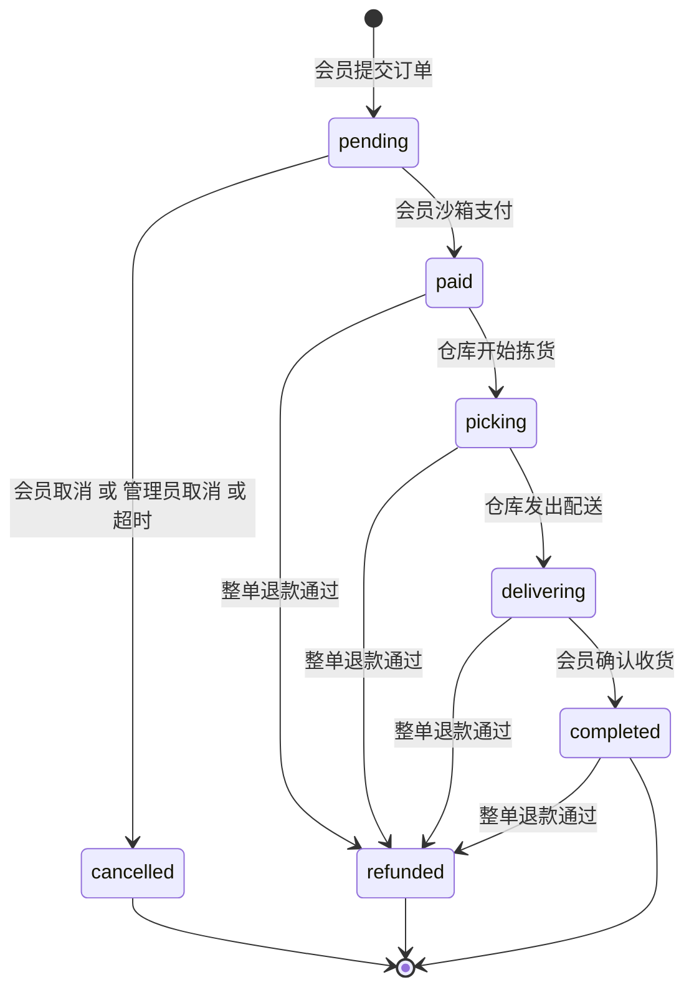

| 转换 | 操作者 | 前置条件 | 副作用 | 事件 |
| --- | --- | --- | --- | --- |
| 创建为 pending | 会员 | 地址属于本人；购物车非空；库存充足 | 扣库存；写订单与明细快照；清空购物车；expires_at=当前时间加 TTL | order.created |
| pending 到 paid | 会员本人 | 未过期；无支付流水 | 写支付流水；累加销量 | order.paid |
| pending 到 cancelled | 会员本人、orders.manage、系统任务 | 仍为 pending；系统任务另需已过期 | 归还库存 | order.cancelled |
| paid 到 picking、picking 到 delivering | fulfillment | 无待审核售后 | 无 | order.picking、order.delivering |
| delivering 到 completed | 会员本人 | 无待审核售后 | 无 | order.completed |
| 任意已付款状态到 refunded | refunds | 整单退款审核通过且未结算 | 见 5.6 | order.refunded |

### 5.2 幂等下单与预扣库存

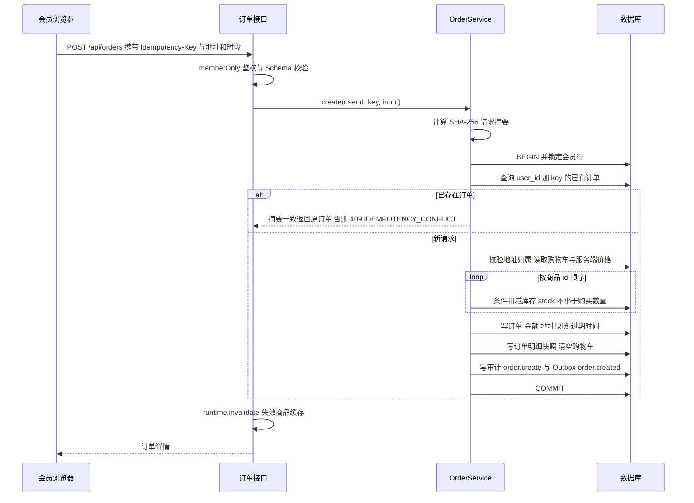

设计要点：

- 请求摘要只覆盖 addressId、deliverySlot、note，与幂等键共同识别“同一次提交”。前端在用户修改地址、时段或备注时重新生成幂等键，因此修改后再次提交会被视为新订单。
- 金额完全由服务端从数据库读取的当前售价计算；运费规则为商品小计不少于 9900 分免运费，否则 600 分。
- 任一商品扣减失败抛出 409 OUT_OF_STOCK，事务整体回滚，库存、购物车、订单与 Outbox 均回到提交前状态。
- 订单保存地址、商品名称、图片、规格与单价快照，后续商品改价或地址修改不影响已创建订单。

### 5.3 沙箱支付

支付接口不接受客户端金额：在订单行锁内校验归属、状态 pending 与未过期，写入金额等于订单 total 的 sandbox 流水，订单置为 paid，并按明细累加销量。重复调用时若已有流水直接返回当前订单（已整单退款的订单返回 409 ORDER_REFUNDED），保证只记账一次、销量只增加一次。

### 5.4 取消与超时回收

- 会员只能取消本人 pending 订单；管理员通过 orders.manage 取消任意 pending 订单，审计记录实际管理员。
- 系统任务每 2 秒查询 status=pending 且 expires_at 早于当前时间的订单，逐一调用 cancel()。cancel() 在行锁内再次确认“仍为 pending 且已过期”，否则静默返回，避免与刚完成的支付竞争。
- 取消时按订单明细归还库存，订单置为 cancelled，写 order.cancelled 事件与审计。重复取消直接返回，不会二次回库存。

### 5.5 履约与确认收货

仓库（fulfillment）只能推进 paid 到 picking、picking 到 delivering；会员只能将本人 delivering 订单确认为 completed。其他组合返回 409 INVALID_STATE。存在待审核售后时拒绝推进。员工接口返回的订单手机号经过掩码。

### 5.6 售后退款

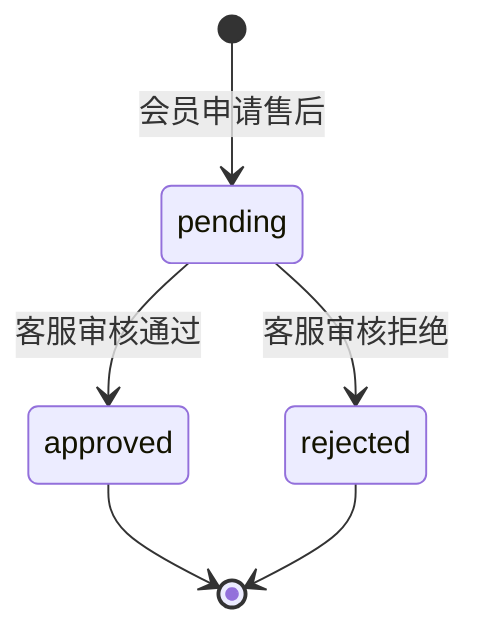

申请规则：订单须为本人且处于 paid、picking、delivering 或 completed；已结算订单返回 409 ALREADY_SETTLED；每单仅能申请一次，重复申请返回已有记录。退款金额的确定方式如下。

| 申请方式 | 金额 | 退款明细 |
| --- | --- | --- |
| 不传 items 与 amount | 订单 total（整单退款） | 无 |
| 传 items（最多 50 项） | 所选商品单价快照乘退款数量之和；数量不得超过购买数量；同一商品多次出现会合并 | 写入 refund_items |
| 只传 amount | 指定金额，须为正整数且不超过订单 total | 无 |

审核规则：审核在订单行锁内进行；重复提交相同结论直接返回；已处理的售后再次审核返回 409。审核通过时：

| 类型 | 判定 | 库存 | 销量 | 订单与支付 | 事件 |
| --- | --- | --- | --- | --- | --- |
| 整单退款 | 退款金额不小于订单 total | 订单为 paid 或 picking 时归还全部库存；已配送或已完成的生鲜不回库存 | 扣回全部销量（不低于 0） | 订单置 refunded，支付流水置 refunded | order.refunded |
| 部分退款（按商品） | 金额小于 total 且有退款明细 | 订单为 paid 或 picking 时只归还所选商品 | 只扣回所选商品 | 订单状态不变 | order.partially_refunded |
| 部分退款（按金额） | 金额小于 total 且无明细 | 不变 | 不变 | 订单状态不变 | order.partially_refunded |

审核拒绝只记录结论与审核意见，订单恢复正常履约。售后待审核期间订单的履约、确认收货、配送信息修改与结算均被冻结。

### 5.7 财务结算

结算为批量操作：在一个事务内锁定全部 completed 订单，逐单跳过已结算或售后待审核的订单；结算净额等于订单 total 减去已通过的退款金额，净额不大于 0 时跳过；为每单写入 settlements 记录，最后写一条 entity_id 为 batch 的审计并返回本批数量与金额。整单退款的订单状态已是 refunded，不会进入结算。重复执行批次不会重复入账。

### 5.8 商品评价

评价须满足：订单属于本人、订单为 completed、商品在订单明细中、该订单该商品尚未评价。商品详情返回最近 30 条评价，前端只显示评价人姓名首字加星号。

### 5.9 账号生命周期与会话失效

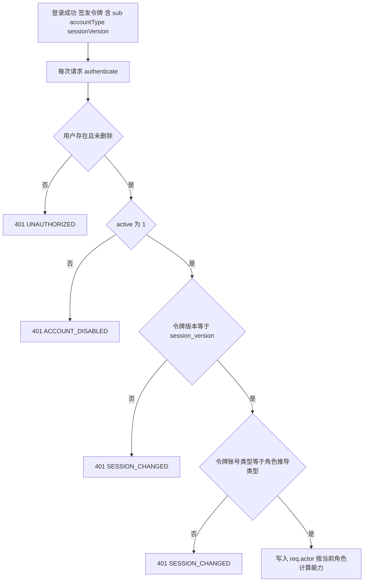

| 管理操作 | 会话版本 | 效果 |
| --- | --- | --- |
| 重置密码 | 加 1 | 旧令牌全部失效 |
| 停用或启用 | 加 1 | 旧令牌全部失效；停用账号无法登录 |
| 删除 | 加 1 | 旧令牌失效，账号不可登录，用户名保留 |
| 调整员工岗位 | 不变 | 下一次请求即按新岗位授权 |
| 修改姓名或账号名 | 不变 | 不影响会话 |

保护规则：禁止会员与员工相互转换；禁止管理员调整本人岗位、停用或删除本人；任何操作后系统至少保留一名启用的管理员（LAST_ADMIN）。

### 5.10 商品维护与库存调整

商品新建时库存为 0，必须通过库存调整入库；库存调整记录正负增量与原因，条件更新保证结果不为负数。商品编辑可修改除库存、销量、浏览量以外的全部展示字段及上下架状态，图片路径限定为站内 /images 目录下的 jpg 文件。所有商品写操作写审计并失效商品缓存。

### 5.11 模糊搜索与匹配高亮

搜索在 CatalogService.list 中执行，先由 SQL 应用可见性与分类过滤及业务排序取出候选集，再在内存中逐个评分，最后分页，从而保证 total 与后续页面覆盖全部匹配商品。

1. 规范化：关键词与商品字段均做 NFKC 归一化与小写转换（统一全角半角与大小写），字段去除空白。
2. 分词：关键词按空白拆分并去重，每个词都必须命中。
3. 精确命中：名称包含得 100 分，产地包含得 80 分，副标题包含得 60 分。
4. 放宽命中：整个查询最多允许一个词放宽。长度不小于 3 且只含字母数字的词，允许与名称中某个片段相差一次编辑（替换、插入、删除或相邻对调），片段长度不小于 3；仅有一个关键词且为两个以上不同汉字时，允许字面重合：两字词命中一个字即可，更长的词要求覆盖至少 75% 的不同汉字，得分为覆盖率乘 40。
5. 综合得分为 2 减放宽等级加上累计分除以词数乘 100。精确匹配落在 2 至 3 区间，错字匹配落在 1 至 2 区间，字面重合落在 0 至 1 区间。
6. 弱匹配上限：字面重合结果按得分、销量乘 0.5 加浏览量乘 0.3、id 的顺序最多保留 6 款；精确与错字匹配不设上限。
7. 排序：综合推荐时按相关度排序；显式选择价格或销量排序时保持 SQL 排序。

匹配高亮由 web/src/search-highlight.ts 的 searchHighlightParts 实现：将关键词拆为单个汉字与非汉字连续片段，在 NFKC 小写化后的文本中查找所有出现位置，并映射回原始字符位置后标记，商品卡片的名称、副标题与产地以 mark 元素显示红色。该模块不依赖浏览器与 React，同时被 API 测试直接导入。

### 5.12 综合推荐排序

商城默认排序（sort=default 且非工作台）使用加权表达式：销量乘 0.5，加浏览量乘 0.3，加新品标记乘 0.2（上架 30 天内为 1，否则为 0），按结果降序，id 为次序键。工作台默认按上架时间倒序；其余排序为价格升序、价格降序、销量降序。浏览量在每次打开商品详情时累加。

### 5.13 商品缓存

| 设计点 | 说明 |
| --- | --- |
| 缓存对象 | 商品列表与搜索结果（商城与工作台分别缓存）；商品详情不缓存 |
| 缓存键 | 命名空间:catalog:search-v2:版本号:查询参数 JSON:是否工作台 |
| 过期 | 30 秒 |
| 失效 | 版本号递增使旧键自然失效。Redis 可用时版本存于 命名空间:catalog:version 并在多实例间共享；否则使用进程内计数 |
| 触发失效 | 下单、支付、会员取消、管理员取消、退款审核、商品新建与编辑与删除、库存调整 |
| 故障处理 | Redis 读写异常一律视为未命中，不影响业务；下单与加购始终以数据库库存为准 |

### 5.14 Outbox 与消息投递

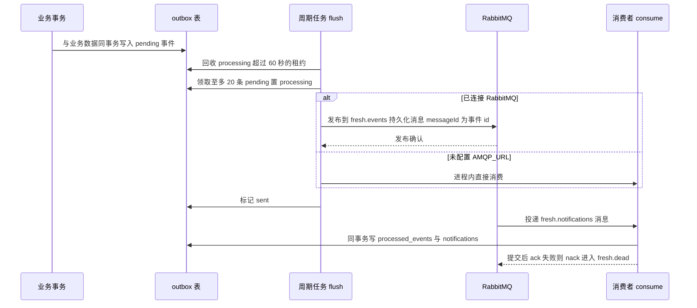

| 设计点 | 说明 |
| --- | --- |
| 交换机与队列 | 主题交换机 命名空间.events；队列 命名空间.notifications 绑定 order.*，死信交换机与队列 命名空间.dead；均为持久化；预取 20 |
| 命名空间 | MQ_NAMESPACE 与 CACHE_NAMESPACE，默认 fresh，冒烟测试使用随机命名空间隔离 |
| 可靠发布 | Confirm Channel 收到确认后才标记 sent；发布失败重置为 pending 并记录 outbox_retry |
| 不切换传输 | 已配置 AMQP_URL 但未连接时 flush 直接返回，事件保留在库内，避免进程内消费与队列消费混用造成乱序 |
| 至少一次 | 确认与标记之间崩溃可能导致重复发布，由消费端 processed_events 去重 |
| 失败处理 | 消费异常 nack 且不重新入队，消息进入死信队列供人工检查与重放 |
| 约束 | attempts 只计数，未设置最大重试次数与退避策略 |

### 5.15 消息通知

消费者把事件主题映射为会员消息标题：订单提交成功、付款成功、订单已取消、商品正在拣货、商品配送中、已确认收货、退款已完成；未登记的主题（如 order.partially_refunded）使用“订单更新”。消息正文为订单号状态更新提示。会员可查询最近 30 条消息。

### 5.16 经营概览统计

经营概览返回：未删除订单总数、有效销售额（paid、picking、delivering、completed 订单 total 之和）、待拣货数、会员数、待审核售后数、低库存商品（库存小于 20 的上架商品前 8 个）、各状态订单数、近 7 日沙箱支付成功笔数与金额（按服务器本地时区自然日切分，容器内 TZ 为 Asia/Shanghai）、未发送事件数。其中订单总数、销售额、待拣货数与各状态计数直接透传数据库结果，在 PostgreSQL 下为字符串，且无订单时待拣货数为 null（DEF-01）。

## 6. 接口设计

### 6.1 通用约定

| 约定 | 说明 |
| --- | --- |
| 路径前缀 | 全部接口位于 /api；员工工作台接口位于 /api/admin |
| 数据格式 | 请求与响应均为 JSON，请求体上限 64 KiB；未声明字段一律拒绝 |
| 鉴权 | Authorization: Bearer 令牌；会员令牌与员工令牌互不通用 |
| 幂等 | 下单必须携带 Idempotency-Key 请求头，长度 8 至 100 |
| 分页 | page 从 1 开始；pageSize 1 至 100，商城商品默认 12，其余默认 20；返回 items、total、page、pageSize |
| 金额 | 整数分 |
| 时间 | 毫秒时间戳 |
| 响应信封 | {code, message, data, traceId}，成功时 code 为 0；响应头 x-trace-id 与 traceId 一致 |
| 越权语义 | 访问他人订单、地址返回 404，避免暴露对象存在性；岗位越权返回 403 |
| 文档 | Swagger UI 位于 /api/docs，OpenAPI JSON 位于 /api/openapi.json |

### 6.2 错误码

| HTTP | 错误码 | 含义 |
| --- | --- | --- |
| 400 | VALIDATION_ERROR | 参数不符合 Schema |
| 400 | ADDRESS_INVALID / ADDRESS_LIMIT | 地址无效 / 地址超过 20 个 |
| 400 | CART_EMPTY | 购物车为空 |
| 400 | INVALID_CATEGORY / INVALID_STOCK | 分类不存在 / 库存调整无效 |
| 400 | INVALID_PRODUCT / INVALID_REFUND_AMOUNT / INVALID_REFUND_QUANTITY | 商品不在订单中 / 退款金额无效 / 退款数量超限 |
| 400 | INVALID_NAME / INVALID_STAFF_ROLE / ACCOUNT_TYPE_IMMUTABLE | 姓名为空 / 员工岗位无效 / 会员与员工不可互转 |
| 400 | SELF_DELETE / SELF_DISABLE / SELF_ROLE_CHANGE | 不能删除、停用或改岗本人 |
| 401 | UNAUTHORIZED / INVALID_CREDENTIALS | 未登录或令牌无效 / 账号或密码错误 |
| 401 | SESSION_CHANGED / ACCOUNT_DISABLED | 会话版本或账号类型变化 / 账号已停用（请求阶段） |
| 403 | ACCOUNT_DISABLED / ACCOUNT_TYPE_MISMATCH | 登录阶段账号停用 / 登录入口与账号类型不符 |
| 403 | MEMBER_ONLY / STAFF_ONLY / FORBIDDEN | 仅限会员 / 仅限员工 / 无此能力 |
| 404 | NOT_FOUND / ORDER_NOT_FOUND / PRODUCT_NOT_FOUND / ADDRESS_NOT_FOUND / REFUND_NOT_FOUND / USER_NOT_FOUND | 资源不存在或无权访问 |
| 409 | OUT_OF_STOCK | 库存不足或商品已下架 |
| 409 | IDEMPOTENCY_CONFLICT | 同一幂等键用于不同请求 |
| 409 | INVALID_STATE / ORDER_EXPIRED / ORDER_REFUNDED | 状态不允许 / 支付超时 / 订单已退款 |
| 409 | REFUND_PENDING / ALREADY_SETTLED / ALREADY_REVIEWED | 售后处理中 / 已结算 / 已评价 |
| 409 | ORDER_HAS_TRANSACTIONS | 有交易记录的订单不能删除 |
| 409 | USERNAME_EXISTS / LAST_ADMIN / ACCOUNT_IN_USE | 账号已存在 / 须保留管理员 / 账号有未完成业务 |
| 429 | RATE_LIMITED | 触发限流 |
| 500 | INTERNAL_ERROR / CONFIG_INVALID | 内部错误 / 生产配置不合规（启动阶段） |

### 6.3 端点清单

#### 6.3.1 会员与公开接口

| 方法 | 路径 | 鉴权 | 说明 |
| --- | --- | --- | --- |
| POST | /api/auth/register | 公开，8 次每分钟 | 注册会员并返回令牌；账号 3 至 60 位，密码 10 至 128 位且含字母与数字 |
| POST | /api/auth/login | 公开，10 次每分钟 | 会员登录 |
| GET | /api/auth/me | 会员 | 当前会员信息 |
| GET | /api/categories | 公开 | 分类列表，按固定顺序 |
| GET | /api/products | 公开 | 参数 q（不超过 80）、category、sort（default、priceAsc、priceDesc、sales）、page、pageSize |
| GET | /api/products/:id | 公开 | 商品详情与评价，浏览量加 1 |
| GET | /api/cart | 会员 | 购物车与金额汇总 |
| POST | /api/cart | 会员 | 加购，quantity 1 至 99，与已有数量累加 |
| PUT | /api/cart/:id | 会员 | 设置数量 0 至 99，0 表示移除 |
| GET | /api/addresses | 会员 | 本人地址，默认地址在前 |
| POST | /api/addresses | 会员 | 新增地址 |
| PUT | /api/addresses/:id | 会员 | 编辑本人地址 |
| DELETE | /api/addresses/:id | 会员 | 删除本人地址 |
| GET | /api/notifications | 会员 | 最近 30 条消息 |
| POST | /api/orders | 会员，Idempotency-Key | 提交订单：addressId、deliverySlot（尽快送达、今日 18:00–20:00、明日 09:00–12:00、明日 14:00–18:00）、note |
| GET | /api/orders | 会员 | 本人订单分页，可按状态过滤 |
| GET | /api/orders/:id | 会员 | 本人订单详情 |
| POST | /api/orders/:id/pay | 会员 | 沙箱支付 |
| POST | /api/orders/:id/cancel | 会员 | 取消待付款订单 |
| POST | /api/orders/:id/receive | 会员 | 确认收货 |
| POST | /api/orders/:id/refund | 会员 | 申请售后：reason 5 至 300 字，可选 items 或 amount |
| POST | /api/orders/:id/reviews | 会员 | 评价：productId、rating 1 至 5、content 3 至 500 字 |

#### 6.3.2 员工工作台接口

| 方法 | 路径 | 能力 | 说明 |
| --- | --- | --- | --- |
| POST | /api/admin/auth/login | 公开，10 次每分钟 | 员工登录 |
| GET | /api/admin/auth/me | 员工 | 当前员工信息与能力列表 |
| GET | /api/admin/dashboard | dashboard | 经营概览 |
| GET | /api/admin/products | catalog.read | 商品列表，额外支持 active 过滤 |
| GET | /api/admin/products/:id | catalog.read | 商品详情（含下架） |
| POST | /api/admin/products | products | 新建商品 |
| PUT | /api/admin/products/:id | products | 编辑商品与上下架 |
| DELETE | /api/admin/products/:id | products.delete | 逻辑删除商品 |
| POST | /api/admin/products/:id/stock | stock | 库存调整：delta 介于正负 100000 且非 0，reason 必填 |
| GET | /api/admin/orders | orders | 订单分页，按订单号或收货信息搜索、按状态过滤，手机号掩码 |
| GET | /api/admin/orders/:id | orders | 订单详情，手机号掩码 |
| PUT | /api/admin/orders/:id | orders.manage | 修改待付款或待拣货订单的配送信息；phone 为空串时保留原号 |
| POST | /api/admin/orders/:id/cancel | orders.manage | 取消待付款订单 |
| DELETE | /api/admin/orders/:id | orders.delete | 删除无交易记录的已取消订单 |
| POST | /api/admin/orders/:id/status | fulfillment | 推进到 picking 或 delivering |
| GET | /api/admin/refunds | refunds | 售后分页，按订单号或原因搜索、按状态过滤 |
| GET | /api/admin/refunds/:id | refunds | 售后详情及关联订单 |
| POST | /api/admin/refunds/:id/decision | refunds | 审核：approve、note 必填 |
| GET | /api/admin/settlements | settlements | 结算记录分页与合计金额 |
| POST | /api/admin/settlements | settlements | 执行一次结算批次 |
| GET、POST | /api/admin/users | users | 员工列表（按账号、姓名、岗位、状态查询）与新增员工 |
| GET、PUT | /api/admin/users/:id | users | 员工详情与编辑（含岗位、启停、重置密码） |
| DELETE | /api/admin/users/:id | users.delete | 删除员工 |
| PUT | /api/admin/users/:id/role | users | 仅调整员工岗位 |
| GET、POST | /api/admin/members | users | 会员列表与新增会员 |
| GET、PUT | /api/admin/members/:id | users | 会员详情与编辑 |
| DELETE | /api/admin/members/:id | users.delete | 删除会员 |
| GET | /api/admin/audit | audit | 审计日志分页，按动作、操作者、对象、traceId 搜索 |

#### 6.3.3 运维接口

| 方法 | 路径 | 鉴权 | 说明 |
| --- | --- | --- | --- |
| GET | /api/health | 公开 | 数据库探测与缓存、队列状态（connected、degraded、local-disabled、local-outbox） |
| GET | /api/metrics | 公开（网关返回 404） | Prometheus 文本格式指标 |
| GET | /api/openapi.json | 公开 | OpenAPI 文档 |
| GET | /api/docs | 公开 | Swagger UI |

## 7. 前端设计

### 7.1 技术与结构

前端为 Vite 构建的 React 19 单页应用，不使用 UI 组件库，样式集中在 style.css（商城）与 staff.css（工作台）。入口 main.tsx 依次包裹 BrowserRouter、StoreProvider 与 App。开发模式下 Vite 在 5173 端口运行并将 /api 代理到 API_PROXY_TARGET（默认 http://127.0.0.1:3001）。

### 7.2 路由设计

| 路径 | 页面 | 访问要求 |
| --- | --- | --- |
| / | 商城首页：轮播图、分类栏、商品网格、排序、分页、搜索结果 | 公开；URL 参数 category、q、sort、page |
| /products/:id | 商品详情与评价 | 公开 |
| /checkout | 结算：地址选择与新增、配送时段、商品清单、备注、金额汇总 | 会员 |
| /orders | 我的订单：状态页签、支付倒计时、支付、取消、收货、售后、评价 | 会员 |
| /account | 个人中心：资料、地址管理、消息 | 会员 |
| /admin/login | 员工登录 | 公开 |
| /admin 及其子路径 | 员工工作台 | 员工；未登录重定向到 /admin/login |
| 其他 | 页面未找到 | 公开 |

商城路由带公共头部（配送地址选择、搜索框、账号入口、订单入口、购物车抽屉、主导航）与页脚；/admin 下的路由使用独立的工作台布局，不渲染商城头部。主导航与图标分类栏共同读取 URL 中的 category 参数，选中状态始终一致。

### 7.3 全局状态

StoreProvider 通过 React Context 提供：会员 user、员工 staffUser 及各自加载状态；购物车、地址列表；当前配送区域 delivery（持久化到 localStorage 的 fresh-delivery，默认上海张江，可从预设区域或本人地址中选择，结算页优先选中该地址）；加购、改数量、登录、退出、员工登录退出与消息提示等操作。未登录时点击加购会弹出登录框，并在登录成功后自动补加该商品。

### 7.4 双会话与 API 客户端

| 设计点 | 说明 |
| --- | --- |
| 令牌存储 | sessionStorage 中分别保存 fresh-member-token 与 fresh-staff-token，浏览器标签关闭即清除；同一浏览器可同时登录会员与员工 |
| 令牌选择 | api() 根据路径是否以 /admin/ 开头选择员工令牌或会员令牌 |
| 会话恢复 | 启动时分别调用 /auth/me 与 /admin/auth/me 校验令牌及账号类型，失败则清除对应令牌；同时清理旧版共享令牌 fresh-token |
| 401 处理 | api() 收到 401 时派发 fresh-session-expired 事件，StoreProvider 仅当存储中的令牌仍是触发请求的令牌时才清除对应会话并提示，避免误清新会话 |
| 错误展示 | 非 0 业务码抛出 ApiError，携带中文 message、code 与 traceId，由页面以提示条或表单错误展示 |

### 7.5 员工工作台

| 菜单 | 所需能力 | 主要功能 |
| --- | --- | --- |
| 经营概览 | dashboard | 指标卡、近 7 日成交趋势、待办、低库存预警、服务健康状态 |
| 商品管理 | products | 查询、详情、新建、编辑、上下架；具备 products.delete 时显示删除 |
| 库存管理 | stock | 入库与损耗调整，填写原因 |
| 订单履约 | orders | 搜索、详情；fulfillment 推进拣货与配送；orders.manage 修改配送与取消；orders.delete 删除错误订单 |
| 售后服务 | refunds | 搜索、详情、审核 |
| 财务结算 | settlements | 结算记录、生成结算批次 |
| 账号管理 | users | 员工与会员分别新增、查询、详情、编辑、启停、重置密码；users.delete 时显示删除 |
| 审计日志 | audit | 搜索与详情 |

菜单与按钮依据登录响应中的 capabilities 渲染，直接访问无权页面显示“当前账号没有此页面权限”；所有操作仍由服务端再次校验，前端隐藏不作为安全边界。

### 7.6 关键交互设计

- 结算页使用 crypto.randomUUID() 生成幂等键并保存在 ref 中；地址、时段、备注变化时重新生成，提交按钮在请求期间禁用。
- 商品卡片显示库存数量，库存小于 20 提示库存紧张，为 0 显示暂时售罄并禁用加购；已加购商品显示数量步进器，上限为 99 与库存的较小值。
- 订单页每 15 秒自动刷新；待付款订单显示支付倒计时。
- 售后弹窗支持勾选商品并调整数量计算部分退款金额，不勾选即整单退款；原因与评价内容采用输入框下方提示的自定义校验。
- 通用 Modal 实现焦点捕获、Esc 关闭、关闭后焦点归还，并用 ref 保存回调，避免父组件重渲染抢走输入框焦点。
- 首页轮播每 5 秒切换，悬停、聚焦、页面隐藏或系统开启减少动态效果时暂停，支持方向键与指示点切换。

## 8. 安全设计

### 8.1 认证

- 会员入口 /api/auth/login 与员工入口 /api/admin/auth/login 分离，入口与账号类型不符时拒绝登录。
- JWT 使用 HS256 默认算法与 JWT_SECRET 签名，有效期 2 小时，载荷仅含 sub、accountType、sessionVersion；角色不写入令牌。
- 无刷新令牌与 HttpOnly Cookie，令牌通过 Authorization 头发送，不受 CSRF 自动携带影响。

### 8.2 授权与数据隔离

| 角色 | 能力 |
| --- | --- |
| member | 无员工能力；仅可访问会员接口 |
| operator 运营 | dashboard、catalog.read、products、orders |
| warehouse 仓库 | dashboard、catalog.read、stock、orders、fulfillment |
| support 客服 | dashboard、orders、refunds |
| finance 财务 | dashboard、settlements |
| admin 管理员 | dashboard、catalog.read、products、products.delete、stock、orders、orders.manage、orders.delete、fulfillment、refunds、settlements、users、users.delete、audit |

会员数据访问一律在 SQL 中附带 user_id 条件或在服务层比对归属；员工账号无法调用购物车、地址、下单、支付、收货、售后申请、评价接口；会员账号无法调用任何 /api/admin 接口。下单事务内再次确认下单人为启用的会员。

### 8.3 密码与凭据

密码使用 scrypt（64 字节输出）加 16 字节随机盐存储，比较使用 timingSafeEqual；登录时对不存在的账号也执行一次哈希比较，使响应时间与错误密码路径接近。日志序列化时屏蔽 authorization、password、password_hash，审计详情不记录密码与令牌。注册与管理员设置的密码要求 10 至 128 位且同时包含字母与数字。

### 8.4 输入校验与注入防护

全部路由声明 JSON Schema，拒绝未声明字段并限制长度、枚举与数值范围；SQL 全部使用参数绑定，排序表达式来自固定分支，LIKE 查询转义通配符；商品图片路径受正则约束；前端以文本节点渲染用户输入，不使用 dangerouslySetInnerHTML。

### 8.5 限流

| 层次 | 规则 |
| --- | --- |
| API 全局 | 每个客户端地址 300 次每分钟（单实例内存计数） |
| API 路由级 | 注册 8 次每分钟，会员登录与员工登录各 10 次每分钟 |
| Nginx | 登录与注册路径按客户端地址 5 次每分钟，突发 10，超限返回 429 |

API 进程未开启 trustProxy，Nginx 也未传递 X-Forwarded-For 或 X-Real-IP，容器部署时 API 看到的客户端地址均为网关容器地址，所有用户共享同一限流计数（DEF-03）。

### 8.6 传输与响应头

Helmet 为 API 响应添加 CSP、HSTS、X-Frame-Options 等安全头；Nginx 为全部响应追加 nosniff、Referrer-Policy、X-Frame-Options DENY 与严格 CSP，并关闭版本号显示。由于两层同时添加，经网关的 API 响应会出现重复且相互冲突的安全头（DEF-08）。教学部署仅为 HTTP 且只绑定本机，公网部署需在网关或负载均衡终止 TLS。

### 8.7 数据脱敏与隐私

员工接口中的订单手机号统一掩码为前三位加四个星号加后四位；员工修改配送信息时，未填写新号码则保留原号，掩码值不会回写；商品评价只展示姓名首字；用户对象对外输出时剔除密码哈希。

### 8.8 审计

账号、商品、库存、订单、支付、售后、结算、评价的关键写操作在同一事务内写入 audit_logs，记录操作者、动作、对象、详情与 traceId；审计记录不提供修改与删除接口。完整动作清单见附录 A。

### 8.9 生产配置校验

NODE_ENV=production 时启动即校验：JWT_SECRET 长度不少于 32 且不得以本地开发前缀开头；必须提供 DATABASE_URL；未关闭演示数据时 DEMO_PASSWORD 必须不少于 12 位且不同于本地默认密码。任一条件不满足即以 CONFIG_INVALID 终止启动。

### 8.10 已知安全缺陷

| 编号 | 级别 | 问题 | 影响 |
| --- | --- | --- | --- |
| DEF-02 | 高 | compose.yaml 固定以 VITE_DEMO=true 构建前端，并把 DEMO_PASSWORD 作为 VITE_DEMO_PASSWORD 打包进公开 JS；员工登录页提供管理员一键填充；SEED_DEMO 同样被固定为 true | 任何能访问站点的人都能从前端资源读取管理员密码，生产强密码校验形同虚设 |
| DEF-03 | 中 | 网关后限流以网关地址计数 | 全站共享 300 次每分钟与登录 10 次每分钟额度，少量用户即可触发 429，单一攻击者可使其他用户无法登录 |
| DEF-07 | 低 | /api/docs 与 /api/openapi.json 在生产网关公开 | 暴露完整接口面 |
| DEF-08 | 低 | API 响应安全头重复且冲突 | 策略语义不清，HSTS 在 HTTP 上无效 |

## 9. 部署设计

### 9.1 环境划分

| 环境 | 组成 | 配置来源 | 用途 |
| --- | --- | --- | --- |
| 本地开发 | npm run dev 并行启动 API（tsx watch，3001）与 Vite（5173）；SQLite 持久化文件 | 可选 .env（参考 .env.example） | 开发与演示，仅需 Node.js 24 |
| 自动化测试 | 内存 SQLite 或 TEST_DATABASE_URL 指向的 PostgreSQL，每个用例独立 schema | 环境变量 | 单元与接口集成测试 |
| 端到端测试 | Playwright 自动启动开发环境，或通过 E2E_BASE_URL 指向已部署站点 | 环境变量 | 浏览器测试 |
| 容器演示部署 | compose.yaml 七个服务，NODE_ENV=production | .env.docker（由初始化脚本生成） | 完整组件演示 |
| 容器内测试 | compose.test.yaml 的 tests 服务（profile test） | .env.docker 中的 DB_PASSWORD | 在容器网络内对 PostgreSQL 回归 |

### 9.2 Compose 服务

| 服务 | 镜像 | 关键配置 | 健康检查 | 依赖 |
| --- | --- | --- | --- | --- |
| postgres | postgres:17-alpine | 库与用户 freshmarket，密码 DB_PASSWORD，TZ Asia/Shanghai | pg_isready，5 秒间隔，20 次重试 | 无 |
| redis | redis:7.4-alpine | AOF 持久化，maxmemory 128mb，allkeys-lru | redis-cli ping | 无 |
| rabbitmq | rabbitmq:4.3.6-management-alpine | 用户 freshmarket，密码 MQ_PASSWORD | rabbitmq-diagnostics ping，10 秒间隔 | 无 |
| api | freshmarket-api:APP_VERSION | NODE_ENV=production，三项连接串，JWT_SECRET，DEMO_PASSWORD，SEED_DEMO=true，CORS_ORIGIN | node fetch /api/health，10 秒间隔 | postgres、redis、rabbitmq 均健康 |
| web | freshmarket-web:APP_VERSION | 构建参数 VITE_DEMO=true、VITE_DEMO_PASSWORD | wget /healthz | api 健康 |
| prometheus | prom/prometheus:v3.13.4 | 只读挂载配置与告警规则，数据保留 7 天 | 无 | 无 |
| grafana | grafana/grafana:13.2.3 | 管理员密码 GRAFANA_PASSWORD，禁止注册，只读挂载预置数据源与仪表盘 | 无 | 无 |

全部服务 restart: unless-stopped。Compose 文件固定项目名 name: freshmarket（DEF-06）。

### 9.3 网络与端口

| 端口 | 绑定 | 说明 |
| --- | --- | --- |
| 8080 | WEB_BIND（默认 127.0.0.1） | 商城与工作台入口 |
| 3000 | 127.0.0.1 | Grafana |
| 9090 | 127.0.0.1 | Prometheus |
| 15672 | 127.0.0.1 | RabbitMQ 管理界面 |
| 3001、5432、6379、5672 | 仅容器网络 | API、PostgreSQL、Redis、AMQP 不对宿主机发布 |

### 9.4 存储卷

postgres-data、redis-data、rabbit-data、prometheus-data、grafana-data 五个命名卷。停止服务应使用 stop 或 down，不带 -v，以免删除数据卷。

### 9.5 启动顺序

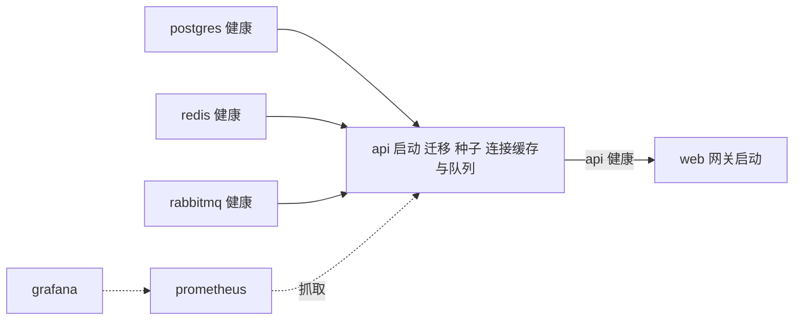

### 9.6 镜像构建

| 镜像 | 构建方式 |
| --- | --- |
| API | 多阶段：node:24-alpine 中按锁文件 npm ci，复制 api 与 database，构建后 npm prune --omit=dev；运行阶段只复制 node_modules、api/dist、api/package.json、database，以 node 用户运行，入口 node api/dist/server.js |
| Web | 多阶段：node:24-alpine 构建前端（注入 VITE_DEMO 与 VITE_DEMO_PASSWORD），nginx:1.28-alpine 运行，复制 nginx.conf 与 dist |
| 测试 | node:24-alpine，npm ci，复制 api 与 database，默认命令 npm test；未复制 web 目录，而 API 测试导入了 web/src/search-highlight.ts（DEF-04） |

.dockerignore 排除依赖目录、构建产物、运行时数据、环境文件、文档、交付物与 SQLite 文件，避免密钥与本地数据进入构建上下文。

### 9.7 Nginx 网关

| 配置 | 说明 |
| --- | --- |
| 静态资源 | /assets 一年强缓存且 immutable；/images 缓存一天；其余路径回退 index.html 支持前端路由 |
| 反向代理 | /api/ 代理到 api:3001，连接超时 5 秒，读取超时 15 秒，传递 Host 与 X-Forwarded-Proto |
| 登录限流 | 会员登录、注册、员工登录路径使用 auth 限流区 |
| 指标保护 | /api/metrics 直接返回 404 |
| 健康检查 | /healthz 返回 200 |
| 安全 | 隐藏版本号，请求体上限 64k，gzip 压缩文本资源，统一安全响应头 |

### 9.8 配置项清单

| 变量 | 默认值 | 作用 |
| --- | --- | --- |
| NODE_ENV | development | production 时启用生产配置校验 |
| HOST / PORT | 127.0.0.1 / 3001 | API 监听地址与端口（容器内为 0.0.0.0） |
| JWT_SECRET | 本地开发密钥 | 令牌签名密钥，生产必须替换 |
| DATABASE_URL | 空 | 设置后使用 PostgreSQL |
| SQLITE_PATH | .runtime/freshmarket.sqlite | 本地 SQLite 文件路径，:memory: 表示内存库 |
| REDIS_URL | 空 | 设置后启用 Redis 缓存 |
| AMQP_URL | 空 | 设置后启用 RabbitMQ |
| MQ_NAMESPACE / CACHE_NAMESPACE | fresh | 队列与缓存命名空间 |
| CORS_ORIGIN | http://localhost:5173 | 允许的跨域来源，逗号分隔 |
| ORDER_TTL_MINUTES | 15 | 待付款有效期 |
| SEED_DEMO | 启用 | 设为 false 时不写演示数据 |
| DEMO_PASSWORD | 本地默认密码 | 演示账号初始密码 |
| LOG_LEVEL | info | 日志级别 |
| DB_PASSWORD / MQ_PASSWORD / GRAFANA_PASSWORD | 无，必须提供 | Compose 中各组件密码 |
| APP_VERSION | local | 镜像标签，用于发布与回滚 |
| WEB_BIND | 127.0.0.1 | 网关端口绑定地址 |
| VITE_DEMO / VITE_DEMO_PASSWORD | 显示演示账号 / 本地默认密码 | 前端构建时注入，控制演示账号快捷填充 |
| API_PROXY_TARGET | http://127.0.0.1:3001 | Vite 开发代理目标 |
| TEST_DATABASE_URL | 空 | API 测试使用 PostgreSQL |
| E2E_BASE_URL / E2E_SCREENSHOT_DIR | 空 / docs/screenshots | 端到端测试目标与截图目录 |
| LOAD_BASE_URL / LOAD_CONCURRENCY / LOAD_REQUESTS | http://127.0.0.1:3001 / 10 / 200 | 压测参数 |

### 9.9 密钥生成

scripts/init-env.sh（Linux、macOS）与 scripts/init-env.ps1（Windows）生成 .env.docker：JWT_SECRET、DB_PASSWORD、MQ_PASSWORD、GRAFANA_PASSWORD 为 24 字节随机数的十六进制，DEMO_PASSWORD 为固定前缀加随机串；同时写入 CORS_ORIGIN、WEB_BIND、APP_VERSION。Shell 脚本以 umask 077 创建文件；两个脚本在文件已存在时拒绝覆盖，保护现有密钥。.env 与 .env.* 已被 Git 忽略。

### 9.10 持续集成

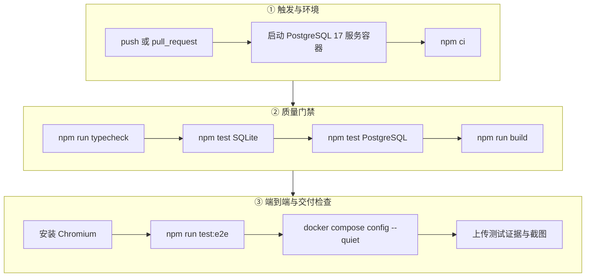

流水线在 ubuntu-latest 上使用 Node 24 与 npm 缓存，任一步骤失败即中止；无论成败均上传 docs/evidence、docs/screenshots 与 test-results。当前 PostgreSQL 测试步骤因 DEF-01 失败。流水线未包含镜像构建、镜像漏洞扫描与部署步骤。

### 9.11 备份、恢复与回滚

| 脚本 | 设计 |
| --- | --- |
| scripts/backup.ps1 | 在 postgres 容器内以 pg_dump 自定义格式导出到 /tmp/freshmarket.dump，再用 docker compose cp 复制到 backups 目录（文件名含时间戳），避免文本管道损坏二进制 |
| scripts/restore.ps1 | 停止 api；复制备份到容器；pg_restore --clean --if-exists --single-transaction 单事务恢复；成功后启动 api；失败时保持 api 停止以便排查 |
| scripts/rollback.ps1 | 校验版本号格式；确认目标版本的 API 与 Web 镜像存在；以 APP_VERSION 指定版本执行 up -d --no-build --no-deps api web |

设计约束：

- 数据库迁移只增不删，应用镜像回滚无需回退数据库；不兼容的结构变更必须通过备份恢复处理。
- 镜像标签默认 local，若发布时不设置新的 APP_VERSION，旧镜像会被覆盖而无法回滚。
- 三个脚本均为 PowerShell，Linux 运维环境缺少等价脚本；start.ps1 与 e2e-docker.ps1 调用 npm.cmd，仅能在 Windows 运行（DEF-05）。
- 固定项目名使同机的其他检出或测试栈共用数据卷（DEF-06）。
- 恢复后 Redis 中的缓存版本保持不变，商品列表可能在 30 秒 TTL 内返回恢复前的数据（DEF-09）。
- 备份与恢复的中间文件留在 postgres 容器的 /tmp 中，未清理（DEF-10）。
- 未提供定时备份与备份保留策略；Redis 与 RabbitMQ 数据不在备份范围内（业务事实以数据库为准）。

### 9.12 部署验证工具

| 工具 | 说明 |
| --- | --- |
| scripts/infra-smoke.mjs | 复制到 API 容器内运行；为本次验证创建随机命名的 PostgreSQL schema、队列与缓存命名空间，依次验证 Redis 连接、缓存 TTL、共享版本失效、事务下单、发布确认、消费入库、重复事件去重、取消回库存与投递，结束后清理全部资源 |
| scripts/load-test.mjs | 对商品列表接口执行指定并发与请求数的压测，输出 QPS、平均值、p50、p95、p99、错误率，并写入 docs/evidence/load-test.json |
| compose.test.yaml | 以 profile test 在容器网络内运行 API 测试并连接部署的 PostgreSQL |

## 10. 可观测性设计

### 10.1 日志与追踪

Fastify 输出 JSON 结构化日志；每个请求以 UUID 作为请求 id，同时写入响应头 x-trace-id 与响应体 traceId，并作为审计日志 trace_id，从而串联用户反馈、访问日志、错误日志与审计记录。5xx 错误以 request_failed 记录完整错误对象；外部组件降级、Outbox 重试、消费失败、周期任务失败分别以 redis_degraded、cache_disabled、broker_degraded_outbox_will_wait、outbox_retry、event_consume_failed、worker_failed 等事件名记录。

### 10.2 指标

| 指标 | 类型 | 标签 | 说明 |
| --- | --- | --- | --- |
| fresh_http_requests_total | Counter | method、route、status | 请求计数，route 使用路由模板，避免订单号造成高基数 |
| fresh_http_duration_seconds | Histogram | method、route、status | 响应耗时，桶边界 0.01 至 5 秒共 9 档 |
| Node.js 默认指标 | 多种 | — | 进程 CPU、内存、事件循环延迟、GC 等 |

/api/metrics 自身请求不计入指标。Prometheus 每 15 秒从 api:3001 抓取。

### 10.3 告警规则

| 告警 | 表达式含义 | 持续时间 | 级别 |
| --- | --- | --- | --- |
| FreshmarketApiDown | 抓取目标 up 为 0 | 1 分钟 | critical |
| FreshmarketHighErrorRate | 5 分钟内 5xx 请求占比超过 1% | 3 分钟 | warning |
| FreshmarketSlowRequests | 5 分钟内 p95 响应时间超过 0.5 秒 | 3 分钟 | warning |

未部署 Alertmanager 与通知渠道，告警状态只能在 Prometheus 与 Grafana 中查看。

### 10.4 仪表盘

Grafana 启动时自动装载 Prometheus 数据源与“FreshMarket · 业务服务监控”仪表盘，默认显示最近 30 分钟、每 15 秒刷新，包含 API 健康、QPS、p95 响应时间、5xx 错误率、进程常驻内存、事件循环延迟六个面板。

## 11. 性能与容量设计

| 设计点 | 说明 |
| --- | --- |
| 连接池 | PostgreSQL 最大 15 连接，获取超时 5 秒，避免无限排队 |
| 缓存 | 商品列表 30 秒缓存，版本失效；Redis 最大内存 128 MB，LRU 淘汰 |
| 分页上限 | 所有分页接口 pageSize 不超过 100；消息与评价最多返回 30 条 |
| 请求体 | 64 KiB 上限，售后明细最多 50 项 |
| 索引 | 见 4.7，外键列索引缺口见 DEF-11 |
| 搜索 | 搜索时一次读取全部候选商品在内存评分，适用于当前百级商品规模；商品量达到万级需改用数据库全文检索或独立搜索引擎 |
| 后台任务 | Outbox 每轮最多 20 条，每 2 秒一轮，单实例理论投递上限约每秒 10 条事件 |
| 单实例限制 | 应用层限流为进程内计数；SQLite 模式串行执行，仅用于开发演示 |
| 横向扩展前提 | 共享限流存储或边缘限流、迁移加锁、正确的客户端地址透传、Outbox 多实例已支持 SKIP LOCKED |

## 12. 设计约束、技术债与改进建议

### 12.1 已知缺陷与设计改进

| 编号 | 级别 | 根因 | 建议的设计修正 |
| --- | --- | --- | --- |
| DEF-01 | 高 | 经营概览将 PostgreSQL 返回的字符串计数与 SUM 结果直接展开到响应，pending_fulfillment 缺少 COALESCE；接口契约随数据库方言变化 | 所有聚合结果在出参处显式 Number() 并以 COALESCE 处理空值；为响应声明 JSON Schema 序列化约束，使契约与方言无关 |
| DEF-02 | 高 | 演示开关与演示密码在 Compose 中写死，并作为构建参数进入公开前端包 | VITE_DEMO、SEED_DEMO 改为由环境变量控制且生产默认关闭；前端只填充账号名，绝不注入密码；演示账号密码单独生成且不与管理员共用 |
| DEF-03 | 中 | 网关未传递客户端地址，API 未信任代理 | Nginx 设置 X-Forwarded-For 与 X-Real-IP，API 配置 trustProxy 为网关网段；多副本时改用 Redis 存储限流计数 |
| DEF-04 | 中 | 测试镜像构建上下文缺少 web 目录 | test.Dockerfile 复制 web/src/search-highlight.ts（或整个 web 目录），或把共享模块移动到独立的共享包 |
| DEF-05 | 中 | 运维脚本只提供 PowerShell 版本，并依赖 Windows 专用的 npm.cmd | 提供等价的 POSIX Shell 版本或改用跨平台 Node 脚本；用 npm 替代 npm.cmd |
| DEF-06 | 低 | compose.yaml 固定项目名 | 去掉固定 name，或改为通过 COMPOSE_PROJECT_NAME 配置，并在文档中约定每套环境独立项目名 |
| DEF-07 | 低 | Swagger UI 与 OpenAPI 在生产环境无条件注册 | 生产环境关闭或在网关层限制访问来源 |
| DEF-08 | 低 | Helmet 与 Nginx 同时下发安全头 | 统一由一层负责：网关对 /api 不再追加，或 API 关闭 Helmet 中与网关重复的头 |
| DEF-09 | 低 | 恢复流程不处理缓存 | 恢复完成后递增 Redis 缓存版本或清空缓存命名空间 |
| DEF-10 | 低 | 备份与恢复中间文件未清理 | 复制完成后删除容器内 /tmp 下的转储文件 |
| DEF-11 | 低 | 外键列缺少索引；迁移无并发保护 | 为 addresses.user_id、notifications(user_id, created_at)、refunds.user_id、reviews.product_id、cart_items.product_id 建索引；PostgreSQL 迁移前获取 pg_advisory_lock |

### 12.2 其他设计观察

| 编号 | 观察 | 建议 |
| --- | --- | --- |
| OBS-01 | 超时取消由后台任务执行，归还库存后没有调用缓存失效，商品列表最长 30 秒显示旧库存 | 在 expire 取消成功后调用 runtime.invalidate() |
| OBS-02 | order.partially_refunded 事件没有对应的消息标题，会员收到通用的“订单更新” | 补充部分退款消息文案 |
| OBS-03 | 综合推荐直接使用销量与浏览量原始值，新品权重 0.2 相对于计数值几乎不起作用 | 对各因子做归一化或对数变换后再加权 |
| OBS-04 | Outbox 只累计 attempts，没有最大重试次数与退避，持续失败的事件会被反复领取 | 增加重试上限、指数退避与失败状态，并纳入监控 |
| OBS-05 | 管理后台的部分查询直接在控制器中编写 SQL，绕过服务层 | 随功能增长将聚合查询下沉到独立的查询服务或仓储 |
| OBS-06 | 删除地址时若删除的是默认地址，不会自动指定新的默认地址 | 删除后将最早的剩余地址设为默认 |
| OBS-07 | 用户名在账号逻辑删除后永久占用 | 属有意的审计设计，需在需求中明确；如需复用可在删除时改写用户名 |

### 12.3 设计约束

- 支付、退款为沙箱实现，接入真实渠道需增加回调签名校验、对账与资金渠道退款。
- 认证体系没有刷新令牌、单点登录与多因素认证。
- 应用为单实例设计，横向扩展需先完成 11 章所列前提。
- SQLite 模式不作为生产部署方案。

## 附录 A 审计动作清单

| 动作 | 触发场景 |
| --- | --- |
| auth.register | 会员自助注册 |
| auth.login | 会员或员工登录成功 |
| user.create / user.update / user.delete | 管理员新增、编辑、删除账号 |
| product.create / product.update / product.delete | 商品新建、编辑、删除 |
| stock.adjust | 库存调整 |
| order.create | 下单 |
| payment.sandbox | 沙箱支付 |
| order.cancel | 会员、管理员或系统取消订单 |
| order.transition | 履约推进与确认收货 |
| order.delivery.update | 管理员修改配送信息 |
| order.delete | 管理员删除错误订单 |
| refund.request / refund.decision | 售后申请与审核 |
| settlement.create | 结算批次 |
| review.create | 商品评价 |

## 附录 B 事件主题清单

| 主题 | 产生时机 | 会员消息标题 |
| --- | --- | --- |
| order.created | 下单成功 | 订单提交成功 |
| order.paid | 支付成功 | 付款成功 |
| order.cancelled | 订单取消 | 订单已取消 |
| order.picking | 开始拣货 | 商品正在拣货 |
| order.delivering | 发出配送 | 商品配送中 |
| order.completed | 确认收货 | 已确认收货 |
| order.refunded | 整单退款通过 | 退款已完成 |
| order.partially_refunded | 部分退款通过 | 订单更新 |
