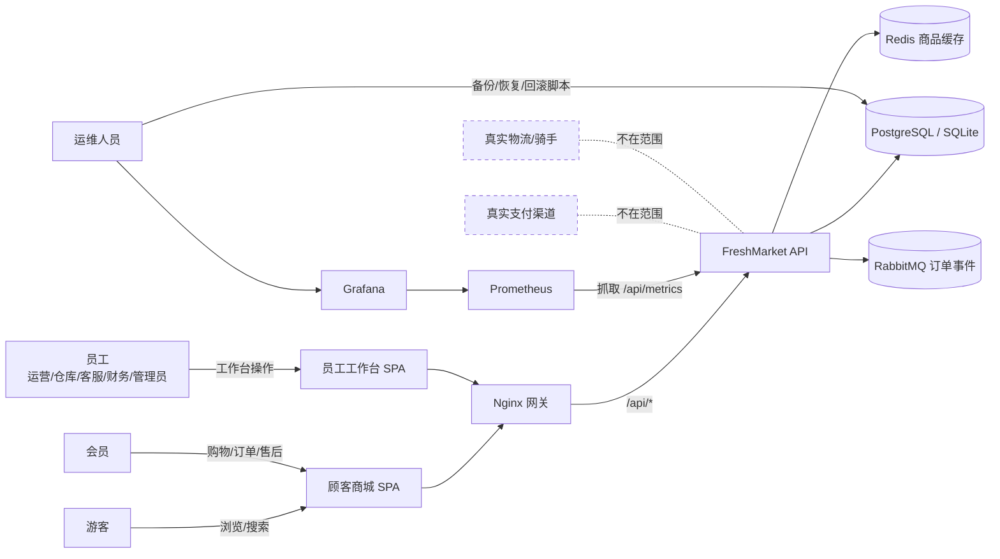
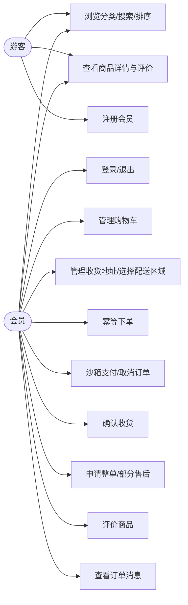
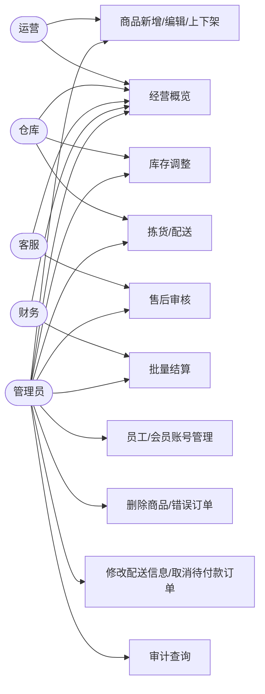
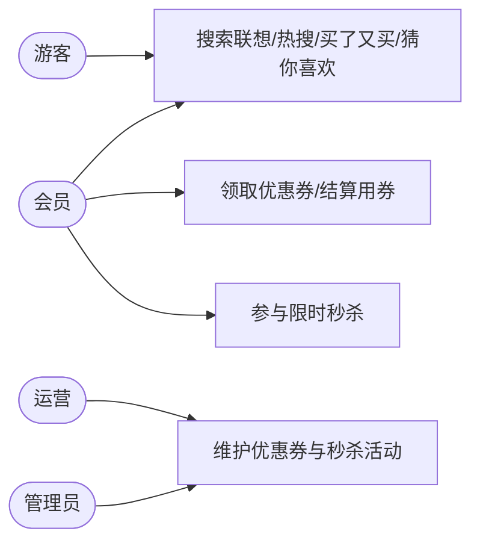
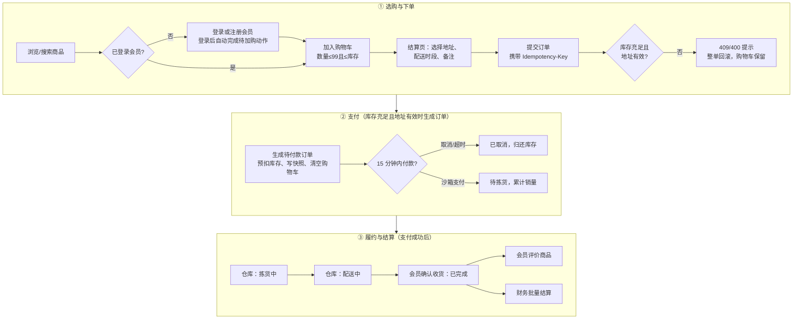
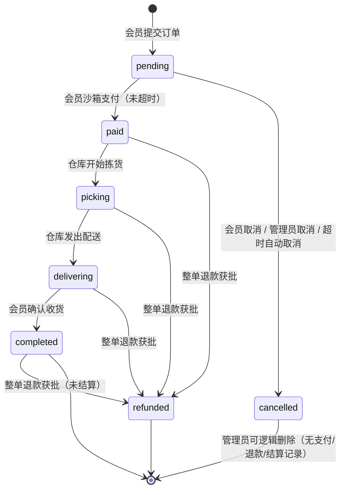
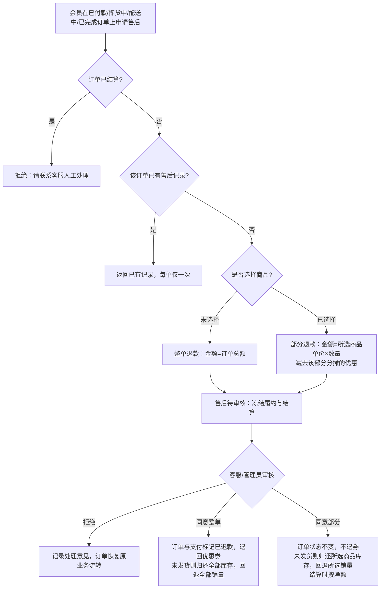
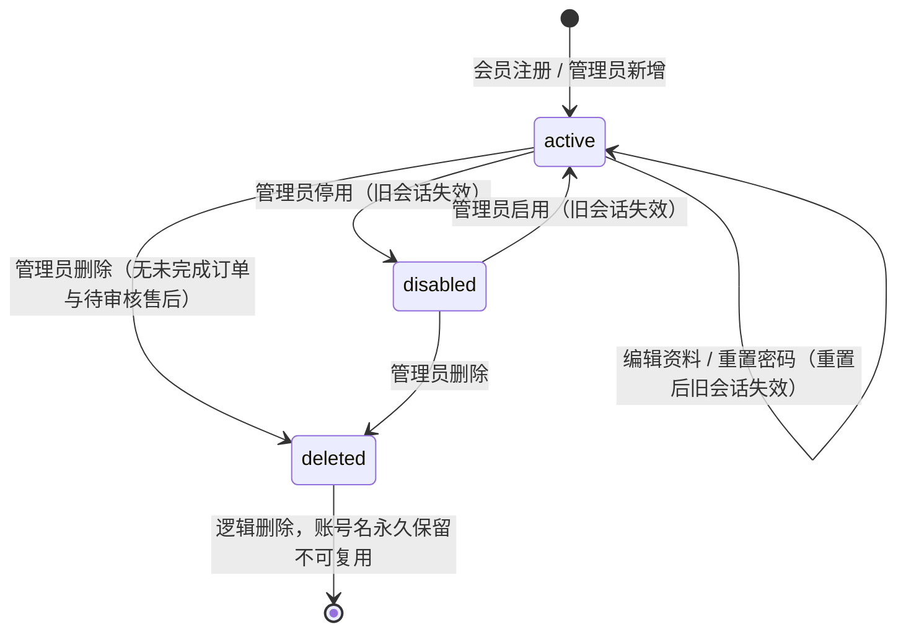

# 鲜境 FreshMarket 生鲜电商平台 软件需求规格说明书

## 文档控制

| 项目 | 内容 |
| --- | --- |
| 文档编号 | FM-SRS-001 |
| 文档名称 | 鲜境 FreshMarket 生鲜电商平台 软件需求规格说明书 |
| 版本 | 3.0 |
| 日期 | 2026-10-21 |
| 状态 | 正式稿 |
| 适用版本 | main 分支当前代码（api/src、web/src、database/schema.sql） |
| 编制 | FreshMarket 项目组 |
| 审核 | ________ |
| 批准 | ________ |
| 关联文档 | FM-SDD-001 系统设计说明书；FM-STR-001 测试报告 |

修订记录：

| 版本 | 日期 | 修订内容 |
| --- | --- | --- |
| 1.0 | 2026-10-06 | 初稿 |
| 2.0 | 2026-10-18 | 企业级重写 |
| 3.0 | 2026-10-21 | 按现有代码精简合并 |

## 1. 引言

### 1.1 编写目的

本文档以可验证的方式定义鲜境 FreshMarket 生鲜电商平台（以下简称“本系统”）的业务功能、角色权限、数据、外部接口和质量属性，作为设计（FM-SDD-001）、测试验收（FM-STR-001）与变更评审的共同基线。每条需求均可在当前代码中找到实现位置；未实现的内容列入“不在范围”。需求的实测结论以测试报告为准，本文不记录测试结果。

### 1.2 适用范围

- 顾客商城：浏览、搜索与推荐、购物车、优惠券、限时秒杀、地址、下单、沙箱支付、订单跟踪、确认收货、售后与评价。
- 员工工作台：经营概览、商品与库存、营销活动、订单履约与维护、售后审核、财务结算、账号管理与审计查询。
- 服务端与基础设施：Fastify API、PostgreSQL / SQLite、Redis、RabbitMQ、Nginx、Prometheus / Alertmanager / Grafana、OpenTelemetry / Jaeger。

支付与配送均为实验沙箱，不对接真实支付渠道、物流或骑手服务。

### 1.3 术语与缩略语

| 术语 | 说明 |
| --- | --- |
| 会员 / 员工 | 角色为 member 的顾客账号 / 角色为 operator、warehouse、support、finance、admin 的工作台账号 |
| 能力（Capability） | 服务端授权的最小单位，如 products、orders.manage，定义于 api/src/core/security.ts |
| 分 | 金额最小单位，所有金额字段为整数分，1 元 = 100 分 |
| 幂等键 | 下单请求头 Idempotency-Key，防止重复下单 |
| 预扣库存 | 下单即条件扣减可售库存，取消或超时后归还 |
| 快照 | 下单时复制的商品名称、图片、规格、成交单价与收货信息 |
| 优惠分摊 | 订单优惠按商品行金额比例分配到每行（order_items.discount），用于部分退款扣回 |
| 秒杀名额 | 秒杀活动可售数量（seckill_activities.stock），已售为 sold |
| 逻辑删除 | 以 deleted_at 标记删除，保留历史关联 |
| 会话版本 | users.session_version，账号安全属性变化时递增，使旧令牌失效 |
| Outbox | 与业务数据同事务写入的待发事件表 |
| traceId | W3C Trace Context 的 32 位十六进制追踪号，见于响应体、x-trace-id 响应头、日志与审计 |
| RBAC / JWT / SPA | 基于角色的访问控制 / 登录令牌 / 单页应用 |
| M / S / C | 优先级：必须 / 应当 / 可以 |

### 1.4 参考资料

| 编号 | 资料 |
| --- | --- |
| R1 | GB/T 9385—2008《计算机软件需求规格说明规范》 |
| R2 | ISO/IEC/IEEE 29148:2018 Requirements engineering |
| R3 | GB/T 25000.10—2016《系统与软件质量模型》 |
| R4 | 《中华人民共和国个人信息保护法》（2021） |
| R5 | 源代码与脚本：api/src、web/src、database/、infra/、compose.yaml、scripts/ |
| R6 | 自动化测试：api/test/*.test.ts、e2e/shopping.spec.ts |

## 2. 总体描述

### 2.1 业务目标

| 编号 | 业务目标 | 成功度量 |
| --- | --- | --- |
| BG-01 | 顾客独立完成从浏览到评价的购物闭环 | 端到端测试覆盖“加购→下单→支付→履约→收货→评价→结算” |
| BG-02 | 杜绝超卖、超发、重复下单与重复扣款 | 并发与重复提交测试中库存、券发放量、秒杀名额不越界，订单与支付记录唯一 |
| BG-03 | 岗位职责隔离 | 越权调用返回 403/404；员工不能购物，会员不能访问工作台接口 |
| BG-04 | 售后、优惠与财务账目一致 | 退款不超过实付；待审核售后的订单不履约、不结算；结算按净额且不重复 |
| BG-05 | 可部署、可观测、可恢复 | Compose 一次启动全部组件；具备指标、告警、链路追踪、备份、恢复与回滚 |

### 2.2 系统上下文

图中 Redis 同时承载秒杀令牌闸门。完整部署另含 Jaeger（接收 API 经 OTLP 导出的链路数据）与 Alertmanager（接收 Prometheus 告警），见 7.3。

### 2.3 用户类别

| 用户类别 | 账号类型 | 主要诉求 |
| --- | --- | --- |
| 游客 | 无 | 浏览、搜索、查看详情、领券中心与秒杀列表；加购、领券、下单时被引导登录 |
| 会员（member） | 会员 | 购物车、地址、领券用券、秒杀、下单支付、订单跟踪、售后、评价、消息 |
| 运营（operator） | 员工 | 商品资料与上下架、优惠券与秒杀活动、订单查看、经营概览 |
| 仓库（warehouse） | 员工 | 库存调整、拣货与配送、订单与商品查看 |
| 客服（support） | 员工 | 售后审核、订单查看 |
| 财务（finance） | 员工 | 批量结算、经营概览 |
| 管理员（admin） | 员工 | 全部后台能力，含账号管理、删除类操作、订单维护与审计 |
| 运维人员 | 基础设施权限 | 部署、监控、链路追踪、备份恢复与回滚 |

### 2.4 运行环境

| 类别 | 要求 |
| --- | --- |
| 服务端运行时 | Node.js 24 及以上（本地模式依赖内置 node:sqlite） |
| 数据库 | 本地开发：SQLite 文件库 api/.runtime/freshmarket.sqlite；完整部署：PostgreSQL 17 |
| 可选中间件 | Redis 7.4（商品查询缓存、秒杀令牌）；RabbitMQ 4.3（订单事件投递） |
| 网关 | Nginx（静态资源、SPA 路由、API 反向代理、登录限流、屏蔽指标与接口文档） |
| 监控与追踪 | Prometheus 3.13、Alertmanager 0.34、Grafana 13.2、Jaeger 2.22 |
| 部署方式 | npm workspaces 本地开发；Docker Compose 完整部署（9 个服务） |
| 客户端 | 现代桌面与移动浏览器（Chromium / Edge），桌面 1440px 与手机 390px 宽度 |

### 2.5 设计与实现约束

- C-01：金额一律以整数分存储和计算。
- C-02：时间戳一律为 Unix 毫秒（BIGINT）。
- C-03：同一套 SQL 与业务代码同时运行于 SQLite 与 PostgreSQL，返回一致的数据与类型；PostgreSQL 专有子句（FOR UPDATE、SKIP LOCKED）仅在该方言下追加。
- C-04：数据库结构由 database/schema.sql 定义，启动时自动执行，并以幂等方式为旧库补齐新增字段。
- C-05：前后端分离，前端只通过 /api 下的 JSON 接口访问数据。
- C-06：生产模式（NODE_ENV=production）必须配置至少 32 位且非默认的 JWT_SECRET 与 PostgreSQL 连接串；启用演示数据时还须配置至少 12 位且非默认的 DEMO_PASSWORD，否则拒绝启动。
- C-07：支付与配送页面须明确标注沙箱性质，不发生真实扣款与配送。

### 2.6 假设与依赖

- A-01：单个 API 实例部署，应用内限流为进程内存计数。
- A-02：Redis、RabbitMQ、OTLP 导出均为可选；未配置时分别以数据库回源、持久化 Outbox 进程内消费、仅本地生成 traceId 的方式运行。
- A-03：演示环境默认开启演示数据（SEED_DEMO 不为 false）：6 个分类、48 款商品、3 张优惠券、1 场秒杀；数据库无账号时另建 6 个角色演示账号与 1 个演示地址。
- A-04：浏览器支持 sessionStorage 与 localStorage。
- A-05：配送时段为固定 4 档，不依赖真实运力排班。

### 2.7 不在范围

| 编号 | 内容 | 说明 |
| --- | --- | --- |
| OOS-01 | 真实支付与退款资金通道 | 仅沙箱支付记录；退款审批只更新状态 |
| OOS-02 | 真实物流、骑手调度、地图定位、配送范围校验 | 履约仅为状态流转；顶部配送区域仅为展示与偏好 |
| OOS-03 | 积分、会员等级、多券叠加、优惠券与秒杀删除 | 每单至多一张券；营销记录只可停用不可删除 |
| OOS-04 | 多商户、佣金、税费、发票 | 未实现 |
| OOS-05 | 第三方登录、短信验证码、找回密码、刷新令牌 | 密码重置仅由管理员在工作台执行 |
| OOS-06 | 商品批次、保质期、溯源 | 未实现 |
| OOS-07 | 多实例高可用、异地灾备 | 仅单实例部署与备份恢复脚本 |
| OOS-08 | 已结算订单的售后 | 系统拒绝申请，提示联系客服人工处理 |

## 3. 业务流程

### 3.1 用例

### 3.2 购物到结算主流程

结算页还可选择一张优惠券（服务端试算，默认选中优惠最多的券），取消或超时时退回该券。秒杀订单不经购物车、不可用券，每人每场 1 件，付款时限 5 分钟，取消或超时归还名额；其后流程与普通订单相同。

### 3.3 订单状态

状态对照：pending 待付款、paid 待拣货、picking 拣货中、delivering 配送中、completed 已完成、cancelled 已取消、refunded 已退款。部分退款获批后订单保持原状态。存在待审核售后时，订单不得拣货、配送、确认收货、修改配送信息与结算。

### 3.4 售后流程

### 3.5 账号状态

## 4. 功能需求

除特别说明外，接口错误均以统一响应结构返回中文提示与 traceId（见 7.2）。

### 4.1 会员账号与认证（FR-ACC）

| 编号 | 需求 | 优先级 | 验收标准 |
| --- | --- | --- | --- |
| FR-ACC-01 | 会员自助注册：账号 3–60 位（字母、数字、_、@、.），密码 10–128 位且含字母与数字，昵称 1–40 字；身份固定为会员，不接受 role 等额外字段；账号名全局唯一（含已删除） | M | 合法注册返回会员身份与令牌；携带 role 返回 400；重复账号返回 409 USERNAME_EXISTS |
| FR-ACC-02 | 会员登录：仅会员可从商城入口登录；账号不存在与密码错误统一提示“账号或密码错误”；停用账号 403 ACCOUNT_DISABLED；员工账号 403 ACCOUNT_TYPE_MISMATCH | M | 错误凭据 401；员工账号登录商城被拒绝 |
| FR-ACC-03 | 员工登录：员工从 /admin/login 独立入口登录，会员账号被拒绝，其余规则同 FR-ACC-02 | M | 会员账号登录工作台返回 403 |
| FR-ACC-04 | 令牌有效期 2 小时，只携带账号 ID、账号类型与会话版本；角色与能力每次请求从数据库读取 | M | 角色被撤销后旧令牌立即失去对应能力 |
| FR-ACC-05 | 会话即时失效：每次请求校验账号未删除、已启用、会话版本一致、账号类型一致；重置密码、停用/启用、删除使会话版本递增 | M | 上述变更后旧令牌返回 401，前端清除对应会话 |
| FR-ACC-06 | 会员与员工会话分开保存，可在同一浏览器同时登录、分别退出；401 只清除对应入口的会话 | M | 退出其一，另一会话不受影响 |
| FR-ACC-07 | 当前身份：GET /api/auth/me（会员）、GET /api/admin/auth/me（员工）返回账号、姓名、角色、账号类型与能力，不含密码哈希 | M | 刷新页面自动恢复登录状态 |
| FR-ACC-08 | 防暴力尝试：注册每客户端 8 次/分钟、登录 10 次/分钟，超限 429 RATE_LIMITED；网关对登录与注册另限 5 次/分钟（突发 10） | M | 连续错误登录超过阈值返回 429 且提示统一 |
| FR-ACC-09 | 游客点击加购被引导登录，登录后自动完成原加购动作 | S | 未登录加购→登录→购物车出现该商品 |

### 4.2 商品目录与搜索（FR-CAT）

| 编号 | 需求 | 优先级 | 验收标准 |
| --- | --- | --- | --- |
| FR-CAT-01 | 6 个分类按“时令水果、海鲜水产、肉禽蛋品、新鲜蔬菜、乳品烘焙、方便速食”排序；顶部主导航与图标分类栏共用 URL 参数 category，高亮同步 | M | 点击任一入口两处高亮一致，列表只含该分类商品 |
| FR-CAT-02 | 商城只展示已上架且未删除商品；默认每页 12 条，pageSize 1–100，page ≥ 1 | M | pageSize=101 返回 400 |
| FR-CAT-03 | 排序仅限 default（综合推荐）、priceAsc、priceDesc、sales；同值按商品 ID 稳定排序 | M | 非法 sort 返回 400 |
| FR-CAT-04 | 综合推荐得分 = 销量×0.5 + 浏览量×0.3 + 新品权重×0.2（上架 30 天内为 1） | M | 高销量、高浏览商品排在新上架低热度商品之前 |
| FR-CAT-05 | 模糊搜索：关键词 ≤ 80 字，忽略大小写与全/半角；匹配名称、产地、副标题（权重依次降低）；空格分隔的多个关键词须全部命中，整个查询最多一处放宽；通配符按字面处理 | M | “草莓 丹东”只返回同时命中的商品 |
| FR-CAT-06 | 容错：3 字符及以上的字母数字关键词允许与名称有一处替换、增字、漏字或相邻颠倒；单个两字中文关键词允许命中其一，更长时须命中至少 75% 的不同汉字；字面重合结果最多 6 款；不使用同义词表 | M | 单处错字可搜到目标；重合不足不返回；弱匹配不超过 6 款 |
| FR-CAT-07 | 搜索排序：准确匹配、错字匹配、字面重合依次优先；显式选择价格或销量排序时按所选排序；分类、上下架过滤与分页继续生效，分页前完成全部匹配 | M | 搜索总数覆盖全部相关商品，翻页无遗漏 |
| FR-CAT-08 | 搜索高亮：名称、副标题、产地中与关键词相同的文字标红；中文逐字、非中文按连续片段字面匹配，正则与 HTML 字符按普通文本处理 | S | 卡片中“草莓”二字标红且原文不被改写 |
| FR-CAT-09 | 商品卡片展示图片、标签、名称、副标题、规格、产地、售价与划线价、“库存 N 件”；低于 20 件追加“库存紧张”，为 0 显示“暂时售罄”且不可加购；已在购物车时显示数量增减器 | M | 库存 0 的商品加购按钮不可用 |
| FR-CAT-10 | 商品详情：仅已上架未删除商品可查看，否则 404；展示规格、产地、储存方式、库存、销量、描述与最近 30 条评价（评价人仅显示首字）；每次访问浏览量加 1 | M | 下架商品详情返回 404 |
| FR-CAT-11 | 首页轮播 4 张分类导购图，每 5 秒切换；悬停、聚焦、页面不可见或“减少动态效果”时暂停；支持箭头、圆点与方向键 | C | 悬停时不自动切换 |
| FR-CAT-12 | 配置 Redis 时商品列表、联想、热搜、相关推荐缓存 30 秒；商品、库存、订单、秒杀变更后缓存版本递增；Redis 不可用时回源数据库 | S | 调整库存后再次查询返回新库存 |

### 4.3 搜索联想与推荐（FR-SEARCH-REC）

| 编号 | 需求 | 优先级 | 验收标准 |
| --- | --- | --- | --- |
| FR-SEARCH-REC-01 | 搜索联想 GET /api/search/suggest：关键词 ≤ 40 字，复用 FR-CAT-05/06 算法，准确与一处错字优先，最多 8 款已上架商品；前端输入 200 ms 防抖，点击直达详情 | S | 错字关键词仍能联想到目标商品，结果不超过 8 项 |
| FR-SEARCH-REC-02 | 热搜 GET /api/search/hot：取近 7 天商城搜索第一页且有结果的关键词按次数排序，取 8 个，不足用热销商品名补齐；翻页与后台搜索不计入 | S | 翻页与后台搜索不改变热搜计数 |
| FR-SEARCH-REC-03 | 买了又买 GET /api/products/:id/related：按同一已付款订单中共同出现的订单数排序，不足 6 款用同类综合推荐补齐，只含上架有货商品，标注推荐理由 | S | 共同购买商品排在同类补足商品之前 |
| FR-SEARCH-REC-04 | 猜你喜欢 GET /api/recommendations（limit 1–24，默认 8）：会员按已购与购物车品类偏好（0.6）结合归一化热度（0.4）排序，排除购物车内商品，标注“您常买/偏好品类/热销推荐”；游客只按热度；首页底部与无结果搜索页滚动到可视区才加载 | S | 会员推荐优先出现其偏好品类商品 |

### 4.4 购物车（FR-CART）

| 编号 | 需求 | 优先级 | 验收标准 |
| --- | --- | --- | --- |
| FR-CART-01 | 仅会员可加购；商品须已上架未删除；单品累计数量 1–99 且不超过当前库存 | M | 超库存加购返回 409 OUT_OF_STOCK |
| FR-CART-02 | 数量可改为 0–99，设为 0 即移除 | M | 改为 0 后购物车不再包含该商品 |
| FR-CART-03 | 金额：单价取服务端当前售价；商品金额（扣除优惠后）≥ 9900 分免配送费，否则 600 分；空购物车配送费为 0 | M | 小计 98.99 元配送费 6 元，99 元为 0 |
| FR-CART-04 | 顶部购物车显示件数徽标，抽屉内可调整数量、移除、查看距免配送费差额并进入结算 | S | 差额提示随数量实时变化 |
| FR-CART-05 | 员工令牌调用购物车接口返回 403 MEMBER_ONLY | M | 员工调用 GET/POST /api/cart 均返回 403 |

### 4.5 收货地址与配送区域（FR-ADDR）

| 编号 | 需求 | 优先级 | 验收标准 |
| --- | --- | --- | --- |
| FR-ADDR-01 | 收货人 1–40 字；手机号匹配 1[3-9] 开头 11 位；详细地址 8–200 字；每位会员最多 20 个地址 | M | 第 21 个地址返回 400 ADDRESS_LIMIT |
| FR-ADDR-02 | 首个地址自动设为默认；设置新默认时取消其他默认；删除默认地址后自动将下一个地址设为默认；列表默认地址在前 | M | 任一时刻最多一个默认地址 |
| FR-ADDR-03 | 只能编辑、删除本人地址 | M | 编辑他人地址返回 404；删除请求不影响他人地址 |
| FR-ADDR-04 | 地址卡片手机号显示为 138****8000 形式 | S | 页面不展示完整手机号 |
| FR-ADDR-05 | 顶部地址选择器提供 5 个预置配送区域，登录后列出本人地址；选择结果写入全局状态并本地持久化；结算页依次优先该地址、默认地址、第一个地址；点击外部或 Esc 关闭 | S | 选择后标签立即更新，刷新后保留 |

### 4.6 优惠券（FR-PROM-COUPON）

| 编号 | 需求 | 优先级 | 验收标准 |
| --- | --- | --- | --- |
| FR-PROM-COUPON-01 | 领券中心 GET /api/coupons 展示启用且未过期的券及剩余数量，登录会员标注是否已领；首页通过 GET /api/promotions 一次获取领券中心与秒杀列表 | S | 停用或过期的券不出现 |
| FR-PROM-COUPON-02 | 领取：仅会员；每人每券限 1 张（UNIQUE(coupon_id,user_id)）；发放以 issued<total 条件更新防超发；按会员令牌限流 30 次/分钟 | M | 重复领取 409 COUPON_CLAIMED；领完 409 COUPON_SOLD_OUT；并发领取不超过总量 |
| FR-PROM-COUPON-03 | 券类型：满减券（减免额小于门槛）与折扣券（填 10–99，90 即 9 折，可设最高优惠）；可限定商品分类，门槛按适用商品金额判断 | M | 规则不合法返回 400 INVALID_COUPON |
| FR-PROM-COUPON-04 | 我的优惠券 GET /api/my/coupons 显示未使用、已使用、已过期、未开始状态 | S | 状态与有效期一致 |
| FR-PROM-COUPON-05 | 结算试算 GET /api/cart/coupons：按当前购物车由服务端计算每张未使用券的优惠、配送费与应付，优惠最多者在前；前端默认选中最优券，可选择不使用 | M | 试算金额与下单金额一致 |
| FR-PROM-COUPON-06 | 用券下单：每单至多一张券，在下单事务内校验有效期与适用性并条件核销；优惠按商品行金额比例分摊，取整余数逐分补齐，分摊合计等于优惠额且不超过行金额；配送费按优惠后商品金额计算 | M | 已用券 409 COUPON_USED；不适用 409 COUPON_NOT_APPLICABLE；分摊合计等于优惠额 |
| FR-PROM-COUPON-07 | 退券：待付款取消、超时取消、整单退款退回优惠券（过期券退回后显示为已过期）；部分退款不退券，退款额扣回该部分分摊优惠（向上取整） | M | 部分退款金额不超过该商品实付 |
| FR-PROM-COUPON-08 | 运营与管理员（promotions）可查询、新增、编辑、启停优惠券；已有会员领取后只能改名称、总量（不少于已领数）、结束时间与启停 | M | 已领取后改规则返回 409 COUPON_LOCKED |

### 4.7 限时秒杀（FR-PROM-SECKILL）

| 编号 | 需求 | 优先级 | 验收标准 |
| --- | --- | --- | --- |
| FR-PROM-SECKILL-01 | 秒杀列表 GET /api/seckill 返回启用、未结束且商品在售的活动，含服务器时间、剩余名额（取名额余量与商品库存的较小值）、状态（未开始/进行中/已抢光）与本人是否已参与；前端按服务器时间倒计时 | S | 未开始活动显示为 upcoming |
| FR-PROM-SECKILL-02 | 秒杀下单 POST /api/seckill/:id/orders：仅会员，须携带幂等键；不经购物车、不可用券，按秒杀价每人每场 1 件；校验活动时间窗；活动名额（sold<stock，CHECK 兜底）与商品库存同时条件扣减，任一失败整单回滚 | M | 未开始 409 SECKILL_NOT_STARTED；已结束 409 SECKILL_ENDED；重复参与 409 SECKILL_LIMIT；并发抢购不超过名额 |
| FR-PROM-SECKILL-03 | 秒杀订单 5 分钟未付款自动取消（SECKILL_TTL_MINUTES）；取消或超时归还名额并允许该会员重新参与；付款后退款不归还名额 | M | 超时取消后 sold 减 1 |
| FR-PROM-SECKILL-04 | 配置 Redis 时先经过令牌闸门：令牌耗尽直接返回 409 SECKILL_SOLD_OUT 而不进入数据库事务；令牌 60 秒过期后按数据库校准；下单失败或幂等重放退回令牌；Redis 不可用时直接由数据库判定 | S | 成交结果始终以数据库为准 |
| FR-PROM-SECKILL-05 | 秒杀下单按会员令牌限流 20 次/分钟 | S | 更换新令牌不能重置计数 |
| FR-PROM-SECKILL-06 | 运营与管理员（promotions）可查询、新增、编辑、启停活动；秒杀价须低于商品当前售价，结束时间晚于开始时间；已有成交的活动不能改商品与秒杀价，名额不能少于已售 | M | 违反规则返回 400 INVALID_SECKILL 或 409 SECKILL_LOCKED |

### 4.8 下单、支付与订单（FR-ORD）

| 编号 | 需求 | 优先级 | 验收标准 |
| --- | --- | --- | --- |
| FR-ORD-01 | 提交订单：仅会员（事务内复核身份与启用状态）；须携带 8–100 位 Idempotency-Key；地址属于本人；购物车非空；配送时段限“尽快送达、今日 18:00–20:00、明日 09:00–12:00、明日 14:00–18:00”；备注 ≤ 200 字；可选 couponId | M | 员工下单 403；缺少幂等键 400；空购物车 400 CART_EMPTY |
| FR-ORD-02 | 幂等：同一会员同一幂等键且请求内容（含所选券）相同时返回同一订单；内容不同返回 409 IDEMPOTENCY_CONFLICT；前端在地址、时段、备注或券变化时重新生成幂等键 | M | 8 次并发重复提交只生成 1 个订单 |
| FR-ORD-03 | 防超卖：逐商品条件扣减（库存 ≥ 购买量且上架未删除）；任一失败整单回滚，库存、购物车、优惠券保持原状，返回 409 OUT_OF_STOCK 并指出商品名 | M | 两会员争抢最后 3 件，仅 1 单成功且库存为 0 |
| FR-ORD-04 | 订单保存商品名称、图片、规格、成交单价、数量、行优惠分摊及收货信息快照 | M | 修改商品售价后历史订单金额不变 |
| FR-ORD-05 | 金额由服务端计算：小计 − 优惠 + 配送费；订单号为 FM + 时间戳 + 8 位随机串 | M | 订单金额与结算页试算一致 |
| FR-ORD-06 | 普通订单 15 分钟（ORDER_TTL_MINUTES）内须付款，前端显示倒计时；后台任务每 2 秒取消超时订单，归还库存、优惠券与秒杀名额，并使商品缓存失效 | M | 超时后支付返回 409 ORDER_EXPIRED，库存只归还一次 |
| FR-ORD-07 | 沙箱支付：仅本人待付款订单；金额取订单快照；每单只记一笔支付，重复请求返回原结果且销量只累加一次；付款后变为待拣货 | M | 6 次重复支付只产生 1 条支付记录 |
| FR-ORD-08 | 会员取消：仅待付款订单，归还库存、优惠券与秒杀名额；重复取消不重复归还；支付与取消并发时只有一个生效 | M | 并发结果状态唯一且库存一致 |
| FR-ORD-09 | 确认收货：仅本人配送中订单，存在待审核售后时拒绝 | M | 非配送中订单收货返回 409 |
| FR-ORD-10 | 我的订单按状态筛选，每页 10 条，每 15 秒自动刷新；卡片展示商品、金额、优惠、配送信息、售后进度与可执行操作 | M | 只能看到本人订单 |
| FR-ORD-11 | 读取、付款、取消、收货、售后、评价他人订单一律返回 404 ORDER_NOT_FOUND | M | 越权测试全部返回 404 |

### 4.9 售后退款（FR-AFS）

| 编号 | 需求 | 优先级 | 验收标准 |
| --- | --- | --- | --- |
| FR-AFS-01 | 仅本人待拣货、拣货中、配送中、已完成且未结算的订单可申请；原因 5–300 字；每单只有一条售后记录（含已拒绝），重复申请返回已有记录 | M | 已结算订单返回 409 ALREADY_SETTLED |
| FR-AFS-02 | 不选商品为整单退款，金额等于订单总额（含配送费） | M | 退款金额 = 订单总额 |
| FR-AFS-03 | 部分退款：勾选商品与数量（1 至购买数量，最多 50 行），金额为各所选商品“成交单价×数量 − 向上取整(行分摊优惠×数量÷购买数量)”之和，须大于 0 | M | 超过购买数量返回 400 INVALID_REFUND_QUANTITY |
| FR-AFS-04 | 接口允许不选商品而指定 1 分至订单总额的金额，审批后不调整库存与销量；商城界面不提供入口 | C | 金额越界返回 400 |
| FR-AFS-05 | 售后待审核期间订单不可拣货、配送、收货、修改配送信息，不参与结算 | M | 待审核时推进状态返回 409 REFUND_PENDING |
| FR-AFS-06 | 客服或管理员审核，须填写 1–200 字处理意见；已处理不可改判，重复提交相同结论视为成功；订单已结算时不可同意 | M | 审核后状态为已通过或已拒绝 |
| FR-AFS-07 | 整单同意：订单与支付标记已退款，回退全部销量并退券，待拣货或拣货中时归还全部库存，已配送生鲜不重新入库。部分同意：订单状态不变，回退所选销量，未发货时只归还所选商品库存 | M | 已配送订单退款后库存不变 |
| FR-AFS-08 | 会员订单卡片显示售后状态、金额、原因与处理意见；售后弹窗区分整单/部分并自动计算金额，校验提示显示在输入框下方 | S | 弹窗输入框可连续输入不丢焦点 |

### 4.10 商品评价（FR-REV）

| 编号 | 需求 | 优先级 | 验收标准 |
| --- | --- | --- | --- |
| FR-REV-01 | 仅本人已完成订单中的商品可评价；1–5 星；内容 3–500 字；同一订单同一商品只评价一次 | M | 未收货 409；重复 409 ALREADY_REVIEWED；非订单商品 400 |
| FR-REV-02 | 详情页按时间倒序展示最近 30 条评价，评价人姓名只显示首字加 ** | M | 评价人姓名脱敏 |
| FR-REV-03 | 订单商品全部评价后显示“已评价”，否则只列出未评价商品 | S | 已评价商品不再出现在下拉列表 |

### 4.11 消息通知（FR-NTF）

| 编号 | 需求 | 优先级 | 验收标准 |
| --- | --- | --- | --- |
| FR-NTF-01 | 订单提交、付款、取消、拣货、配送、完成、整单退款、部分退款各生成一条会员消息（如“付款成功”“部分退款已完成”） | M | 每个事件对应一条消息 |
| FR-NTF-02 | 事件与业务数据同事务写入 Outbox，投递失败自动重试，重复投递只生成一条消息（processed_events 去重） | M | 重复消费同一事件消息数不变 |
| FR-NTF-03 | 会员在“我的鲜境”查看最近 30 条消息，可手动刷新 | M | 消息按时间倒序 |

### 4.12 工作台通用要求（FR-ADM）

- 工作台使用独立布局，左侧菜单只显示当前员工能力范围内的页面；直接访问无权限页面显示“当前账号没有此页面权限”，服务端独立校验能力。
- 未登录访问 /admin 下任一页面跳转到员工登录页。
- 后台列表统一分页（默认 20 条，1–100），支持关键词搜索与刷新；删除、取消等危险操作须二次确认。
- 支付、退款、结算、审计记录不提供编辑与删除接口。

### 4.13 经营概览（FR-ADM-DASH）

| 编号 | 需求 | 优先级 | 验收标准 |
| --- | --- | --- | --- |
| FR-ADM-DASH-01 | 展示累计有效销售额（待拣货、拣货中、配送中、已完成订单金额之和）、订单数、会员数、待审核售后数，排除已删除数据 | M | 零订单时显示 0 |
| FR-ADM-DASH-02 | 展示待拣货订单数、待审核售后数、库存预警（已上架且库存低于 20 件，最多 8 款）、未发送事件数 | M | 库存调至 20 以下后出现在预警列表 |
| FR-ADM-DASH-03 | 按自然日统计近 7 日沙箱支付成功笔数与金额，以折线图展示，无成交时显示空状态 | S | 图表日期为最近 7 天 |
| FR-ADM-DASH-04 | 展示业务接口、数据库类型、商品缓存、消息队列的实际连接状态（来自 /api/health） | S | Redis 断开时显示 degraded |
| FR-ADM-DASH-05 | 概览接口在 SQLite 与 PostgreSQL 上返回的计数与金额均为数值类型，零订单时不为空值 | M | 两种数据库响应类型一致 |

### 4.14 商品与库存管理（FR-ADM-PRD / FR-ADM-STK）

| 编号 | 需求 | 优先级 | 验收标准 |
| --- | --- | --- | --- |
| FR-ADM-PRD-01 | 具备 catalog.read 的员工可按关键词（与商城相同的模糊搜索）、分类、上下架状态查询商品（含已下架），未搜索时按上架时间倒序，可查看详情 | M | 已删除商品不出现在列表中 |
| FR-ADM-PRD-02 | 新增商品必填分类（须存在）、名称 ≤ 80、副标题 ≤ 120、描述 ≤ 3000、售价与原价 1–10,000,000 分、图片（/images/ 下 .jpg）、规格、产地、储存方式、标签、上下架状态；初始库存为 0 | M | 分类不存在返回 400 INVALID_CATEGORY |
| FR-ADM-PRD-03 | 运营与管理员可编辑资料并切换上下架，下架商品立即从商城列表与详情消失 | M | 下架后商城详情返回 404 |
| FR-ADM-PRD-04 | 仅管理员（products.delete）可删除商品：逻辑删除并下架，从所有购物车移除；历史订单与售后明细保留；演示数据不会重建已删除商品 | M | 运营删除返回 403 |
| FR-ADM-PRD-05 | 商品新增、编辑、删除写入审计（名称、价格、状态） | M | 存在 product.create/update/delete 记录 |
| FR-ADM-STK-01 | 仓库与管理员可入库（正数）或损耗出库（负数），单次 −100,000 至 100,000 且不为 0，须填写 1–200 字原因 | M | 调整量为 0 或原因为空返回 400 |
| FR-ADM-STK-02 | 调整后库存不得小于 0，否则整笔拒绝 | M | 库存 5 时调整 −6 返回 409 INVALID_STOCK |
| FR-ADM-STK-03 | 每次调整记录调整量、原因、操作人与 traceId | M | 存在 stock.adjust 记录 |

### 4.15 订单履约与维护（FR-ADM-ORD）

| 编号 | 需求 | 优先级 | 验收标准 |
| --- | --- | --- | --- |
| FR-ADM-ORD-01 | 运营、仓库、客服、管理员可按订单号或收货人、状态查询全部订单并查看详情；员工侧手机号一律脱敏，不返回原始地址快照字段 | M | 员工接口响应中无完整手机号 |
| FR-ADM-ORD-02 | 仓库与管理员按“待拣货→拣货中→配送中”推进，不可跳级或回退；有待审核售后时拒绝 | M | 待付款订单直接设为配送中返回 409 |
| FR-ADM-ORD-03 | 仅管理员（orders.manage）可修改待付款或待拣货且无待审核售后订单的收货人、手机号、地址（≥ 8 字）、时段与备注；手机号留空保留原号码；只改订单快照 | M | 已拣货订单修改返回 409 |
| FR-ADM-ORD-04 | 仅管理员可取消待付款订单，归还库存、优惠券与秒杀名额，审计记录实际操作人 | M | 非待付款订单取消返回 409 |
| FR-ADM-ORD-05 | 仅管理员（orders.delete）可逻辑删除已取消且无支付、退款、结算记录的订单，删除后会员与后台不可见，概览不计入 | M | 有交易记录返回 409 ORDER_HAS_TRANSACTIONS |

### 4.16 售后审核与财务结算（FR-ADM-AFS / FR-ADM-SET）

| 编号 | 需求 | 优先级 | 验收标准 |
| --- | --- | --- | --- |
| FR-ADM-AFS-01 | 客服与管理员可按订单号或原因、状态查询售后，详情含订单信息（手机号脱敏）与退款商品明细 | M | 关键词中的 %、_ 按字面匹配 |
| FR-ADM-AFS-02 | 同意或拒绝须填写处理意见，规则见 FR-AFS-06、FR-AFS-07 | M | 审核写入审计 refund.decision |
| FR-ADM-AFS-03 | 售后记录不提供编辑与删除 | M | 不存在售后编辑/删除接口 |
| FR-ADM-SET-01 | 财务与管理员一键结算全部已完成订单：跳过已结算与售后待审核订单；已通过部分退款的按“订单总额 − 退款金额”净额结算，净额 ≤ 0 跳过；返回本批笔数与金额 | M | 重复执行不产生重复记录 |
| FR-ADM-SET-02 | 可按结算单号、订单号或操作人查询结算记录，并显示筛选范围内总额 | M | 总额与列表之和一致 |
| FR-ADM-SET-03 | 结算记录不可修改删除；已结算订单不可再申请或批准售后 | M | 不存在结算编辑/删除接口 |

### 4.17 账号管理（FR-ADM-USR）

| 编号 | 需求 | 优先级 | 验收标准 |
| --- | --- | --- | --- |
| FR-ADM-USR-01 | 管理员分别管理员工（/api/admin/users）与会员（/api/admin/members），两类账号不能互转；员工只在 5 个岗位间调整 | M | 会员改为员工岗位返回 400 ACCOUNT_TYPE_IMMUTABLE |
| FR-ADM-USR-02 | 按账号或姓名、启停状态查询，员工可按岗位筛选；详情含账号、姓名、岗位、状态、创建时间与能力 | M | 筛选结果与条件一致 |
| FR-ADM-USR-03 | 新增员工须指定岗位，新增会员身份固定；账号、密码、姓名规则同 FR-ACC-01 | M | 新员工可从员工入口登录 |
| FR-ADM-USR-04 | 可改账号名（不得与现有或已删除账号重名）、姓名、岗位、启停，可选重置密码；重置密码或变更启停使旧会话失效 | M | 重置后旧令牌 401，新密码可登录 |
| FR-ADM-USR-05 | 仅管理员（users.delete）可删除；有待付款、待拣货、拣货中、配送中订单或待审核售后的账号不可删除；逻辑删除并清空购物车、使会话失效，历史订单与审计保留，账号名不可再注册 | M | 有未完成订单返回 409 ACCOUNT_IN_USE |
| FR-ADM-USR-06 | 管理员不能删除、停用或调整本人岗位；系统始终保留至少一名启用的管理员，并发降级时同样保证 | M | 并发降级两名管理员仍保留一名 |
| FR-ADM-USR-07 | 账号新增、编辑、删除、注册与登录写入审计，审计不含密码或令牌 | M | 存在 user.create/update/delete、auth.register/login |

### 4.18 审计（FR-ADM-AUD）

| 编号 | 需求 | 优先级 | 验收标准 |
| --- | --- | --- | --- |
| FR-ADM-AUD-01 | 登录、注册、账号、商品、库存、订单（创建/支付/取消/推进/配送修改/删除）、售后、评价、结算、优惠券（领取/新增/编辑）、秒杀活动（新增/编辑）操作记录操作人、事件、对象、详情、traceId 与时间 | M | 每类操作至少产生一条对应事件 |
| FR-ADM-AUD-02 | 仅管理员可按事件、操作人、对象或 traceId 查询，按时间倒序分页 | M | 非管理员访问返回 403 |
| FR-ADM-AUD-03 | 审计记录只增不改，不提供修改与删除 | M | 不存在审计编辑/删除接口 |

### 4.19 运维接口（FR-OPS）

| 编号 | 需求 | 优先级 | 验收标准 |
| --- | --- | --- | --- |
| FR-OPS-01 | GET /api/health 实际查询数据库，报告数据库类型、缓存（connected / degraded / local-disabled）、队列（connected / degraded / local-outbox）、追踪模式（otlp / local）与时间；数据库不可用时失败 | M | Docker 健康检查依赖此接口 |
| FR-OPS-02 | GET /api/metrics 输出 Prometheus 格式的请求计数、耗时直方图（方法、路由模板、状态码）、依赖就绪 fresh_dependency_up、Outbox 最旧积压 fresh_outbox_oldest_pending_seconds 与进程指标 | M | 网关外部访问返回 404 |
| FR-OPS-03 | 提供 OpenAPI（/api/openapi.json）与 Swagger UI（/api/docs），含 Bearer 鉴权定义；生产网关不对外提供 | S | 开发入口可访问，网关返回 404 |
| FR-OPS-04 | 请求 ID 即 W3C traceId：沿用上游 traceparent，否则新建；写入响应体、x-trace-id 响应头、错误日志与审计 trace_id；商城前端每次请求生成 traceparent | M | 任一响应带 traceId，且与审计记录一致 |
| FR-OPS-05 | 开启演示数据时启动自动补入缺失的分类、商品、优惠券与秒杀活动，不覆盖已有记录的价格、库存、状态，不重建已删除商品；已有账号时不建演示账号；SEED_DEMO=false 时不执行 | S | 老库升级后商品补齐、原库存不变 |

## 5. 角色与权限

### 5.1 能力定义与矩阵

能力定义于 api/src/core/security.ts 的 capabilities，删除类能力（*.delete）仅授予管理员。会员不持有任何后台能力。

| 能力 | 含义 | 运营 | 仓库 | 客服 | 财务 | 管理员 |
| --- | --- | --- | --- | --- | --- | --- |
| dashboard | 经营概览 | 是 | 是 | 是 | 是 | 是 |
| catalog.read | 查看后台商品列表与详情 | 是 | 是 | 否 | 否 | 是 |
| products | 新增、编辑、上下架商品 | 是 | 否 | 否 | 否 | 是 |
| products.delete | 删除商品 | 否 | 否 | 否 | 否 | 是 |
| promotions | 优惠券与秒杀活动维护 | 是 | 否 | 否 | 否 | 是 |
| stock | 调整库存 | 否 | 是 | 否 | 否 | 是 |
| orders | 查看全部订单 | 是 | 是 | 是 | 否 | 是 |
| orders.manage | 修改配送信息、取消待付款订单 | 否 | 否 | 否 | 否 | 是 |
| orders.delete | 删除错误订单 | 否 | 否 | 否 | 否 | 是 |
| fulfillment | 拣货、配送状态推进 | 否 | 是 | 否 | 否 | 是 |
| refunds | 售后查询与审核 | 否 | 否 | 是 | 否 | 是 |
| settlements | 结算查询与批量结算 | 否 | 否 | 否 | 是 | 是 |
| users | 员工与会员账号查询、新增、编辑、岗位调整 | 否 | 否 | 否 | 否 | 是 |
| users.delete | 删除员工与会员账号 | 否 | 否 | 否 | 否 | 是 |
| audit | 审计日志查询 | 否 | 否 | 否 | 否 | 是 |

### 5.2 访问控制规则

- 游客只能访问公开接口：分类、商品列表与详情、搜索联想、热搜、相关推荐、猜你喜欢、领券中心、秒杀列表、注册、登录、健康检查。公开推荐与营销接口携带有效会员令牌时返回个性化结果，否则按游客处理。
- 会员与员工完全分离：会员只能从商城入口登录，员工只能从 /admin/login 登录；令牌带账号类型，类型不符被拒绝。购物车、地址、领券、下单、秒杀、支付、取消、收货、售后、评价、消息接口仅允许会员（403 MEMBER_ONLY）；全部 /api/admin 接口仅允许员工（403 STAFF_ONLY）并校验能力（403 FORBIDDEN）。
- 会员只能读写本人的购物车、地址、优惠券、订单、售后、评价与消息，越权访问统一返回 404。
- 员工查看订单与售后时，手机号脱敏为前 3 位与后 4 位，不返回原始地址快照字段；会员查看本人订单可见完整信息。
- 管理员不能把会员改为员工或把员工改为会员。

## 6. 数据需求

### 6.1 业务实体

| 实体 | 说明 | 关键约束 |
| --- | --- | --- |
| users | 会员与员工共用 | 账号名唯一（含已删除）；启用 0/1；会话版本；逻辑删除 |
| categories | 6 个固定分类 | 主键为分类标识 |
| products | 售价、原价、库存、销量、浏览量、规格、产地、储存、标签、上下架 | 售价 > 0；库存 ≥ 0；逻辑删除 |
| addresses | 会员地址簿 | 每人 ≤ 20 个；最多一个默认 |
| cart_items | 会员 × 商品 | 数量 1–99；组合唯一 |
| search_logs | 商城搜索第一页的关键词与命中数 | 热搜数据来源 |
| orders | 小计、优惠、配送费、总额、状态、地址快照、时段、备注、幂等键与请求哈希、所用券、秒杀活动、过期时间 | 会员 + 幂等键唯一；逻辑删除 |
| order_items | 商品快照、成交单价、数量、行优惠分摊 | 订单 + 商品唯一 |
| payments / settlements | 沙箱支付 / 结算记录 | 均以订单唯一 |
| refunds / refund_items | 售后申请 / 部分退款明细 | 每订单唯一；明细数量 > 0 |
| reviews | 评分与内容 | 评分 1–5；订单 + 商品 + 会员唯一 |
| coupons / user_coupons | 券模板 / 会员持券 | issued ≤ total；UNIQUE(coupon_id,user_id)；状态 unused/used |
| seckill_activities / seckill_participants | 秒杀活动 / 参与记录 | sold ≤ stock（CHECK）；参与记录主键 (activity_id,user_id) |
| outbox / processed_events | 待发事件（含链路上下文）/ 已消费事件 | 事件 ID 唯一，用于去重 |
| notifications | 会员订单消息 | 归属会员 |
| audit_logs | 操作审计 | 只增不改，记录 trace_id |

### 6.2 数据规则

- DR-01 金额：所有金额为整数分；配送费、优惠分摊、退款金额、结算净额均以分计算。
- DR-02 时间：所有时间字段为 Unix 毫秒。
- DR-03 快照：订单地址以 JSON 快照保存，订单明细保存商品名称、图片、规格、成交单价与行优惠分摊，不引用可变的当前数据。
- DR-04 逻辑删除：users、products、orders 以 deleted_at 逻辑删除；查询须过滤 deleted_at IS NULL；历史订单明细与退款保留；已删除账号名永久保留。
- DR-05 唯一性与条件更新：支付、售后、结算以订单唯一；库存、券发放量、秒杀名额只用条件 UPDATE 扣减，不先查后改。
- DR-06 一致性：每次订单状态变更在同一事务内锁定订单行、写审计与 Outbox 事件。
- DR-07 演示数据：api/src/modules/catalog/seed.ts 为唯一来源（6 分类、48 款商品、3 张券、1 场秒杀、6 个演示账号、1 个地址），database/seed.sql 由其构建产物导出并保持一致。
- DR-08 兼容升级：启动时幂等执行 schema.sql，并为旧库补齐新增字段，无需清库；PostgreSQL 迁移以咨询锁串行化，每个外键列建立前导索引。

### 6.3 敏感数据与隐私

| 数据 | 处理要求 |
| --- | --- |
| 登录密码 | 仅存储随机盐 scrypt 哈希；日志、审计、链路数据不出现明文密码、哈希或令牌 |
| 手机号、收货地址 | 仅用于履约；员工侧手机号一律脱敏；仅本人与具备订单能力的员工可见 |
| 访问令牌 | 仅保存在浏览器 sessionStorage，会员与员工分开存放 |
| SQL 链路数据 | span 只记录语句模板，不记录参数值 |
| 审计日志 | 不可修改删除，记录 traceId 以便追溯 |

## 7. 外部接口需求

### 7.1 用户界面

- UI-01：顾客商城与员工工作台为两个独立布局，工作台标题为“鲜境员工工作台”。
- UI-02：1440px 桌面与 390px 手机宽度下无横向溢出，搜索、分类、加购、数量调整、结算可用。
- UI-03：弹窗支持 Esc 关闭与焦点循环，弹窗内输入框可连续输入。
- UI-04：错误以中文提示展示；加载、空状态、失败重试均有明确界面。
- UI-05：支付与配送页面明确标注沙箱性质；商城登录弹窗只提供会员账号，演示账号按钮只填入账号名。

### 7.2 应用接口约定

| 编号 | 约定 |
| --- | --- |
| API-01 | 接口位于 /api 前缀，JSON 格式；请求体上限 64 KiB；请求体不允许未定义字段 |
| API-02 | 成功响应 {code:0, message:"success", data, traceId}；失败响应 {code:错误码, message:中文提示, data:null, traceId} |
| API-03 | 400 参数或业务校验失败，401 未登录或会话失效，403 权限或账号类型不符，404 资源不存在或无权访问，409 状态冲突，429 请求过多，500 服务异常 |
| API-04 | 分页响应 {items, total, page, pageSize} |
| API-05 | 鉴权使用 Authorization: Bearer；普通下单与秒杀下单须携带 Idempotency-Key；可携带 traceparent |
| API-06 | 全局每客户端 300 次/分钟；领券每会员 30 次/分钟，秒杀下单每会员 20 次/分钟（按验签后的令牌主体计数，无效令牌按 IP） |
| API-07 | 仅在配置 TRUST_PROXY 时信任代理转发头，否则忽略 X-Forwarded-For |

主要接口清单：

| 分组 | 接口 | 访问者 |
| --- | --- | --- |
| 会员认证 | POST /api/auth/register、/api/auth/login；GET /api/auth/me | 公开 / 会员 |
| 员工认证 | POST /api/admin/auth/login；GET /api/admin/auth/me | 公开 / 员工 |
| 商品 | GET /api/categories、/api/products、/api/products/:id | 公开 |
| 搜索推荐 | GET /api/search/suggest、/api/search/hot、/api/products/:id/related、/api/recommendations | 公开 |
| 营销 | GET /api/promotions、/api/coupons、/api/seckill | 公开 |
| 优惠券 | POST /api/coupons/:id/claim；GET /api/my/coupons、/api/cart/coupons | 会员 |
| 秒杀下单 | POST /api/seckill/:id/orders | 会员 |
| 购物车 | GET/POST /api/cart；PUT /api/cart/:id | 会员 |
| 地址 | GET/POST /api/addresses；PUT/DELETE /api/addresses/:id | 会员 |
| 订单 | POST/GET /api/orders；GET /api/orders/:id；POST /api/orders/:id/pay、/cancel、/receive、/refund、/reviews | 会员 |
| 消息 | GET /api/notifications | 会员 |
| 经营概览 | GET /api/admin/dashboard | dashboard |
| 商品管理 | GET /api/admin/products、/:id；POST /api/admin/products；PUT、DELETE /api/admin/products/:id；POST /api/admin/products/:id/stock | catalog.read / products / products.delete / stock |
| 营销管理 | GET/POST /api/admin/coupons；PUT /api/admin/coupons/:id；GET/POST /api/admin/seckill；PUT /api/admin/seckill/:id | promotions |
| 订单管理 | GET /api/admin/orders、/:id；PUT、DELETE /api/admin/orders/:id；POST /api/admin/orders/:id/cancel、/status | orders / orders.manage / orders.delete / fulfillment |
| 售后 | GET /api/admin/refunds、/:id；POST /api/admin/refunds/:id/decision | refunds |
| 结算 | GET/POST /api/admin/settlements | settlements |
| 账号 | GET/POST /api/admin/users、/api/admin/members；GET/PUT/DELETE 对应 /:id；PUT /api/admin/users/:id/role | users / users.delete |
| 审计 | GET /api/admin/audit | audit |
| 运维 | GET /api/health、/api/metrics、/api/openapi.json；/api/docs | 公开（metrics 与文档由网关屏蔽） |

### 7.3 外部系统接口

| 外部系统 | 接口方式 | 需求 |
| --- | --- | --- |
| PostgreSQL 17 | DATABASE_URL，连接池 | 生产必须；事务、行锁与唯一约束保证一致性 |
| SQLite（Node 内置） | 本地文件 | 仅开发与演示；未配置 DATABASE_URL 时使用 |
| Redis 7.4 | REDIS_URL | 可选；商品查询缓存与秒杀令牌，故障时降级为数据库 |
| RabbitMQ 4.3 | AMQP_URL；持久化交换机与队列、发布确认、mandatory、死信队列 | 可选；订单事件投递；配置后断连时事件保留在 Outbox 待恢复 |
| Prometheus / Alertmanager / Grafana | 抓取 /api/metrics；预置 5 条告警规则、告警路由、数据源与仪表盘 | 完整部署必须；外部通知渠道由部署方配置 |
| Jaeger | OTLP/HTTP（OTEL_EXPORTER_OTLP_ENDPOINT） | 可选；Docker 部署附带，内存存储，已加入 Grafana 数据源 |
| 真实支付 / 物流 | 无 | 不在范围（OOS-01、OOS-02） |

## 8. 非功能需求

| 编号 | 类别 | 需求与指标 | 验证方法 |
| --- | --- | --- | --- |
| NFR-PERF-01 | 性能 | 单实例商品列表接口在并发 10、200 次请求下 p95 < 500 ms，错误率 0% | scripts/load-test.mjs |
| NFR-PERF-02 | 性能 | 分页上限 100 条；请求体上限 64 KiB；PostgreSQL 连接池最多 15 个连接 | 接口测试、配置检查 |
| NFR-PERF-03 | 性能 | 配置 Redis 时商品查询缓存 30 秒，相关数据变更后立即失效 | 中间件集成测试 |
| NFR-REL-01 | 一致性 | 任何并发场景下库存、券发放量、秒杀名额不越界 | 并发争抢测试（SQLite 与 PostgreSQL） |
| NFR-REL-02 | 一致性 | 同一幂等键只生成一个订单；重复支付只记一笔；重复取消只归还一次 | 幂等、重复支付、重复取消测试 |
| NFR-REL-03 | 一致性 | 支付与取消、超时与支付并发时只有一个状态转换生效 | 竞争测试 |
| NFR-REL-04 | 可靠性 | 订单事件不因进程崩溃或消息队列故障丢失；重复投递不产生重复消息；消费失败进入死信队列 | Outbox 与消息通道测试 |
| NFR-REL-05 | 一致性 | 同一业务在 SQLite 与 PostgreSQL 上行为和响应数据类型一致 | 两种数据库分别执行全部 API 测试 |
| NFR-AVL-01 | 可用性 | Redis 不可用时回源数据库；RabbitMQ 不可用时业务照常提交，事件在重连（约 30 秒）后补发 | 健康检查与降级测试 |
| NFR-AVL-02 | 可用性 | 容器均配置自动重启；API 在数据库、缓存、队列健康后启动，网关在 API 健康后启动 | Compose 配置检查 |
| NFR-SEC-01 | 安全 | 密码使用随机盐 scrypt 哈希并常量时间比较；未知账号与错误密码响应一致 | 单元与接口测试 |
| NFR-SEC-02 | 安全 | 服务端 RBAC 每次请求从数据库读取角色与状态，前端隐藏菜单不作为唯一控制 | RBAC 越权测试 |
| NFR-SEC-03 | 安全 | SQL 全部参数绑定；排序字段来自固定枚举；关键词通配符按字面处理 | 注入与通配符测试 |
| NFR-SEC-04 | 安全 | 限流按真实客户端计数，网关后各客户端互不影响；会员级限流按验签后的令牌主体计数 | 限流隔离测试 |
| NFR-SEC-05 | 安全 | 公开前端产物不包含任何密码；演示账号与演示登录提示可通过 SEED_DEMO、VITE_DEMO 关闭 | 前端产物检查 |
| NFR-SEC-06 | 安全 | 生产模式拒绝弱 JWT 密钥、缺失 PostgreSQL 配置与默认演示密码 | 配置校验测试 |
| NFR-SEC-07 | 安全 | 安全响应头（CSP、X-Frame-Options、X-Content-Type-Options、Referrer-Policy）由网关统一输出，不重复不冲突 | 网关配置检查 |
| NFR-SEC-08 | 安全 | 生产网关屏蔽 /api/metrics、/api/docs 与 /api/openapi.json | 网关配置检查 |
| NFR-SEC-09 | 安全 | 数据库、缓存、API 不向宿主机发布端口；管理端口仅绑定 127.0.0.1；API 容器以非 root 用户运行 | 部署检查 |
| NFR-PRIV-01 | 隐私 | 员工侧手机号脱敏；日志脱敏 Authorization 头、密码与密码哈希；仅收集履约必需的个人信息 | 接口与日志检查 |
| NFR-OBS-01 | 可观测性 | 每个请求带 traceId，HTTP、SQL、Redis、Outbox 发布与消费处于同一链路；5xx 写结构化日志 | 链路追踪测试 |
| NFR-OBS-02 | 可观测性 | 预置 5 条告警：采集掉线 1 分钟、依赖未就绪 1 分钟、事件积压超过 60 秒持续 3 分钟、5xx 占比超过 1% 持续 3 分钟、p95 超过 500 ms 持续 3 分钟；Grafana 自动加载数据源与仪表盘 | 监控配置检查 |
| NFR-DEP-01 | 部署 | 一条命令完成构建与启动，并等待健康检查通过；部署前脚本生成随机密钥且不覆盖已有配置 | 部署脚本控制流测试 |
| NFR-DEP-02 | 运维 | 备份、恢复、部署、回滚脚本同时提供 Linux/macOS（.sh）与 Windows（.ps1）版本，行为一致 | scripts/test-ops.sh、test-ops.ps1 |
| NFR-DEP-03 | 运维 | 部署失败自动退回上一成功版本；恢复前自动备份当前库、须显式确认，任一步失败不启动 API；恢复后清空缓存；备份经校验且容器内不留副本 | 部署脚本控制流测试 |
| NFR-DEP-04 | 部署 | 同一主机多套部署使用不同 Compose 项目名，数据卷不共用 | Compose 配置检查 |
| NFR-MNT-01 | 可维护性 | TypeScript 严格模式类型检查通过；API 测试行覆盖率不低于 85% | 类型检查、覆盖率报告 |
| NFR-MNT-02 | 可维护性 | CI 依次执行类型检查、SQLite 与 PostgreSQL 测试、构建、端到端测试、运维脚本测试与 Compose 配置检查 | .github/workflows/ci.yml |
| NFR-MNT-03 | 可维护性 | 数据库脚本可在新库与旧库上重复执行；schema.sql 与 seed.sql 可脱离应用直接导入两种数据库 | 数据库脚本测试 |
| NFR-CMP-01 | 兼容性 | 支持 Node.js 24+、PostgreSQL 17、SQLite（Node 内置）；浏览器支持 Chromium 与 Edge；390px 与 1440px 视口可用 | 跨环境与端到端测试 |

本文档不承诺 99.9% 可用性、长期峰值吞吐、多节点故障转移或灾备 RPO/RTO，相关指标须在生产工程中另行定义与验证。

## 9. 需求追踪矩阵

| 需求 | 主要实现 | 主要验证（api/test、e2e） |
| --- | --- | --- |
| FR-ACC | modules/accounts、core/security.ts、web/src/store.tsx | system：login/registration/RBAC/会员员工分离/会话失效/限流；e2e 下单闭环 |
| FR-CAT | modules/catalog（service.ts、search.ts）、web/src/search-highlight.ts | system：catalog search/sort/pagination/seeding；search-highlight；e2e 桌面目录、分类高亮、手机 |
| FR-SEARCH-REC | modules/catalog/service.ts | features：search suggestions、related products、recommendations |
| FR-CART / FR-ADDR | modules/accounts | system：cart、address；fixes：默认地址删除；e2e 地址选择器 |
| FR-PROM-COUPON | modules/promotions/coupons.ts、orders/service.ts | features：coupon allocation/claim/checkout/refund/administration |
| FR-PROM-SECKILL | modules/promotions/seckill.ts、orders/service.ts | features：seckill 限购、时间窗、并发名额、活动管理；fixes：会员级限流 |
| FR-ORD | modules/orders、core/runtime.ts | system：快照、运费、幂等、回滚、防超卖、重复支付、竞争、超时、越权、状态机；e2e 下单到结算 |
| FR-AFS | modules/orders/service.ts | system：售后冻结、整单/部分退款、净额结算；e2e 部分退款弹窗 |
| FR-REV / FR-NTF | modules/orders、core/runtime.ts | system：reviews、outbox；fixes：部分退款通知；runtime：消息通道 |
| FR-ADM-* | modules/admin、orders、catalog、accounts | system：商品/订单/账号管理、库存、结算、审计；fixes：dashboard 数值类型；e2e 客服审核、仓库界面 |
| FR-OPS | app.ts、core/tracing.ts、runtime.ts | system：OpenAPI/health/metrics；features：W3C trace context；runtime：metrics |
| NFR-REL / NFR-CMP | core/database.ts、orders | 全部 API 测试在 SQLite 与 PostgreSQL 各执行一次 |
| NFR-SEC / NFR-PRIV | core/security.ts、app.ts、infra/nginx.conf | system：RBAC、限流、脱敏；fixes：TRUST_PROXY |
| NFR-OBS | prom-client、infra/prometheus.yml、alerts.yml、grafana | features：链路追踪；runtime：依赖指标 |
| NFR-DEP | compose.yaml、infra/*、scripts/*.sh、scripts/*.ps1 | scripts/test-ops.sh、scripts/test-ops.ps1 |
| NFR-MNT | database/*.sql、core/database.ts、.github/workflows/ci.yml | database-scripts：脚本重复执行、脚本建库启动、外键索引 |

各项的实际执行结果见测试报告 FM-STR-001。

## 10. 风险与待决问题

### 10.1 待决问题

| 编号 | 问题 | 影响 | 当前处理 |
| --- | --- | --- | --- |
| Q-01 | 已结算订单的售后如何线上处理 | 顾客体验与财务冲正 | 系统拒绝申请，人工处理 |
| Q-02 | 已删除账号名是否在一定期限后释放 | 注册体验与审计可追溯 | 永久保留 |
| Q-03 | 指定金额的部分退款是否开放到商城界面及其库存规则 | 售后灵活性 | 仅接口支持，不调整库存 |
| Q-04 | 生产支付、物流对接方案与签名验签要求 | 正式上线前提 | 不在范围（OOS-01、OOS-02） |
| Q-05 | 多实例部署时的共享限流与会话策略 | 横向扩展 | 单实例内存限流（A-01） |
| Q-06 | 告警外部通知渠道（邮件、Webhook） | 告警送达 | Alertmanager 默认接收器未配置外部通道，由部署方配置 |

### 10.2 需求风险

| 风险 | 可能性 | 影响 | 应对 |
| --- | --- | --- | --- |
| 演示配置被直接用于公网部署 | 中 | 高 | 部署清单检查 SEED_DEMO=false、VITE_DEMO=false，并处理已有演示账号 |
| 双数据库行为差异在本地 SQLite 测试中无法发现 | 中 | 中 | CI 必须执行 PostgreSQL 测试并作为合并门禁 |
| 不兼容的数据库变更导致应用回滚后无法运行 | 低 | 高 | 迁移只增不改；不兼容变更使用发布前备份恢复 |
| 支付与配送为沙箱，被误认为具备上线条件 | 低 | 高 | 界面与文档明确标注沙箱，上线前完成 Q-04 |
