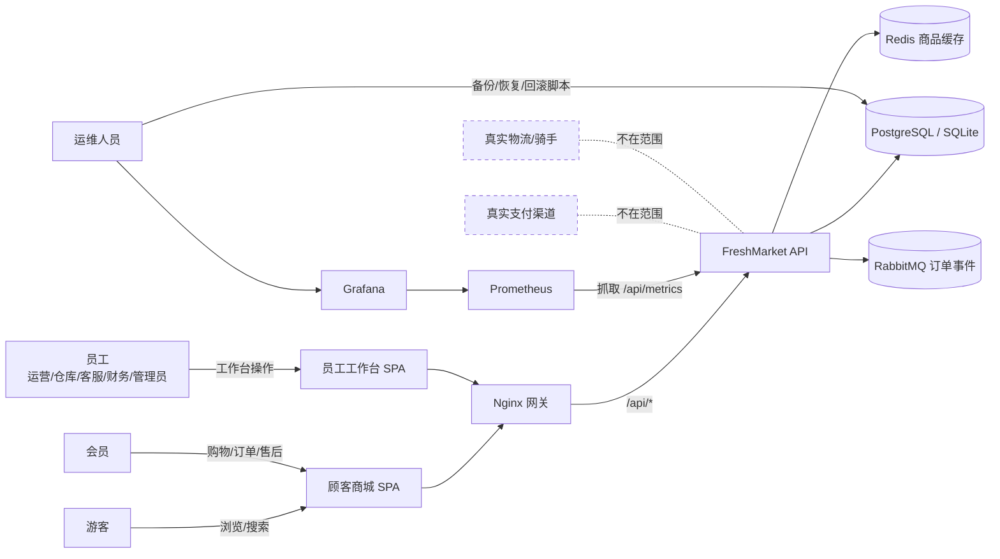
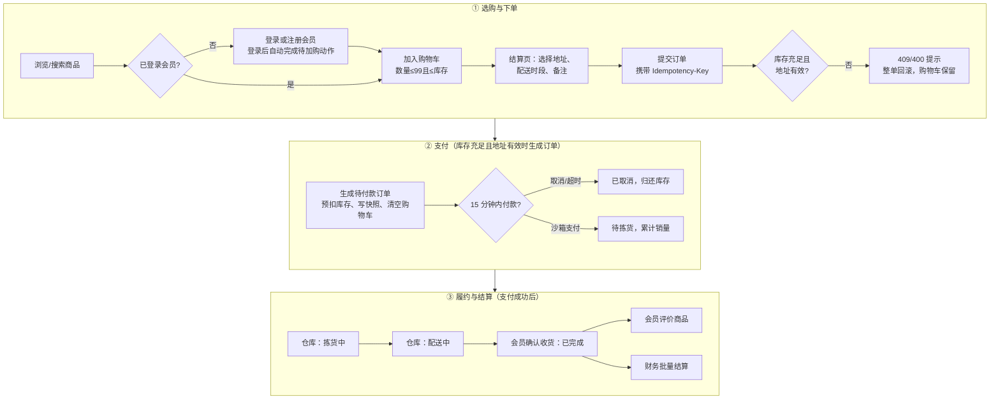
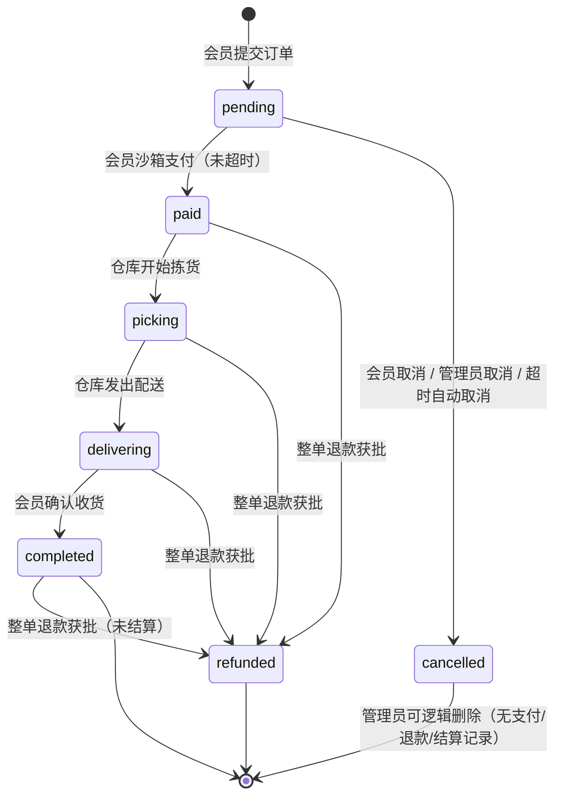
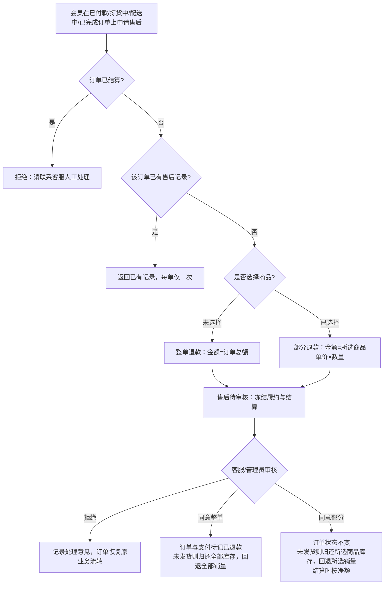
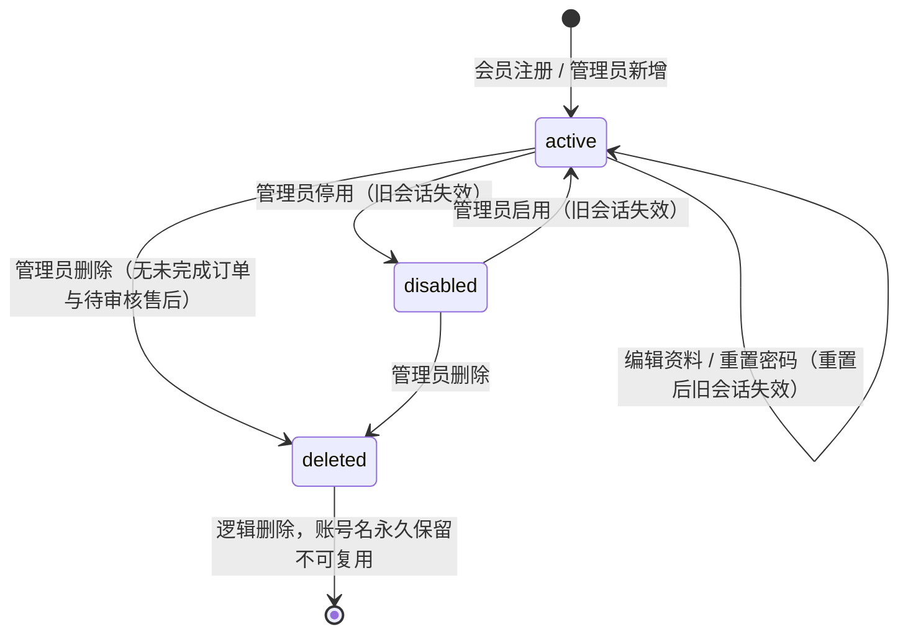

# 鲜境 FreshMarket 生鲜电商平台 软件需求规格说明书

> 2026-10-20 增量：当前实现为 `725696a` 及本轮工作区修改。[维护记录](maintenance-2026-10-20.md)提供当前缺陷状态和验证边界。以下文档控制及原章节保留 **2026-10-18 / bb1bde2 基线**，不将旧验收结果套用于新增功能。

## 当前新增需求与验收

- FR-PROM-COUPON：会员限领一次，发放不超总量；结算由服务端试算，单笔订单使用一张券，优惠分摊合计与整单一致。取消、整单退款退券，部分退款不能超过该商品实付。运营/管理员可维护规则，领取后规则受限。验收对应 `api/test/features.test.ts` 的优惠券、并发领取和退款场景。
- FR-PROM-SECKILL：活动时间、活动名额和实际库存均须校验，每会员每活动限一件；取消和超时取消释放名额，已付款退款不释放；秒杀订单不可叠加优惠券。Redis 故障可回落数据库，不能依赖 Redis 判断是否成交。验收对应 `features.test.ts` 的秒杀并发、时间窗与管理场景。
- FR-SEARCH-REC：输入联想最多八项，热搜忽略翻页和后台查询；详情推荐共同购买与同类补足，会员推荐结合购买/购物车品类，匿名用户返回热销。验收对应 `features.test.ts` 搜索及推荐场景。
- NFR-MSG-RECOVERY：消息通道故障、消费者取消和初始化失败须允许重新连接；不可路由、确认超时与连接中断不能把未可靠发布的事件标为 sent，已配置 MQ 时不能静默切换为本地消费。验收对应 `api/test/runtime.test.ts`，真实中间件故障恢复仍须独立部署验收。
- NFR-OBS-DEPENDENCY：指标采集成功不能代表数据库健康；配置后的依赖就绪和 Outbox 最旧积压须独立输出并提供告警规则，SQL span 不记录参数。自动验收对应 `runtime.test.ts` 和 `features.test.ts`；外部通知端到端交付尚待配置验证。
- NFR-OPS-RESTORE：停止服务、恢复数据库、清缓存或启动服务失败时须报告失败；前置失败后不可继续启动 API。用 `scripts/test-restore.ps1` 验证五条控制流，真实恢复后的健康和订单比对仍为部署验收项。

## 2026-10-18 需求基线（历史）

## 文档控制

| 项目 | 内容 |
| --- | --- |
| 文档编号 | FM-SRS-001 |
| 文档名称 | 鲜境 FreshMarket 生鲜电商平台 软件需求规格说明书 |
| 版本 | 2.0 |
| 日期 | 2026-10-18 |
| 状态 | 正式稿 |
| 适用版本 | Git commit bb1bde2（main 分支） |
| 编制 | FreshMarket 项目组 |
| 审核 | ________ |
| 批准 | ________ |
| 关联文档 | FM-SDD-001 系统设计说明书；FM-STR-001 测试报告 |

修订记录：

| 版本 | 日期 | 修订人 | 修订内容 |
| --- | --- | --- | --- |
| 2.0 | 2026-10-18 | FreshMarket 项目组 | 全面重写：依据 commit bb1bde2 的源代码、数据库脚本与本轮实测结果重新梳理全部业务、权限、数据与非功能需求，补充需求追踪矩阵与待决问题 |

分发范围：项目组成员、课程评审人员、部署与运维人员。

## 1. 引言

### 1.1 编写目的

本文档以可验证的方式定义鲜境 FreshMarket 生鲜电商平台（以下简称“本系统”）应提供的业务功能、角色权限、数据要求、外部接口和质量属性，作为系统设计（FM-SRS-001 → FM-SDD-001）、测试验收（FM-STR-001）和后续变更评审的共同基线。

本文档中的每一条需求均可在当前代码中找到实现位置或明确标注为“不在范围”“未满足”，不包含设想中但未实现的功能。

### 1.2 适用范围

本系统由三部分组成：

- 顾客商城：面向会员与游客的响应式 Web 商城，覆盖浏览、搜索、购物车、地址、下单、沙箱支付、订单跟踪、确认收货、售后与评价。
- 员工工作台：面向运营、仓库、客服、财务和管理员的独立后台，覆盖经营概览、商品与库存、订单履约与维护、售后审核、财务结算、账号管理和审计查询。
- 服务端与基础设施：Fastify API、PostgreSQL / SQLite 数据存储、Redis 商品缓存、RabbitMQ 事件投递、Nginx 网关以及 Prometheus / Grafana 监控。

支付与配送均为实验沙箱：系统不对接任何真实支付渠道、物流或骑手服务。

### 1.3 预期读者

| 读者 | 关注章节 |
| --- | --- |
| 产品与业务负责人 | 第 2、3、4 章 |
| 开发人员 | 第 4、5、6、7 章 |
| 测试人员 | 第 4 章验收准则、第 8 章、第 9 章 |
| 运维与安全人员 | 第 7、8、10 章 |
| 评审与验收人员 | 全文 |

### 1.4 术语与缩略语

| 术语 | 说明 |
| --- | --- |
| 会员 | 通过商城注册或由管理员创建、角色为 member 的顾客账号 |
| 员工 | 角色为 operator、warehouse、support、finance、admin 之一的工作台账号 |
| 能力（Capability） | 服务端授权的最小单位，例如 products、orders.manage，定义于 api/src/core/security.ts |
| 分 | 金额最小单位。系统中所有金额字段均为整数“分”，1 元 = 100 分 |
| 沙箱支付 | 不发生真实扣款的模拟支付，仅在数据库中记录支付成功 |
| 幂等键（Idempotency-Key） | 客户端为一次下单生成的唯一请求标识，用于防止重复下单 |
| 预扣库存 | 下单时即扣减可售库存，取消或超时后归还 |
| 快照 | 下单时复制的商品名称、图片、规格、单价与收货信息，不随后续修改变化 |
| 逻辑删除 | 通过 deleted_at 字段标记删除，保留历史关联，不物理删除数据行 |
| 会话版本 | users.session_version，账号安全属性变化时递增，使旧令牌失效 |
| Outbox | 与业务数据同事务写入的待发事件表，由后台任务投递 |
| RBAC | Role-Based Access Control，基于角色的访问控制 |
| JWT | JSON Web Token，本系统的登录令牌 |
| SPA | Single Page Application，单页应用 |
| MoSCoW | 需求优先级：Must（必须）、Should（应当）、Could（可以）、Won't（本期不做） |
| traceId | 每个请求的唯一追踪号，出现在响应体与 x-trace-id 响应头中 |

### 1.5 参考资料

| 编号 | 资料 |
| --- | --- |
| R1 | GB/T 9385—2008《计算机软件需求规格说明规范》 |
| R2 | ISO/IEC/IEEE 29148:2018 Systems and software engineering — Life cycle processes — Requirements engineering |
| R3 | GB/T 25000.10—2016《系统与软件质量要求和评价（SQuaRE）第10部分：系统与软件质量模型》 |
| R4 | 《中华人民共和国个人信息保护法》（2021） |
| R5 | 源代码：api/src、web/src、database/schema.sql、database/seed.sql、infra/、compose.yaml（commit bb1bde2） |
| R6 | 自动化测试：api/test/system.test.ts、api/test/search-highlight.test.ts、e2e/shopping.spec.ts |
| R7 | FM-SDD-001 系统设计说明书；FM-STR-001 测试报告（含缺陷编号 DEF-01 至 DEF-11 及后续编号） |

## 2. 总体描述

### 2.1 产品愿景

为城市家庭和上班族提供“选得清楚、买得放心、送得准时”的生鲜到家购物体验：商品规格、产地、储存方式和库存一目了然；下单、付款、配送和售后状态可追踪；企业内部按岗位分工处理商品、库存、履约、售后和结算，每一项敏感操作都有审计记录。

### 2.2 业务目标与成功度量

| 编号 | 业务目标 | 成功度量 |
| --- | --- | --- |
| BG-01 | 顾客能独立完成从浏览到评价的完整购物闭环 | 端到端测试覆盖“注册→加购→下单→支付→履约→收货→评价→结算”且全部通过 |
| BG-02 | 杜绝超卖、重复下单与重复扣款 | 并发争抢、重复提交与重复支付测试中，库存不出现负数，订单与支付记录均唯一 |
| BG-03 | 岗位职责隔离，避免越权操作 | 所有越权调用返回 403/404；员工账号无法下单，会员账号无法访问工作台接口 |
| BG-04 | 售后与财务账目一致 | 退款审核中的订单不可履约和结算；结算只按净额入账且不重复结算 |
| BG-05 | 系统可一键部署、可观测、可恢复 | Docker Compose 一次启动全部组件并通过健康检查；具备指标、告警、备份、恢复与回滚手段 |

### 2.3 系统上下文

### 2.4 用户类别与特征

| 用户类别 | 账号类型 | 特征与诉求 | 使用频率 |
| --- | --- | --- | --- |
| 游客 | 无 | 浏览商品、搜索、查看详情；加购时被引导登录或注册 | 高 |
| 会员 | member | 管理购物车与收货地址，下单支付，跟踪订单，申请售后，发表评价，查看订单消息 | 高 |
| 运营（operator） | staff | 维护商品资料、价格、上下架，查看订单和经营概览 | 中 |
| 仓库（warehouse） | staff | 采购入库与损耗登记（库存调整），订单拣货与配送 | 高 |
| 客服（support） | staff | 查看订单，审核整单/部分退款申请 | 中 |
| 财务（finance） | staff | 对已完成订单执行批量结算，查看经营概览 | 低 |
| 管理员（admin） | staff | 拥有全部后台能力，负责账号管理、删除错误数据、维护订单配送信息与审计 | 中 |
| 运维人员 | 无（基础设施权限） | 部署、监控、备份恢复与回滚 | 低 |

### 2.5 运行环境

| 类别 | 要求 |
| --- | --- |
| 服务端运行时 | Node.js 24 及以上（本地开发模式依赖 Node 内置 node:sqlite） |
| 本地开发数据库 | SQLite 文件库，默认 api/.runtime/freshmarket.sqlite，重启后数据保留 |
| 生产/完整部署数据库 | PostgreSQL 17 |
| 可选中间件 | Redis 7.4（商品查询缓存），RabbitMQ 4.3（订单事件投递） |
| 网关 | Nginx 1.28（静态资源、SPA 路由、API 反向代理、登录限流、安全响应头） |
| 监控 | Prometheus 3.13、Grafana 13.2 |
| 部署方式 | npm workspaces 本地开发；Docker Compose 完整部署（7 个服务） |
| 客户端 | 现代桌面与移动浏览器（Chromium 内核 / Edge 已验证），桌面 1440px 与手机 390px 宽度 |

### 2.6 设计与实现约束

- C-01：金额一律使用整数“分”存储和计算，不使用浮点数。
- C-02：时间戳一律使用 Unix 毫秒（BIGINT）。
- C-03：同一套 SQL 与业务代码必须同时运行在 SQLite 与 PostgreSQL 上，并返回一致的数据与数据类型。
- C-04：数据库结构由 database/schema.sql 定义，服务启动时自动执行，并以幂等方式为旧库补齐新增字段。
- C-05：前后端分离，前端只通过 /api 下的 JSON 接口访问数据。
- C-06：生产模式（NODE_ENV=production）必须配置至少 32 位且非默认的 JWT_SECRET、PostgreSQL 连接串；启用演示数据时还必须配置至少 12 位且非默认的 DEMO_PASSWORD，否则服务拒绝启动。
- C-07：支付与配送仅为沙箱流程，界面须明确提示“不会扣除真实资金”“未接入真实配送服务”。

### 2.7 假设与依赖

- A-01：单个 API 实例部署。应用内限流计数为进程内存级别，多实例部署需另行设计共享限流。
- A-02：Redis、RabbitMQ 为可选依赖。未配置时系统以“数据库回源”和“进程内持久化 Outbox 消费”方式运行。
- A-03：演示环境默认开启演示数据（SEED_DEMO 未设置为 false），首次启动写入 6 个分类、48 款商品、6 个角色演示账号和 1 个演示收货地址。
- A-04：浏览器支持 sessionStorage 与 localStorage。
- A-05：配送时段为固定 4 档文本，不依赖真实运力排班。

### 2.8 不在范围

| 编号 | 内容 | 说明 |
| --- | --- | --- |
| OOS-01 | 真实支付、退款资金通道 | 仅沙箱支付记录；退款审批只更新状态，不发生资金流转 |
| OOS-02 | 真实物流、骑手调度、地图定位、配送范围校验 | 履约仅为状态流转；顶部配送区域仅为展示与偏好 |
| OOS-03 | 优惠券、满减（除免配送费规则外）、积分、会员等级 | 未实现 |
| OOS-04 | 多商户、佣金、税费、发票 | 未实现 |
| OOS-05 | 第三方登录、短信验证码、找回密码、刷新令牌 | 未实现；密码重置仅由管理员在工作台执行 |
| OOS-06 | 商品批次、保质期、溯源管理 | 未实现 |
| OOS-07 | 多实例高可用、异地灾备 | 本期仅单实例部署与备份恢复脚本 |
| OOS-08 | 已结算订单的售后 | 系统拒绝申请，提示联系客服人工处理 |

## 3. 业务流程

### 3.1 用例总览

### 3.2 购物到结算主流程

### 3.3 订单状态

状态名称对照：pending 待付款、paid 待拣货、picking 拣货中、delivering 配送中、completed 已完成、cancelled 已取消、refunded 已退款。部分退款获批后订单保持原状态。存在待审核售后时，订单不得进行拣货、配送、确认收货、配送信息修改与结算。

### 3.4 售后流程

### 3.5 账号管理流程

## 4. 功能需求

优先级说明：M = Must（必须），S = Should（应当），C = Could（可以）。除特别说明外，接口错误均以统一响应结构返回中文提示信息与 traceId。

### 4.1 会员账号与认证（FR-ACC）

| 编号 | 需求 | 业务规则与约束 | 优先级 | 验收准则 |
| --- | --- | --- | --- | --- |
| FR-ACC-01 | 会员自助注册 | 账号 3–60 位，仅限字母、数字、下划线、@、点；密码 10–128 位且同时含字母与数字；昵称 1–40 字且不可为空白；注册身份固定为会员，请求体中的其他字段（如 role）被拒绝；账号名全局唯一（含已删除账号） | M | 合法注册返回会员身份与登录令牌；携带 role 字段返回 400；重复账号返回 409 USERNAME_EXISTS |
| FR-ACC-02 | 会员登录 | 仅会员可从商城入口登录；账号不存在与密码错误返回同一提示“账号或密码错误”；停用账号返回 403 ACCOUNT_DISABLED；员工账号返回 403 ACCOUNT_TYPE_MISMATCH 并提示使用员工入口 | M | 正确凭据返回令牌；错误凭据 401；员工账号登录商城被拒绝 |
| FR-ACC-03 | 员工登录 | 员工从 /admin/login 独立入口登录；会员账号被拒绝并提示使用商城入口；规则同 FR-ACC-02 | M | 员工登录成功进入工作台；会员账号登录工作台返回 403 |
| FR-ACC-04 | 登录令牌与有效期 | 令牌有效期 2 小时；令牌包含账号 ID、账号类型（会员/员工）和会话版本；角色与能力不写入令牌而在每次请求时从数据库读取 | M | 角色被撤销后，旧令牌立即失去对应能力 |
| FR-ACC-05 | 会话即时失效 | 每次请求校验：账号存在且未删除、处于启用状态、会话版本一致、账号类型与令牌一致；重置密码、停用/启用、删除账号使会话版本递增 | M | 上述任一变更后旧令牌返回 401，前端清除对应会话并提示重新登录 |
| FR-ACC-06 | 会员与员工会话隔离 | 浏览器分别保存会员与员工会话，可在同一浏览器中同时登录、分别退出；任一入口的 401 只清除该入口的会话；升级前的共用会话自动失效 | M | 同时登录会员与员工后退出其一，另一会话不受影响 |
| FR-ACC-07 | 当前身份查询 | 会员 GET /api/auth/me，员工 GET /api/admin/auth/me；返回账号、姓名、角色、账号类型与能力列表，不含密码哈希 | M | 页面刷新后自动恢复登录状态；类型不符时清除会话 |
| FR-ACC-08 | 登录防暴力尝试 | 注册每客户端每分钟最多 8 次，登录每客户端每分钟最多 10 次，超限返回 429 RATE_LIMITED；网关对登录/注册另行限制每客户端 5 次/分钟（突发 10 次） | M | 连续错误登录超过阈值返回 429 且提示统一 |
| FR-ACC-09 | 登录后续接动作 | 游客点击加购被引导登录，登录成功后自动完成原加购动作 | S | 未登录加购→登录→购物车出现该商品 |

### 4.2 商品目录、搜索与推荐（FR-CAT）

| 编号 | 需求 | 业务规则与约束 | 优先级 | 验收准则 |
| --- | --- | --- | --- | --- |
| FR-CAT-01 | 商品分类 | 6 个固定分类按“时令水果、海鲜水产、肉禽蛋品、新鲜蔬菜、乳品烘焙、方便速食”顺序展示；顶部主导航与图标分类栏共用 URL 参数 category，选中高亮同步 | M | 点击任一分类入口，两处高亮一致，列表只含该分类商品 |
| FR-CAT-02 | 商品列表与分页 | 商城只展示已上架且未删除商品；每页默认 12 条，pageSize 范围 1–100，page ≥1；越界参数返回 400 | M | 分页总数正确；pageSize=101 返回 400 |
| FR-CAT-03 | 排序 | 排序仅允许 default（综合推荐）、priceAsc、priceDesc、sales（人气优选）；其他值返回 400；同值按商品 ID 稳定排序 | M | 非法 sort 返回 400；价格排序结果单调 |
| FR-CAT-04 | 综合推荐 | 综合推荐得分 = 销量×0.5 + 浏览量×0.3 + 新品权重×0.2，上架 30 天内的商品新品权重为 1，否则为 0；不得退化为按上架时间排序 | M | 高销量、高浏览量商品排在新上架低热度商品之前 |
| FR-CAT-05 | 模糊搜索 | 关键词最长 80 字；忽略大小写与全/半角差异；在商品名称、产地、副标题中匹配（名称权重高于产地，产地高于副标题）；空格分隔的多个关键词必须全部命中；整个查询最多一处放宽匹配 | M | “草莓 丹东”只返回同时命中的商品；关键词中的 % 与 _ 按字面处理 |
| FR-CAT-06 | 错字与字面重合容错 | 3 个字符及以上、仅由字母数字组成的关键词允许与商品名称存在一处替换、增字、漏字或相邻字颠倒；单个中文关键词为两字时允许名称命中其中一字，更长时需命中至少 75% 的不同汉字；字面重合类结果最多补充 6 款；不使用同义词表或商品专用映射 | M | 单处错字可搜到目标商品；重合不足的关键词不返回结果；弱匹配不超过 6 款 |
| FR-CAT-07 | 搜索排序与过滤 | 准确匹配优先，其次错字匹配，最后字面重合；综合推荐排序下按相关度排序，显式选择价格或销量排序时按所选业务排序；分类、上下架过滤与分页在搜索时继续生效，分页前完成全部匹配 | M | 搜索结果总数覆盖全部相关商品，翻页无遗漏 |
| FR-CAT-08 | 搜索结果高亮 | 商品名称、副标题、产地中与关键词相同的文字以红色显示；中文逐字匹配，非中文按连续片段字面匹配，正则与 HTML 字符按普通文本处理；清空搜索后恢复普通文字 | S | 搜索“草莓”时卡片中“草莓”二字标红，原文不被改写 |
| FR-CAT-09 | 商品卡片 | 展示图片、标签、名称、副标题、规格、产地、售价与划线原价、库存“库存 N 件”；库存低于 20 件追加“库存紧张”，为 0 时显示“暂时售罄”且不可加购；已在购物车的商品显示数量增减器 | M | 库存 0 的商品加购按钮不可用 |
| FR-CAT-10 | 商品详情 | 仅已上架且未删除商品可查看，否则返回 404；展示规格、产地、储存方式、剩余库存、销量、描述与最近 30 条评价（评价人姓名仅显示首字）；每次访问浏览量加 1 | M | 下架商品详情返回 404；访问后浏览量递增 |
| FR-CAT-11 | 首页轮播与导购 | 首页左上方轮播 4 张分类导购图，每 5 秒自动切换；鼠标悬停、键盘聚焦、页面不可见或系统开启“减少动态效果”时暂停；支持左右箭头按钮、圆点和键盘方向键 | C | 悬停时不自动切换；点击导购按钮进入对应分类 |
| FR-CAT-12 | 商品查询缓存 | 配置 Redis 时商品列表缓存 30 秒；商品、库存、订单相关变更后缓存版本递增，使旧缓存立即失效；Redis 不可用时回源数据库，不影响业务 | S | 调整库存后再次查询返回新库存 |

### 4.3 购物车（FR-CART）

| 编号 | 需求 | 业务规则与约束 | 优先级 | 验收准则 |
| --- | --- | --- | --- | --- |
| FR-CART-01 | 加入购物车 | 仅会员可用；商品须已上架未删除；单品数量 1–99 且累计数量不超过当前库存，否则返回 409 OUT_OF_STOCK | M | 超库存加购返回 409 |
| FR-CART-02 | 修改与移除 | 数量 0–99，设置为 0 即移除该商品 | M | 数量改为 0 后购物车不再包含该商品 |
| FR-CART-03 | 金额计算 | 单价取服务端当前售价；商品小计 ≥ 9900 分（99 元）免配送费，否则配送费 600 分（6 元），空购物车配送费为 0；返回件数、小计、配送费、合计 | M | 小计 98.99 元时配送费 6 元；99 元时为 0 |
| FR-CART-04 | 购物车抽屉 | 顶部购物车显示件数徽标，抽屉内可调整数量、移除、查看距免配送费差额并进入结算 | S | 差额提示随数量实时变化 |
| FR-CART-05 | 员工不可购物 | 员工令牌调用购物车接口返回 403 MEMBER_ONLY，即使存在历史购物车数据 | M | 员工调用 GET/POST /api/cart 均返回 403 |

### 4.4 收货地址与配送区域（FR-ADDR）

| 编号 | 需求 | 业务规则与约束 | 优先级 | 验收准则 |
| --- | --- | --- | --- | --- |
| FR-ADDR-01 | 新增地址 | 收货人 1–40 字；手机号须匹配 1[3-9] 开头的 11 位号码；详细地址 8–200 字；每位会员最多 20 个地址 | M | 第 21 个地址返回 400 ADDRESS_LIMIT；非法手机号返回 400 |
| FR-ADDR-02 | 默认地址 | 首个地址自动设为默认；设置新默认地址时取消其他默认标记；列表默认地址排在最前 | M | 任一时刻最多一个默认地址 |
| FR-ADDR-03 | 编辑与删除 | 只能编辑、删除本人地址；编辑他人地址返回 404 | M | 越权修改返回 404 |
| FR-ADDR-04 | 地址展示脱敏 | 地址卡片中的手机号显示为 138****8000 形式 | S | 页面不展示完整手机号 |
| FR-ADDR-05 | 顶部配送区域选择 | 顶部地址选择器可展开选择 5 个预置配送区域，登录后还列出本人收货地址；选择结果写入全局状态并在浏览器本地持久化；结算页优先选中该地址，其次默认地址，再次第一个地址；点击外部或按 Esc 关闭菜单 | S | 选择后标签立即更新，刷新页面后保留 |

### 4.5 下单、支付与订单（FR-ORD）

| 编号 | 需求 | 业务规则与约束 | 优先级 | 验收准则 |
| --- | --- | --- | --- | --- |
| FR-ORD-01 | 提交订单 | 仅会员可下单（服务端在事务内复核会员身份与启用状态）；必须携带 8–100 位 Idempotency-Key 请求头；地址必须属于本人；购物车不能为空；配送时段限“尽快送达、今日 18:00–20:00、明日 09:00–12:00、明日 14:00–18:00”；备注最长 200 字 | M | 员工下单 403；缺少幂等键 400；空购物车 400 CART_EMPTY |
| FR-ORD-02 | 幂等下单 | 同一会员同一幂等键且请求内容相同，返回同一订单且不重复扣库存；同一幂等键用于不同请求内容返回 409 IDEMPOTENCY_CONFLICT；前端在地址、时段或备注变化时重新生成幂等键 | M | 8 次并发重复提交只生成 1 个订单 |
| FR-ORD-03 | 防超卖与整单回滚 | 按商品逐一条件扣减库存（库存 ≥ 购买量且商品上架未删除）；任一商品失败则整单回滚，库存、购物车、订单均保持提交前状态，返回 409 OUT_OF_STOCK 并指出商品名 | M | 两个会员争抢最后 3 件，仅 1 单成功且库存为 0 |
| FR-ORD-04 | 订单快照 | 订单保存商品名称、图片、规格、成交单价、数量以及收货人、电话、地址快照；之后修改商品价格或地址不影响已有订单 | M | 修改商品售价后历史订单金额不变 |
| FR-ORD-05 | 订单金额 | 订单金额由服务端计算：小计 + 配送费（规则同 FR-CART-03）；订单号格式为 FM + 时间戳 + 8 位随机串 | M | 订单金额与购物车结算金额一致 |
| FR-ORD-06 | 付款时限 | 订单创建后 15 分钟（可由 ORDER_TTL_MINUTES 配置）内须完成付款；前端显示倒计时；后台任务每 2 秒扫描超时订单并自动取消、归还库存 | M | 超时后支付返回 409 ORDER_EXPIRED，库存只归还一次 |
| FR-ORD-07 | 沙箱支付 | 仅本人待付款订单可付款；金额取订单快照，客户端不可提交金额；一笔订单只记一笔支付，重复支付请求返回原结果且销量只累加一次；付款后状态变为待拣货 | M | 6 次重复支付只产生 1 条支付记录 |
| FR-ORD-08 | 会员取消订单 | 仅待付款订单可取消，取消后归还全部库存；重复取消不重复归还；支付与取消并发时只有一个生效 | M | 付款与取消并发，结果状态唯一且库存一致 |
| FR-ORD-09 | 确认收货 | 仅本人配送中订单可确认收货，状态变为已完成；存在待审核售后时不可收货 | M | 非配送中订单确认收货返回 409 |
| FR-ORD-10 | 我的订单 | 会员按状态（全部、待付款、待拣货、拣货中、配送中、已完成、已退款、已取消）筛选，每页 10 条；页面每 15 秒自动刷新；订单卡片展示商品、金额、配送信息、售后进度与可执行操作 | M | 只能看到本人订单；访问他人订单返回 404 |
| FR-ORD-11 | 数据隔离 | 读取、付款、取消、收货、售后、评价他人订单一律返回 404 ORDER_NOT_FOUND，不泄露订单是否存在 | M | 越权测试全部返回 404 |

### 4.6 售后退款（FR-AFS）

| 编号 | 需求 | 业务规则与约束 | 优先级 | 验收准则 |
| --- | --- | --- | --- | --- |
| FR-AFS-01 | 申请售后 | 仅本人待拣货、拣货中、配送中、已完成且未结算的订单可申请；原因 5–300 字；每个订单只能有一条售后记录（含已拒绝），重复申请返回已有记录 | M | 已结算订单申请返回 409 ALREADY_SETTLED |
| FR-AFS-02 | 整单退款 | 不选择商品时为整单退款，金额等于订单总额（含配送费） | M | 退款金额 = 订单总额 |
| FR-AFS-03 | 部分退款 | 可勾选订单中的商品并选择退款数量（1 至购买数量，最多 50 行），金额 = 所选商品成交单价 × 数量；退款商品必须属于该订单 | M | 超过购买数量返回 400 INVALID_REFUND_QUANTITY |
| FR-AFS-04 | 指定金额退款（接口能力） | 接口允许不选商品而指定 1 分至订单总额的退款金额；该方式审批后不调整库存与销量。商城界面不提供此入口 | C | 金额越界返回 400 |
| FR-AFS-05 | 审核冻结 | 售后待审核期间，订单不可拣货、配送、确认收货、修改配送信息，也不参与结算 | M | 待审核时仓库推进状态返回 409 REFUND_PENDING |
| FR-AFS-06 | 售后审核 | 客服或管理员审核，必须填写 1–200 字的处理意见；已处理的申请不可再改判，重复提交相同结论视为成功；订单已结算时不可同意 | M | 审核后状态为已通过或已拒绝，处理意见可见 |
| FR-AFS-07 | 同意后的库存与销量 | 整单同意：订单与支付标记为已退款，回退全部销量；订单处于待拣货或拣货中时归还全部库存，配送中或已完成的生鲜不重新入库。部分同意：订单状态不变，回退所选商品销量；订单未发货时只归还所选商品库存 | M | 已配送订单退款后库存不变；未发货部分退款只归还所选商品 |
| FR-AFS-08 | 售后展示 | 会员订单卡片显示售后状态、退款金额、原因与处理意见；售后弹窗显示整单/部分标识与自动计算的退款金额，校验提示以输入框下方文字显示 | S | 弹窗输入框可连续输入，不丢失焦点 |

### 4.7 商品评价（FR-REV）

| 编号 | 需求 | 业务规则与约束 | 优先级 | 验收准则 |
| --- | --- | --- | --- | --- |
| FR-REV-01 | 发表评价 | 仅本人已完成订单中的商品可评价；评分 1–5 星；内容 3–500 字；同一订单同一商品只能评价一次 | M | 未收货评价返回 409；重复评价返回 409 ALREADY_REVIEWED；非订单商品返回 400 |
| FR-REV-02 | 评价展示 | 商品详情展示最近 30 条评价，评价人姓名只显示首字加 ** | M | 详情页评价按时间倒序 |
| FR-REV-03 | 评价入口 | 订单全部商品评价完成后显示“已评价”，否则显示“评价商品”并只列出未评价商品 | S | 已评价商品不再出现在下拉列表 |

### 4.8 消息通知（FR-NTF）

| 编号 | 需求 | 业务规则与约束 | 优先级 | 验收准则 |
| --- | --- | --- | --- | --- |
| FR-NTF-01 | 订单事件消息 | 订单提交、付款、取消、拣货、配送、完成、整单退款时生成会员消息（如“付款成功”“商品配送中”）；部分退款以“订单更新”标题通知 | M | 每个事件对应一条消息 |
| FR-NTF-02 | 至少一次投递且不重复 | 事件与业务数据在同一事务写入 Outbox；投递失败自动重试；同一事件重复投递只生成一条消息 | M | 重复消费同一事件，消息数量不变 |
| FR-NTF-03 | 消息查看 | 会员在“我的鲜境”查看最近 30 条订单消息，可手动刷新 | M | 消息按时间倒序 |

### 4.9 员工工作台 — 经营概览（FR-ADM-DASH）

| 编号 | 需求 | 业务规则与约束 | 优先级 | 验收准则 |
| --- | --- | --- | --- | --- |
| FR-ADM-DASH-01 | 经营指标 | 展示累计有效销售额（待拣货、拣货中、配送中、已完成订单金额之和）、累计订单数、会员数、待审核售后数；均排除已删除数据 | M | 零订单时显示真实的 0 值 |
| FR-ADM-DASH-02 | 待办与预警 | 展示待拣货订单数、售后待审核数、库存预警商品（已上架且库存低于 20 件，最多 8 款）、待发送订单消息数 | M | 库存调至 20 以下后出现在预警列表 |
| FR-ADM-DASH-03 | 近 7 日成交趋势 | 按自然日统计近 7 日沙箱支付成功的笔数与金额，以折线图展示；无成交时提示空状态 | S | 图表日期为最近 7 天 |
| FR-ADM-DASH-04 | 服务状态 | 展示业务接口、数据库类型、商品缓存、订单消息队列的实际连接状态 | S | Redis 断开时显示 degraded |
| FR-ADM-DASH-05 | 数据类型一致 | 概览接口在 SQLite 与 PostgreSQL 上返回的计数与金额均为数值类型，零订单时待拣货数为 0 而非空值 | M | 两种数据库的接口响应结构与类型一致（当前未满足，见 DEF-01） |

### 4.10 员工工作台 — 商品管理（FR-ADM-PRD）

| 编号 | 需求 | 业务规则与约束 | 优先级 | 验收准则 |
| --- | --- | --- | --- | --- |
| FR-ADM-PRD-01 | 商品查询 | 具备 catalog.read 能力的员工可按名称/产地关键词（与商城相同的模糊搜索）、分类、上下架状态查询商品，含已下架商品；未搜索时按上架时间倒序；可查看商品详情 | M | 已删除商品不出现在列表中 |
| FR-ADM-PRD-02 | 新增商品 | 必填分类、名称（≤80）、副标题（≤120）、描述（≤3000）、售价与原价（1–10,000,000 分）、图片（须为 /images/ 下的 .jpg 路径）、规格（≤80）、产地（≤80）、储存方式（≤100）、标签（≤30）、上下架状态；分类必须存在；新商品初始库存为 0，需通过库存调整入库 | M | 不存在的分类返回 400 INVALID_CATEGORY |
| FR-ADM-PRD-03 | 编辑与上下架 | 运营与管理员可编辑全部资料并切换上下架；下架商品立即从商城列表与详情消失 | M | 下架后商城详情返回 404 |
| FR-ADM-PRD-04 | 删除商品 | 仅管理员（products.delete）可删除；删除为逻辑删除，同时下架并从所有会员购物车移除；历史订单、售后明细保留；重启后演示数据不会重新创建已删除商品 | M | 运营删除返回 403；删除后商城、后台列表与购物车均不再出现 |
| FR-ADM-PRD-05 | 操作审计 | 新增、编辑、删除商品均写入审计日志，记录名称、价格、状态 | M | 审计日志可查询到 product.create/update/delete |

### 4.11 员工工作台 — 库存管理（FR-ADM-STK）

| 编号 | 需求 | 业务规则与约束 | 优先级 | 验收准则 |
| --- | --- | --- | --- | --- |
| FR-ADM-STK-01 | 库存调整 | 仓库与管理员可对商品执行入库（正数）或损耗/出库（负数），单次调整量 -100,000 至 100,000 且不为 0，必须填写 1–200 字原因 | M | 调整量为 0 或原因为空返回 400 |
| FR-ADM-STK-02 | 库存非负 | 调整后库存不得小于 0，否则整笔拒绝并返回 409 INVALID_STOCK | M | 库存 5 时调整 -6 返回 409 |
| FR-ADM-STK-03 | 库存审计 | 每次调整记录调整量、原因、操作人与 traceId | M | 审计日志存在 stock.adjust 记录 |

### 4.12 员工工作台 — 订单履约与维护（FR-ADM-ORD）

| 编号 | 需求 | 业务规则与约束 | 优先级 | 验收准则 |
| --- | --- | --- | --- | --- |
| FR-ADM-ORD-01 | 订单查询 | 运营、仓库、客服、管理员可按订单号或收货人关键词、订单状态查询全部订单并查看详情；员工看到的收货手机号一律脱敏 | M | 员工接口响应中不出现完整手机号与原始地址快照字段 |
| FR-ADM-ORD-02 | 履约状态推进 | 仓库与管理员按“待拣货→拣货中→配送中”顺序推进，不可跳级或回退；存在待审核售后时拒绝 | M | 待付款订单直接设为配送中返回 409 |
| FR-ADM-ORD-03 | 修改配送信息 | 仅管理员（orders.manage）可修改待付款或待拣货、且无待审核售后订单的收货人、手机号、详细地址（≥8 字）、配送时段与备注；手机号留空表示保留原号码；修改只影响订单快照，不影响会员地址簿 | M | 已拣货订单修改返回 409；会员本人仍看到完整的新手机号 |
| FR-ADM-ORD-04 | 后台取消订单 | 仅管理员可取消待付款订单并归还库存，审计记录实际管理员 | M | 非待付款订单取消返回 409 |
| FR-ADM-ORD-05 | 删除错误订单 | 仅管理员（orders.delete）可删除已取消且没有任何支付、退款、结算记录的订单；删除为逻辑删除，删除后会员与后台均不可见，经营概览不再计入 | M | 待付款订单删除返回 409；有支付记录的订单删除返回 409 ORDER_HAS_TRANSACTIONS |

### 4.13 员工工作台 — 售后审核（FR-ADM-AFS）

| 编号 | 需求 | 业务规则与约束 | 优先级 | 验收准则 |
| --- | --- | --- | --- | --- |
| FR-ADM-AFS-01 | 售后列表与详情 | 客服与管理员可按订单号或原因关键词、状态（待审核/已通过/已拒绝）查询售后申请，详情包含订单信息（手机号脱敏）与退款商品明细 | M | 关键词中的 %、_ 按字面匹配 |
| FR-ADM-AFS-02 | 审核操作 | 同意或拒绝须填写处理意见，规则见 FR-AFS-06、FR-AFS-07 | M | 审核结果写入审计 refund.decision |
| FR-ADM-AFS-03 | 记录不可篡改 | 售后记录不提供编辑与删除功能 | M | 不存在售后编辑/删除接口 |

### 4.14 员工工作台 — 财务结算（FR-ADM-SET）

| 编号 | 需求 | 业务规则与约束 | 优先级 | 验收准则 |
| --- | --- | --- | --- | --- |
| FR-ADM-SET-01 | 批量结算 | 财务与管理员一键结算全部已完成订单；跳过已结算、售后待审核的订单；已通过部分退款的订单按“订单总额 − 退款金额”的净额结算；净额 ≤ 0 的订单跳过；返回本批次结算笔数与金额 | M | 重复执行结算不产生重复记录 |
| FR-ADM-SET-02 | 结算查询 | 可按结算单号、订单号或操作人 ID 查询结算记录，并显示筛选范围内的结算总额 | M | 总额与列表金额之和一致 |
| FR-ADM-SET-03 | 结算不可篡改 | 结算记录不提供修改与删除；已结算订单不可再申请或批准售后 | M | 不存在结算编辑/删除接口 |

### 4.15 员工工作台 — 账号管理（FR-ADM-USR）

| 编号 | 需求 | 业务规则与约束 | 优先级 | 验收准则 |
| --- | --- | --- | --- | --- |
| FR-ADM-USR-01 | 分类管理 | 管理员在同一页面分别管理员工账号与会员账号，两类账号不能互相转换；员工仅可在 5 个员工岗位间调整 | M | 把会员改为员工岗位返回 400 ACCOUNT_TYPE_IMMUTABLE |
| FR-ADM-USR-02 | 查询与详情 | 支持按账号或姓名关键词、启停状态查询；员工可再按岗位筛选；详情展示账号、姓名、岗位/身份、状态、创建时间与能力 | M | 筛选结果与条件一致 |
| FR-ADM-USR-03 | 新增账号 | 新增员工须指定岗位；新增会员身份固定；账号、密码、姓名规则同 FR-ACC-01 | M | 新员工可从员工入口登录 |
| FR-ADM-USR-04 | 编辑、重置密码、启停 | 可修改账号名（不得与任何现有或已删除账号重名）、姓名、岗位、启停状态，可选重置密码；重置密码或变更启停状态使旧会话失效 | M | 重置后旧令牌 401，新密码可登录 |
| FR-ADM-USR-05 | 删除账号 | 仅管理员（users.delete）可删除；有待付款/待拣货/拣货中/配送中订单或待审核售后的账号不可删除，提示先处理业务或改为停用；删除为逻辑删除，清空购物车、使会话失效，历史订单、结算操作人与审计保留；账号名不可再次注册 | M | 有未完成订单时删除返回 409 ACCOUNT_IN_USE |
| FR-ADM-USR-06 | 管理员自我保护 | 管理员不能删除、停用或调整自己的岗位；系统必须始终保留至少一名启用的管理员；并发降级或停用管理员时同样保证 | M | 并发降级两名管理员，仍保留一名启用管理员 |
| FR-ADM-USR-07 | 账号审计 | 账号新增、编辑、删除、注册与登录均写入审计日志；审计内容不包含密码或令牌 | M | 审计日志存在 user.create/update/delete、auth.register/login |

### 4.16 员工工作台 — 审计查询（FR-ADM-AUD）

| 编号 | 需求 | 业务规则与约束 | 优先级 | 验收准则 |
| --- | --- | --- | --- | --- |
| FR-ADM-AUD-01 | 审计记录 | 系统对登录、注册、账号、商品、库存、订单（创建/支付/取消/状态推进/配送修改/删除）、售后申请与审核、评价、结算操作记录操作人、事件、业务对象、详情、traceId 与时间 | M | 每类操作至少产生一条对应事件 |
| FR-ADM-AUD-02 | 审计查询 | 仅管理员可按事件、操作人、业务对象或 traceId 关键词查询，按时间倒序分页，可查看详情 | M | 非管理员访问返回 403 |
| FR-ADM-AUD-03 | 审计只读 | 审计记录不提供修改与删除 | M | 不存在审计编辑/删除接口 |

### 4.17 工作台通用要求（FR-ADM-USR 至 FR-ADM-AUD 共用）

- 工作台使用独立布局，左侧菜单只显示当前员工能力范围内的页面；直接访问无权限页面显示“当前账号没有此页面权限”，同时服务端独立校验权限。
- 未登录访问 /admin 下任一页面跳转到员工登录页。
- 后台列表统一分页（默认每页 20 条，1–100），支持关键词搜索与刷新；删除、取消等危险操作须二次确认。

### 4.18 运维接口（FR-OPS）

| 编号 | 需求 | 业务规则与约束 | 优先级 | 验收准则 |
| --- | --- | --- | --- | --- |
| FR-OPS-01 | 健康检查 | GET /api/health 实际查询数据库并报告数据库类型、缓存状态（connected / degraded / local-disabled）、队列状态（connected / degraded / local-outbox）与时间；数据库不可用时失败 | M | Docker 健康检查依赖此接口 |
| FR-OPS-02 | 监控指标 | GET /api/metrics 输出 Prometheus 格式的请求计数、请求耗时直方图（按方法、路由模板、状态码）与进程默认指标；网关对外屏蔽该接口 | M | 外部访问 /api/metrics 返回 404 |
| FR-OPS-03 | 接口文档 | 提供 OpenAPI 文档（/api/openapi.json）与 Swagger UI（/api/docs），包含 Bearer 鉴权定义 | S | 文档列出全部业务接口 |
| FR-OPS-04 | 请求追踪 | 每个请求生成 UUID traceId，写入响应体与 x-trace-id 响应头，并出现在错误日志与审计记录中 | M | 任一响应都带 traceId |
| FR-OPS-05 | 演示数据补充 | 开启演示数据时，启动自动补入缺失的分类与商品，不修改已有商品的价格、库存、上下架状态及订单；数据库中已有账号时不再创建演示账号；SEED_DEMO=false 时不执行 | S | 老库升级后商品数量补齐、原有库存不变 |

## 5. 角色与权限

### 5.1 角色定义

| 角色 | 标识 | 账号类型 | 职责 |
| --- | --- | --- | --- |
| 会员 | member | 会员 | 购物、地址、个人订单、收货、售后申请、评价、消息 |
| 运营 | operator | 员工 | 商品资料维护与上下架、订单查看、经营概览 |
| 仓库 | warehouse | 员工 | 库存调整、订单拣货与配送、订单与商品查看、经营概览 |
| 客服 | support | 员工 | 售后审核、订单查看、经营概览 |
| 财务 | finance | 员工 | 财务结算、经营概览 |
| 管理员 | admin | 员工 | 全部后台能力，含账号管理、删除类操作、订单维护与审计 |

### 5.2 能力定义

| 能力 | 含义 |
| --- | --- |
| dashboard | 经营概览 |
| catalog.read | 查看后台商品列表与详情 |
| products | 新增、编辑、上下架商品 |
| products.delete | 删除商品 |
| stock | 调整库存 |
| orders | 查看全部订单 |
| orders.manage | 修改配送信息、后台取消待付款订单 |
| orders.delete | 删除错误订单 |
| fulfillment | 拣货、配送状态推进 |
| refunds | 售后查询与审核 |
| settlements | 结算查询与批量结算 |
| users | 员工与会员账号的查询、新增、编辑、岗位调整 |
| users.delete | 删除员工与会员账号 |
| audit | 审计日志查询 |

### 5.3 能力矩阵

| 能力 | 运营 | 仓库 | 客服 | 财务 | 管理员 |
| --- | --- | --- | --- | --- | --- |
| dashboard | ✓ | ✓ | ✓ | ✓ | ✓ |
| catalog.read | ✓ | ✓ | — | — | ✓ |
| products | ✓ | — | — | — | ✓ |
| products.delete | — | — | — | — | ✓ |
| stock | — | ✓ | — | — | ✓ |
| orders | ✓ | ✓ | ✓ | — | ✓ |
| orders.manage | — | — | — | — | ✓ |
| orders.delete | — | — | — | — | ✓ |
| fulfillment | — | ✓ | — | — | ✓ |
| refunds | — | — | ✓ | — | ✓ |
| settlements | — | — | — | ✓ | ✓ |
| users | — | — | — | — | ✓ |
| users.delete | — | — | — | — | ✓ |
| audit | — | — | — | — | ✓ |

会员不持有任何后台能力。游客只能访问公开接口：分类、商品列表、商品详情、注册、登录、健康检查。

### 5.4 数据权限

- 会员只能读写本人的购物车、地址、订单、售后、评价与消息；所有会员接口的查询都带有本人归属条件，越权访问统一返回 404。
- 员工查看订单、售后详情时，收货手机号统一脱敏为前 3 位与后 4 位，且不返回原始地址快照字段；会员查看本人订单可见完整信息。
- 员工按能力访问后台接口，能力不足返回 403 FORBIDDEN。

### 5.5 会员与员工隔离

- 会员只能从商城登录入口登录，员工只能从 /admin/login 登录；两类令牌带有账号类型，类型不符的令牌被拒绝。
- 购物车、地址、下单、支付、取消、收货、售后申请、评价、消息接口仅允许会员（403 MEMBER_ONLY）；全部 /api/admin 接口仅允许员工（403 STAFF_ONLY），并继续校验能力。
- 管理员不能把会员改为员工或把员工改为会员。

## 6. 数据需求

### 6.1 业务实体

| 实体 | 说明 | 关键约束 |
| --- | --- | --- |
| 用户 users | 会员与员工共用 | 账号名唯一（含已删除）；启用状态 0/1；会话版本；逻辑删除 |
| 分类 categories | 6 个固定分类 | 主键为分类标识 |
| 商品 products | 售价、原价、库存、销量、浏览量、规格、产地、储存方式、标签、上下架 | 售价 > 0；库存 ≥ 0；逻辑删除 |
| 收货地址 addresses | 会员地址簿 | 每人 ≤ 20 个；最多一个默认 |
| 购物车 cart_items | 会员 × 商品 | 数量 1–99；会员与商品组合唯一 |
| 订单 orders | 金额、状态、地址快照、配送时段、备注、幂等键、过期时间 | 会员 + 幂等键唯一；逻辑删除 |
| 订单明细 order_items | 商品快照与成交单价 | 订单 + 商品唯一 |
| 支付 payments | 沙箱支付记录 | 每订单唯一 |
| 售后 refunds / refund_items | 售后申请与部分退款明细 | 每订单唯一；明细数量 > 0 |
| 评价 reviews | 评分与内容 | 评分 1–5；订单 + 商品 + 会员唯一 |
| 结算 settlements | 结算金额与操作人 | 每订单唯一 |
| 事件 outbox / processed_events | 待发事件与已消费事件 | 事件 ID 唯一，用于去重 |
| 消息 notifications | 会员订单消息 | 归属会员 |
| 审计 audit_logs | 操作审计 | 只增不改 |

### 6.2 数据规则

- DR-01 金额：所有金额字段为整数分；运费规则、退款金额、结算净额均以分计算。
- DR-02 时间：所有时间字段为 Unix 毫秒时间戳。
- DR-03 快照：订单地址以 JSON 快照保存，订单明细保存商品名称、图片、规格与成交单价，均不引用可变的当前数据。
- DR-04 逻辑删除：用户、商品、订单采用逻辑删除；列表、详情、统计排除已删除数据；外键与历史记录保留；已删除账号名永久保留。
- DR-05 唯一性：支付、售后、结算均以订单为唯一键，从数据库层面防止重复入账。
- DR-06 演示数据：演示种子包含 6 个分类、48 款商品（每类 8 款）、6 个演示账号与 1 个演示地址；database/seed.sql 与服务端种子数据保持一致。
- DR-07 兼容升级：服务启动时以幂等方式为旧版数据库补齐新增字段与表，无需清库。

### 6.3 敏感数据与隐私

| 数据 | 分类 | 处理要求 |
| --- | --- | --- |
| 登录密码 | 敏感认证信息 | 仅存储加盐 scrypt 哈希；日志与审计不得出现明文密码、密码哈希或令牌 |
| 手机号 | 个人信息 | 员工侧一律脱敏；会员页面展示脱敏形式；仅用于履约 |
| 收货地址 | 个人信息 | 仅本人与具备订单能力的员工可见 |
| 审计日志 | 业务记录 | 不可修改、不可删除；记录 traceId 以便追溯 |
| 访问令牌 | 认证凭据 | 仅保存在浏览器会话存储，关闭会话后失效 |

## 7. 外部接口需求

### 7.1 用户界面

- UI-01：顾客商城与员工工作台为两个独立布局，工作台标题为“鲜境员工工作台”。
- UI-02：在 1440px 桌面与 390px 手机宽度下页面无横向溢出，核心操作（搜索、分类、加购、数量调整、结算）可用。
- UI-03：弹窗支持 Esc 关闭、焦点循环，弹窗内输入框可连续输入。
- UI-04：所有错误以中文提示展示；加载、空状态、失败重试均有明确界面。
- UI-05：支付与配送页面明确标注沙箱与实验性质。

### 7.2 应用接口约定

| 编号 | 约定 |
| --- | --- |
| API-01 | 全部接口位于 /api 前缀下，使用 JSON；请求体上限 64 KiB；请求体不允许出现未定义字段 |
| API-02 | 成功响应为 {code:0, message:"success", data, traceId}；失败响应为 {code:错误码, message:中文提示, data:null, traceId} |
| API-03 | HTTP 状态码：400 参数或业务校验失败，401 未登录或会话失效，403 权限或账号类型不符，404 资源不存在或无权访问，409 状态冲突，429 请求过多，500 服务异常 |
| API-04 | 分页响应为 {items, total, page, pageSize} |
| API-05 | 鉴权使用 Authorization: Bearer 令牌；下单必须携带 Idempotency-Key 请求头 |
| API-06 | 全局每客户端每分钟最多 300 次请求，超限返回 429 |

主要接口清单：

| 分组 | 接口 | 访问者 |
| --- | --- | --- |
| 会员认证 | POST /api/auth/register；POST /api/auth/login；GET /api/auth/me | 公开 / 会员 |
| 员工认证 | POST /api/admin/auth/login；GET /api/admin/auth/me | 公开 / 员工 |
| 商品 | GET /api/categories；GET /api/products；GET /api/products/:id | 公开 |
| 购物车 | GET /api/cart；POST /api/cart；PUT /api/cart/:id | 会员 |
| 地址 | GET/POST /api/addresses；PUT/DELETE /api/addresses/:id | 会员 |
| 订单 | POST/GET /api/orders；GET /api/orders/:id；POST /api/orders/:id/pay、/cancel、/receive、/refund、/reviews | 会员 |
| 消息 | GET /api/notifications | 会员 |
| 经营概览 | GET /api/admin/dashboard | dashboard |
| 商品管理 | GET /api/admin/products、/api/admin/products/:id；POST /api/admin/products；PUT /api/admin/products/:id；DELETE /api/admin/products/:id；POST /api/admin/products/:id/stock | catalog.read / products / products.delete / stock |
| 订单管理 | GET /api/admin/orders、/api/admin/orders/:id；PUT /api/admin/orders/:id；POST /api/admin/orders/:id/cancel；DELETE /api/admin/orders/:id；POST /api/admin/orders/:id/status | orders / orders.manage / orders.delete / fulfillment |
| 售后 | GET /api/admin/refunds、/api/admin/refunds/:id；POST /api/admin/refunds/:id/decision | refunds |
| 结算 | GET /api/admin/settlements；POST /api/admin/settlements | settlements |
| 员工账号 | GET/POST /api/admin/users；GET/PUT/DELETE /api/admin/users/:id；PUT /api/admin/users/:id/role | users / users.delete |
| 会员账号 | GET/POST /api/admin/members；GET/PUT/DELETE /api/admin/members/:id | users / users.delete |
| 审计 | GET /api/admin/audit | audit |
| 运维 | GET /api/health；GET /api/metrics；GET /api/openapi.json；/api/docs | 公开（metrics 由网关屏蔽） |

### 7.3 外部系统接口

| 外部系统 | 接口方式 | 需求 |
| --- | --- | --- |
| PostgreSQL 17 | DATABASE_URL 连接串，连接池 | 生产必须；事务、行锁与唯一约束保证一致性 |
| SQLite（Node 内置） | 本地文件 | 仅开发与演示；未配置 DATABASE_URL 时使用 |
| Redis 7.4 | REDIS_URL | 可选；商品列表缓存，故障时降级 |
| RabbitMQ 4.3 | AMQP_URL，持久化交换机/队列、发布确认、死信队列 | 可选；订单事件投递；配置后断连时事件保留在 Outbox 待恢复 |
| Prometheus / Grafana | 抓取 /api/metrics；预置数据源、仪表盘与 3 条告警规则 | 完整部署必须 |
| 真实支付 / 物流 | — | 不在范围（OOS-01、OOS-02） |

## 8. 非功能需求

| 编号 | 类别 | 需求与指标 | 验证方法 |
| --- | --- | --- | --- |
| NFR-PERF-01 | 性能 | 商品列表接口在单实例、并发 10、200 次请求的突发测量下 p95 < 500 ms，错误率 0% | 负载脚本 scripts/load-test.mjs，见测试报告 FM-STR-001 |
| NFR-PERF-02 | 性能 | 分页上限 100 条；请求体上限 64 KiB；数据库连接池最多 15 个连接 | 接口测试与配置检查 |
| NFR-PERF-03 | 性能 | 配置 Redis 时商品列表缓存 30 秒，变更后立即失效 | 中间件集成测试 |
| NFR-REL-01 | 一致性 | 任何并发场景下库存不得为负、不得超卖 | 并发争抢测试（SQLite 与 PostgreSQL） |
| NFR-REL-02 | 一致性 | 相同幂等键重复提交只生成一个订单；重复支付只记一笔；重复取消只归还一次库存 | 并发幂等、重复支付、重复取消测试 |
| NFR-REL-03 | 一致性 | 支付与取消、超时取消与支付并发时只有一个状态转换生效 | 竞争测试 |
| NFR-REL-04 | 可靠性 | 订单事件不因进程崩溃或消息队列故障丢失；重复投递不产生重复消息；处理失败的消息进入死信队列 | Outbox 重试与去重测试、中间件集成测试 |
| NFR-REL-05 | 一致性 | 同一业务在 SQLite 与 PostgreSQL 上行为与响应数据类型一致 | 两种数据库分别执行全部 API 测试（当前未满足，见 DEF-01） |
| NFR-AVL-01 | 可用性 | Redis 不可用时商品查询回源数据库；RabbitMQ 不可用时业务照常提交，事件在恢复后补发（30 秒重连） | 健康检查状态与降级测试 |
| NFR-AVL-02 | 可用性 | 所有容器配置健康检查与自动重启；API 在数据库、缓存、队列健康后启动，网关在 API 健康后启动 | Docker 部署测试 |
| NFR-SEC-01 | 安全 | 密码使用随机盐 scrypt 哈希并以常量时间比较；未知账号与错误密码的响应一致 | 单元与接口测试 |
| NFR-SEC-02 | 安全 | 服务端 RBAC 对每个请求从数据库读取角色与状态；前端隐藏菜单不作为唯一控制 | RBAC 越权测试 |
| NFR-SEC-03 | 安全 | 所有 SQL 使用参数绑定；排序字段来自固定枚举；关键词中的通配符按字面处理 | 注入与通配符测试 |
| NFR-SEC-04 | 安全 | 登录/注册与全局请求限流须按真实客户端计数，一个客户端触发限流不得影响其他客户端 | 网关后限流测试（当前未满足，见 DEF-03） |
| NFR-SEC-05 | 安全 | 生产部署不得在公开资源中暴露任何账号密码；演示账号与演示登录提示必须可通过配置关闭 | 前端产物检查（当前未满足，见 DEF-02） |
| NFR-SEC-06 | 安全 | 生产模式拒绝弱 JWT 密钥、缺失 PostgreSQL 配置和默认演示密码 | 配置校验测试 |
| NFR-SEC-07 | 安全 | 网关输出一致的安全响应头（CSP、X-Frame-Options、X-Content-Type-Options、Referrer-Policy），不得出现互相冲突的重复头 | 响应头检查（当前未满足，见 DEF-08） |
| NFR-SEC-08 | 安全 | 生产网关不对外暴露监控指标；接口文档在生产环境应限制访问 | 网关检查（接口文档部分当前未满足，见 DEF-07） |
| NFR-SEC-09 | 安全 | 数据库、缓存、API 容器不向宿主机发布端口；管理端口仅绑定 127.0.0.1；API 容器以非 root 用户运行 | 部署检查 |
| NFR-PRIV-01 | 隐私 | 员工侧手机号全部脱敏；日志脱敏 Authorization 头、密码与密码哈希 | 接口与日志检查 |
| NFR-PRIV-02 | 隐私 | 仅收集履约所需的个人信息（姓名、手机号、地址），符合《个人信息保护法》最小必要原则 | 需求与数据评审 |
| NFR-OBS-01 | 可观测性 | 每个请求带 traceId；5xx 错误写结构化日志 | 接口测试 |
| NFR-OBS-02 | 可观测性 | 提供请求量、耗时直方图与进程指标；预置 API 宕机 1 分钟、5xx 比例 > 1% 持续 3 分钟、p95 > 500 ms 持续 3 分钟三条告警；Grafana 自动加载数据源与仪表盘 | 监控组件检查 |
| NFR-DEP-01 | 部署 | 一条命令完成完整环境的构建与启动；部署前可通过脚本生成随机密钥且不覆盖已有配置 | Docker 部署测试 |
| NFR-DEP-02 | 运维 | 提供数据库备份、恢复与应用版本回滚手段，并支持本项目声明的 Windows 与 Linux/macOS 部署平台 | 运维演练（Linux 平台当前未满足，见 DEF-05） |
| NFR-DEP-03 | 运维 | 恢复后的数据须立即对外一致，备份与恢复不得在容器内遗留数据副本 | 运维演练（见 DEF-09、DEF-10） |
| NFR-DEP-04 | 部署 | 同一主机上的多套部署（如测试栈与正式栈）互不干扰，数据卷不被共用 | 部署检查（当前未满足，见 DEF-06） |
| NFR-DEP-05 | 部署 | 容器化测试入口（compose.test.yaml）可直接运行全部 API 测试 | 容器化测试（见 DEF-04） |
| NFR-MNT-01 | 可维护性 | TypeScript 严格模式类型检查通过；API 测试行覆盖率不低于 85% | 类型检查与覆盖率报告 |
| NFR-MNT-02 | 可维护性 | 持续集成在 SQLite 与 PostgreSQL 上分别运行测试，并执行构建、端到端测试和 Compose 配置检查，全部通过方可合并 | CI 流水线 |
| NFR-MNT-03 | 可维护性 | 数据库结构变更须向后兼容并可在旧库上幂等执行 | 升级测试 |
| NFR-CMP-01 | 兼容性 | 支持 Node.js 24+、PostgreSQL 17、SQLite（Node 内置）；浏览器支持 Chromium 与 Edge | 跨环境测试 |
| NFR-CMP-02 | 兼容性 | 页面在 390px 与 1440px 视口下可用且无横向溢出 | 端到端测试 |

本文档不承诺 99.9% 可用性、长期峰值吞吐、多节点故障转移或灾备 RPO/RTO，相关指标需在生产工程中另行定义与验证。

## 9. 需求追踪矩阵

| 需求编号 | 主要接口 / 模块 | 测试报告 FM-STR-001 验证章节 |
| --- | --- | --- |
| FR-ACC | /api/auth/*、/api/admin/auth/*；api/src/modules/accounts、core/security.ts、web/src/store.tsx | API 自动化测试（登录、注册、会话隔离、会话失效、限流）、端到端测试 |
| FR-CAT | /api/categories、/api/products；modules/catalog（service.ts、search.ts）、web/src/Shop.tsx、HeroCarousel.tsx、search-highlight.ts | API 自动化测试（排序、分页、模糊搜索、推荐、种子）、端到端测试（桌面目录、分类高亮、手机） |
| FR-CART | /api/cart；modules/accounts | API 自动化测试（购物车数量与库存） |
| FR-ADDR | /api/addresses；modules/accounts、web/src/App.tsx、Checkout.tsx | API 自动化测试（地址校验与归属）、端到端测试（顶部地址选择） |
| FR-ORD | /api/orders/*；modules/orders、core/runtime.ts | API 自动化测试（快照、运费、幂等、回滚、防超卖、重复支付、竞争、超时、越权、状态机）、端到端测试（下单到结算） |
| FR-AFS | /api/orders/:id/refund；modules/orders | API 自动化测试（售后冻结、整单/部分退款、净额结算）、端到端测试（部分退款弹窗） |
| FR-REV | /api/orders/:id/reviews；modules/accounts | API 自动化测试（评价约束）、端到端测试 |
| FR-NTF | /api/notifications；core/runtime.ts | API 自动化测试（Outbox 重试与去重）、中间件集成测试 |
| FR-ADM-DASH | /api/admin/dashboard；modules/admin | API 自动化测试、端到端测试；缺陷 DEF-01 |
| FR-ADM-PRD | /api/admin/products*；modules/catalog、admin | API 自动化测试（商品管理与删除） |
| FR-ADM-STK | /api/admin/products/:id/stock | API 自动化测试（库存非负与审计）、端到端测试（仓库界面） |
| FR-ADM-ORD | /api/admin/orders*；modules/orders、admin | API 自动化测试（配送维护、取消、删除、履约状态机） |
| FR-ADM-AFS | /api/admin/refunds*；modules/orders、admin | API 自动化测试、端到端测试（客服审核） |
| FR-ADM-SET | /api/admin/settlements；modules/orders | API 自动化测试（结算排除与不重复） |
| FR-ADM-USR | /api/admin/users*、/api/admin/members*；modules/accounts | API 自动化测试（账号增删改查、自我保护、并发降级、删除限制） |
| FR-ADM-AUD | /api/admin/audit；OrderRepository.audit | API 自动化测试、端到端测试（审计可见） |
| FR-OPS | /api/health、/api/metrics、/api/openapi.json；app.ts、infra/ | API 自动化测试、部署测试、监控检查 |
| NFR-PERF | 商品列表接口 | 性能测试 |
| NFR-REL | 订单服务、Outbox | API 自动化测试（双数据库）、中间件集成测试 |
| NFR-AVL | Runtime、Compose 健康检查 | 部署测试 |
| NFR-SEC | security.ts、app.ts、nginx.conf、compose.yaml | 安全测试；缺陷 DEF-02、DEF-03、DEF-07、DEF-08 |
| NFR-PRIV | admin 控制器脱敏、日志脱敏 | API 自动化测试、安全测试 |
| NFR-OBS | prom-client、infra/prometheus.yml、alerts.yml、grafana | 部署与监控测试 |
| NFR-DEP | compose.yaml、infra/*.Dockerfile、scripts/*.ps1、scripts/init-env.* | 部署测试、运维演练；缺陷 DEF-04、DEF-05、DEF-06、DEF-09、DEF-10 |
| NFR-MNT | tsconfig、api/test、.github/workflows/ci.yml、database.ts 迁移 | 静态检查、覆盖率、数据库脚本测试；缺陷 DEF-01、DEF-11 |
| NFR-CMP | 双数据库适配层、e2e 视口 | 双数据库测试、端到端测试 |

## 10. 需求风险与待决问题

### 10.1 当前未满足的需求

| 缺陷编号 | 严重级别 | 受影响需求 | 说明 | 建议处置 |
| --- | --- | --- | --- | --- |
| DEF-01 | 高 | FR-ADM-DASH-05、NFR-REL-05、NFR-MNT-02 | PostgreSQL 上经营概览的计数与金额以字符串返回，零订单时待拣货数为空值；PostgreSQL 测试失败，CI 无法通过 | 发布前修复：统一数值转换与空值处理 |
| DEF-02 | 高 | NFR-SEC-05、C-06 | Compose 固定开启演示模式，演示密码（同时是管理员密码）被构建进公开前端脚本，任何能访问商城的人都可获得管理员权限 | 发布前修复：演示模式与演示数据改为可配置，生产默认关闭 |
| DEF-03 | 中 | FR-ACC-08、NFR-SEC-04、API-06 | 网关未转发真实客户端地址且 API 未信任代理，限流按网关地址计数，所有用户共享同一限额 | 网关转发客户端地址并在 API 中配置可信代理 |
| DEF-04 | 中 | NFR-DEP-05 | 容器化测试镜像缺少被测试引用的前端源码 | 测试镜像补充所需目录 |
| DEF-05 | 中 | NFR-DEP-02 | 备份、恢复、回滚仅提供 PowerShell 脚本，部分脚本依赖 Windows 专用命令 | 提供 Linux/macOS 等价脚本 |
| DEF-06 | 低 | NFR-DEP-04 | Compose 项目名固定，同一主机多套部署会共用数据卷 | 允许通过环境变量指定项目名 |
| DEF-07 | 低 | NFR-SEC-08 | 生产网关公开 Swagger UI 与 OpenAPI 文档 | 生产环境关闭或加访问控制 |
| DEF-08 | 低 | NFR-SEC-07 | API 响应同时带有应用与网关两套且互相冲突的安全响应头 | 统一由一处输出 |
| DEF-09 | 低 | NFR-DEP-03 | 数据库恢复后，缓存可能在 30 秒内返回恢复前的数据 | 恢复流程中使缓存失效 |
| DEF-10 | 低 | NFR-DEP-03 | 备份与恢复在数据库容器内遗留转储文件 | 脚本结束后清理临时文件 |
| DEF-11 | 低 | NFR-PERF-02、NFR-MNT-03 | PostgreSQL 外键列缺少索引；启动迁移无并发锁，多实例同时启动可能冲突 | 补充索引；迁移加锁 |

上表中“待验证”类缺陷（DEF-03、DEF-04、DEF-09、DEF-10）的最终结论以测试报告 FM-STR-001 为准。

### 10.2 待决问题

| 编号 | 问题 | 影响 | 负责人 | 状态 |
| --- | --- | --- | --- | --- |
| Q-01 | 已结算订单的售后如何线上处理（当前直接拒绝，需人工处理） | 顾客体验与财务冲正流程 | 业务负责人 | 待决 |
| Q-02 | 已删除账号名是否允许在一定期限后释放复用 | 用户注册体验与审计可追溯性 | 产品与安全 | 待决（当前永久保留） |
| Q-03 | 删除默认地址后是否自动指定新的默认地址 | 结算页默认选择 | 产品 | 待决（当前不自动指定，结算页回退为第一个地址） |
| Q-04 | 指定金额的部分退款是否开放到商城界面，以及其库存处理规则 | 售后灵活性 | 业务负责人 | 待决（当前仅接口支持，不调整库存） |
| Q-05 | 生产环境的支付、物流对接方案与签名验签要求 | 正式上线前提 | 技术负责人 | 待决（OOS-01、OOS-02） |
| Q-06 | 多实例部署时的共享限流、迁移加锁与会话策略 | 横向扩展 | 技术负责人 | 待决（A-01、DEF-11） |

### 10.3 需求风险

| 风险 | 可能性 | 影响 | 应对 |
| --- | --- | --- | --- |
| 演示配置被直接用于公网部署 | 中 | 高 | 修复 DEF-02，部署清单中强制检查演示开关与密码 |
| 网关后限流失效导致正常用户被误限或暴力破解防护不足 | 高 | 中 | 修复 DEF-03，增加网关后限流回归测试 |
| 双数据库行为差异在 SQLite 本地测试中无法发现 | 中 | 中 | CI 必须执行 PostgreSQL 测试并作为合并门禁（DEF-01） |
| 支付与配送为沙箱，业务方误以为具备上线条件 | 低 | 高 | 界面与文档明确标注沙箱，上线前完成 Q-05 |
