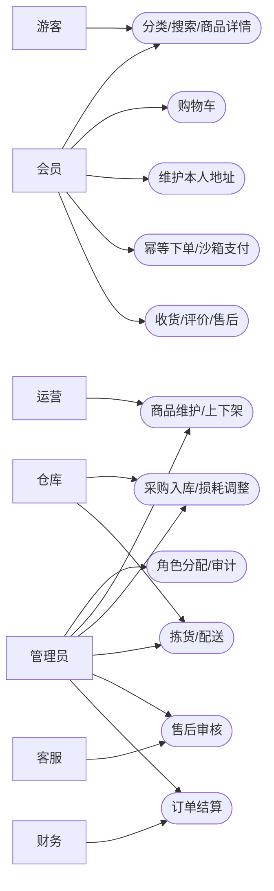
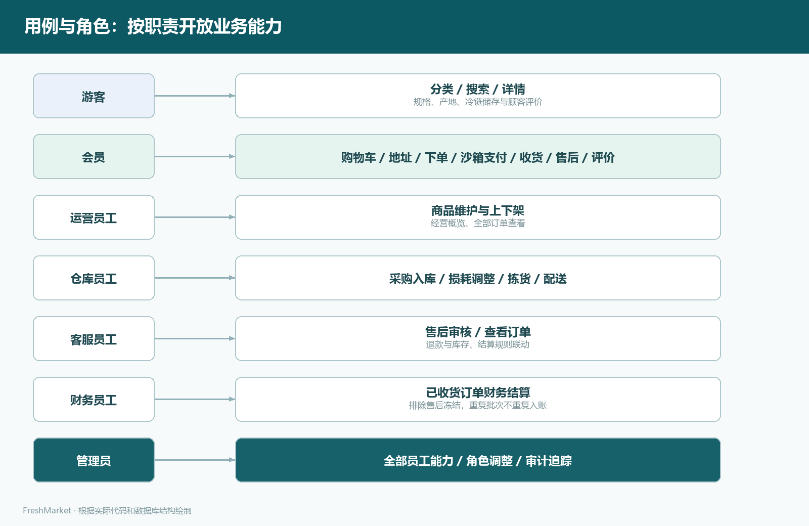
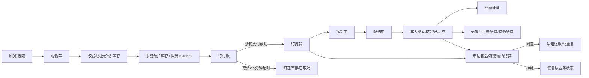
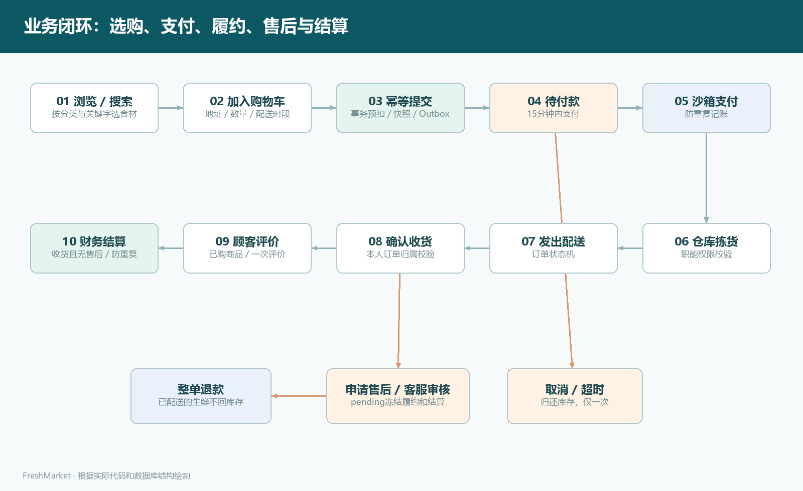
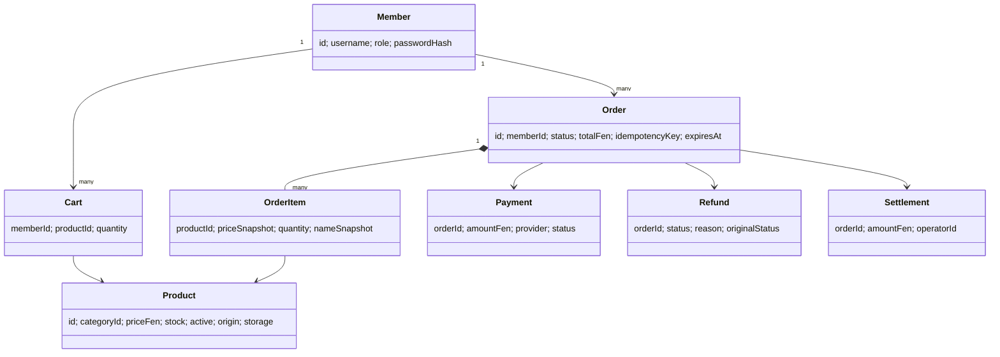
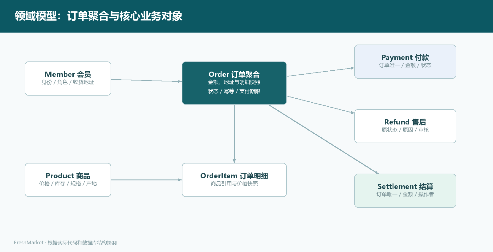
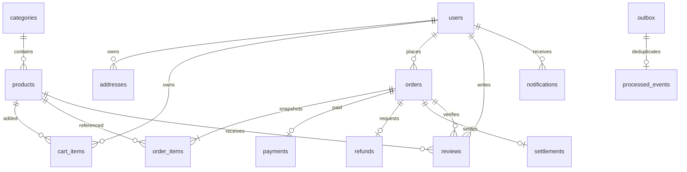
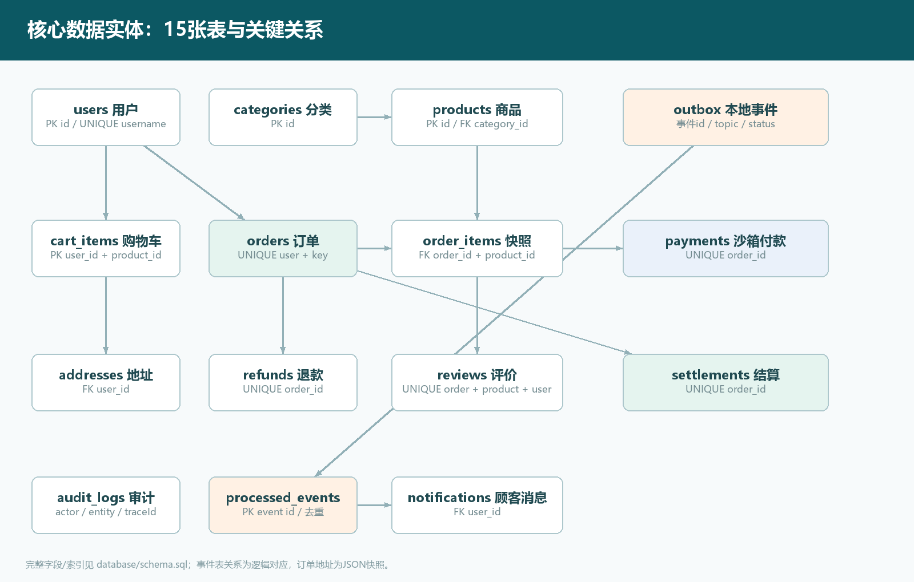

# 鲜境 FreshMarket 需求分析文档

版本：1.0；依据：实验四商城系统任务书、教材第九章（扫描PDF第150–156页，书内第135–141页）。

## 1. 项目定位

参考盒马的分类选购、产地鲜选、冷链食材与到家购物体验，面向城市家庭、上班族和轻食人群搭建生鲜商城；采用独立品牌“鲜境”，不声称与盒马存在合作。目标是让顾客完成真实持久化购物闭环，让员工按职责处理库存、履约、售后与结算。

顾客痛点：食材规格和储存方式不清楚、配送时间不便、售后处理不可追踪。业务痛点：超卖、重复下单/付款、售后与结算冲突、员工越权、缺少可复现部署证据。

范围包含6个分类、24款初始化商品；站点采用响应式网页。支付为本地沙箱，不接入银行卡/支付宝/微信真实扣款；配送为仓库状态流转，不接入真实骑手或地图定位。当前运费为商品小计满99元免配送费，否则6元；支持整单退款。统一货币人民币，金额字段为整数分。

## 2. 用户画像与场景

| 画像 | 目标 | 关键场景 |
| --- | --- | --- |
| 城市家庭采购者 | 一次买齐当天食材 | 搜索蔬菜、肉禽，选择配送时段，查看收货进度 |
| 上班族 | 便捷安排早餐与晚餐 | 选购乳品/速食、保存地址、快速结算 |
| 运营员工 | 维护价格和商品信息 | 上下架、修改规格/产地/图片与价格 |
| 仓库员工 | 避免库存与履约差错 | 采购入库、损耗登记、拣货、配送 |
| 客服/财务 | 管控售后和账务 | 核实退款原因、排除售后订单、幂等结算 |

## 3. 功能验收

| 编号 | 功能 | 验收条件 |
| --- | --- | --- |
| F01 | 分类、搜索、排序、分页 | 搜索名称/副标题/产地；页大小1–100；排序枚举限制 |
| F02 | 商品详情 | 展示售价、原价、规格、产地、储存方式、库存与真实评价 |
| F03 | 账号 | 注册固定会员身份；密码哈希；JWT有效期2小时 |
| F04 | 购物车 | 增加、修改、移除；数量1–99；读取服务端价格计算小计 |
| F05 | 地址 | 支持最多20个地址；校验手机号；用户只能修改本人地址 |
| F06 | 下单 | 校验本人地址及商品可售；订单保存价格、地址和规格快照 |
| F07 | 防超卖与幂等 | 同一请求标识返回同一订单；不同请求内容返回409；多商品扣库存失败全部回滚 |
| F08 | 支付与取消 | 沙箱付款只计账一次；仅待付款订单可取消；超时自动归还库存 |
| F09 | 履约 | 仓库按待拣货→拣货中→配送中操作；会员只能确认本人订单收货 |
| F10 | 售后 | 已付款未结算订单可申请一次整单或部分售后；审核中冻结履约/结算；已配送商品不回库存 |
| F11 | 评价 | 已收货且包含该商品才可评价；每个订单商品只评价一次 |
| F12 | 结算 | 仅已收货、无待审核/通过退款、未结算订单；重复批次不会重复入账 |
| F13 | 运营后台 | 商品、库存、订单、售后、财务、成员权限、审计按角色开放 |
| F14 | 可靠性 | 业务事件与业务数据同事务写入Outbox；重试和消费去重；服务健康及指标可查询 |

## 4. 角色权限矩阵

“本人”表示必须带用户所有权条件；员工订单输出对手机号脱敏。游客仅访问公开商品。

| 能力 | 游客 | 会员 | 运营 | 仓库 | 客服 | 财务 | 管理员 |
| --- | --- | --- | --- | --- | --- | --- | --- |
| 商品浏览/搜索 | ✓ | ✓ | ✓ | ✓ | ✓ | ✓ | ✓ |
| 个人购物/地址/订单 | — | 本人 | 本人 | 本人 | 本人 | 本人 | 本人 |
| 经营概览 | — | — | ✓ | ✓ | ✓ | ✓ | ✓ |
| 商品编辑/上下架 | — | — | ✓ | — | — | — | ✓ |
| 库存入库/损耗 | — | — | — | ✓ | — | — | ✓ |
| 查看全部订单 | — | — | ✓ | ✓ | ✓ | — | ✓ |
| 拣货/配送 | — | — | — | ✓ | — | — | ✓ |
| 退款审核 | — | — | — | — | ✓ | — | ✓ |
| 财务结算 | — | — | — | — | — | ✓ | ✓ |
| 成员角色/审计 | — | — | — | — | — | — | ✓ |

登录后每次请求重新从数据库读取角色，因此角色撤销立即影响旧JWT。后台隐藏菜单与服务端RBAC同时实施；不能只依赖前端隐藏。

## 5. 用例图

## 6. 业务流程与状态

退款申请不把订单直接改为“退款中”，而是在独立退款实体中记录pending；履约及结算查询该实体决定是否拦截。已付款/已拣货且未配送的退款归还库存；配送中/已完成退款不回库存。部分退款按所选商品归还库存与对应销量，订单状态保持不变；已结算订单按订单总额扣除已通过退款金额后的净额结算。退款被拒绝后保留一次申请记录。

## 7. 领域模型

## 8. 数据ER图

逻辑Outbox与processed_events以事件id对应；为保留重放能力，不设置数据库物理外键。订单地址是JSON快照，不引用可被修改/删除的当前地址。完整DDL与索引位于 `database/schema.sql`。

## 9. API清单

| 模块 | 方法与路径 | 访问规则 |
| --- | --- | --- |
| 账号 | POST `/api/auth/register`, POST `/api/auth/login`, GET `/api/auth/me` | 注册/登录公开，其余JWT |
| 商品 | GET `/api/categories`, GET `/api/products`, GET `/api/products/:id` | 公开 |
| 购物车 | GET/POST `/api/cart`, PUT `/api/cart/:id` | 本人 |
| 地址 | GET/POST `/api/addresses`, PUT/DELETE `/api/addresses/:id` | 本人 |
| 订单 | POST/GET `/api/orders`, GET `/api/orders/:id` | 本人；创建须Idempotency-Key |
| 支付/取消/收货 | POST `/api/orders/:id/pay`, `/cancel`, `/receive` | 本人+状态机 |
| 售后/评价 | POST `/api/orders/:id/refund`, `/reviews` | 本人+业务约束 |
| 消息 | GET `/api/notifications` | 本人 |
| 后台概览 | GET `/api/admin/dashboard` | dashboard权限 |
| 商品/库存 | GET/POST `/api/admin/products`, PUT `/:id`, POST `/:id/stock` | 各自RBAC权限 |
| 后台订单 | GET `/api/admin/orders`, POST `/api/admin/orders/:id/status` | orders/fulfillment权限 |
| 售后 | GET `/api/admin/refunds`, POST `/:id/decision` | refunds权限 |
| 结算 | GET/POST `/api/admin/settlements` | settlements权限 |
| 用户/审计 | GET `/api/admin/users`, PUT `/:id/role`, GET `/api/admin/audit` | users/audit权限 |
| 运维 | GET `/api/health`, `/api/metrics`, `/api/openapi.json` | metrics在网关阻断外部访问 |

所有业务接口返回 `{code,message,data,traceId}`；分页为 `{items,total,page,pageSize}`。错误使用400/401/403/404/409/429/500等HTTP状态。OpenAPI保留请求体、参数、Bearer鉴权定义。

## 10. 非功能需求与验证方式

| 编号 | 验收目标 | 验证方式 | 边界 |
| --- | --- | --- | --- |
| N01 | 商品列表本地p95<500ms，并发10 | 200次HTTP突发测量，保存QPS、分位数与错误率 | 不等同生产持续容量 |
| N02 | 并发争抢最后3件时不超卖 | 两个会员同时下单；仅一单成功；库存0 | SQLite本地测试+PostgreSQL CI测试入口 |
| N03 | 重复提交8次只创建1单 | 并发幂等集成测试 | 同用户、同key、同请求内容 |
| N04 | 重复支付只记1笔 | 并发支付测试+唯一约束 | 真实渠道回调签名不在沙箱范围 |
| N05 | 订单/地址所有权隔离 | 越权读取、取消、付款、退款、修改地址测试 | RBAC在服务端重新读取角色 |
| N06 | 核心自动化测试全部通过 | 后端、E2E、类型检查、生产构建 | 见实际测试报告 |
| N07 | 390px手机与1440px桌面可用 | Playwright检查横向溢出与交互，保存截图 | 不代表全部设备矩阵 |
| N08 | 事件不因应用崩溃丢失 | Outbox同事务、发布确认、重复消费测试 | RabbitMQ实际连接验证独立标注 |
| N09 | 可运维/复现 | Docker Compose、健康、指标、备份、回滚、锁文件 | 生产SLA/灾备恢复时间须另测 |

不将99.9%可用性、长期峰值QPS、多节点故障恢复或容灾RPO声明为本次已验证结果。
