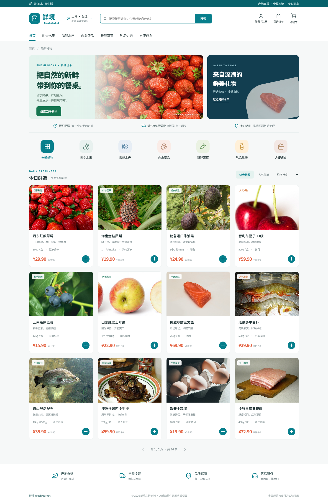
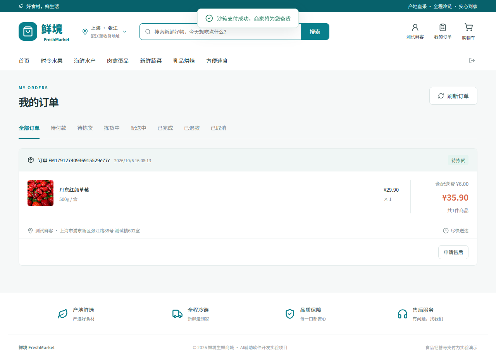
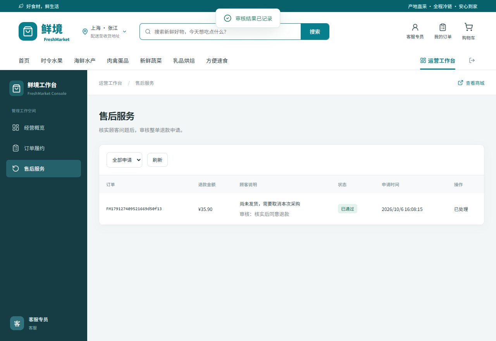
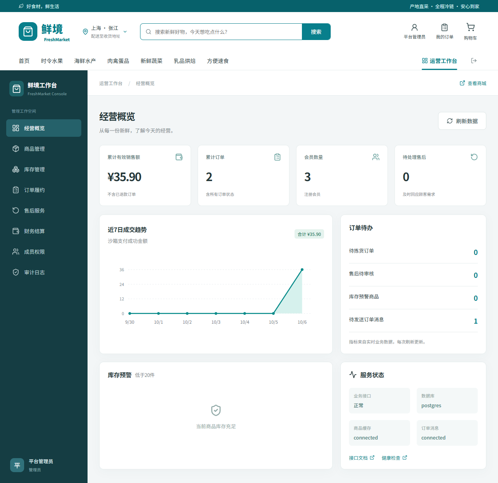
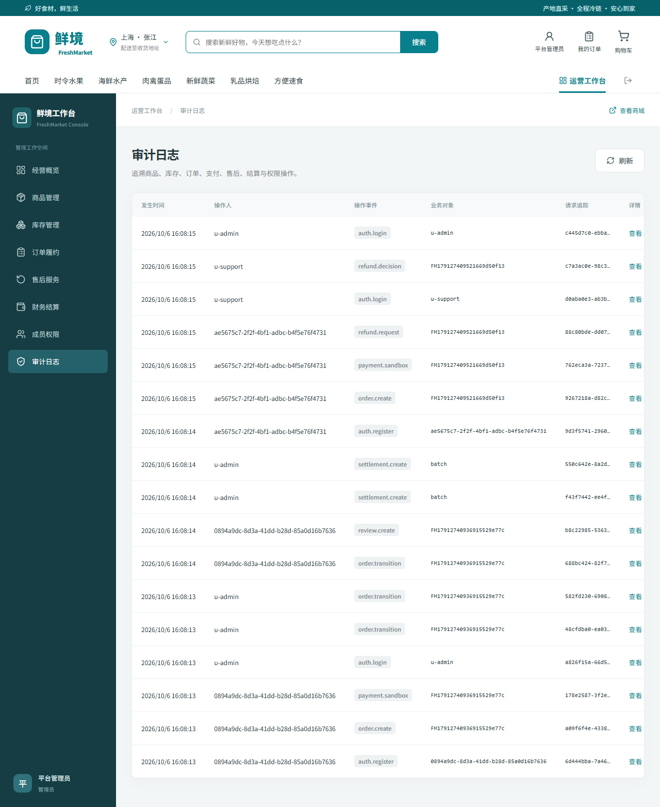
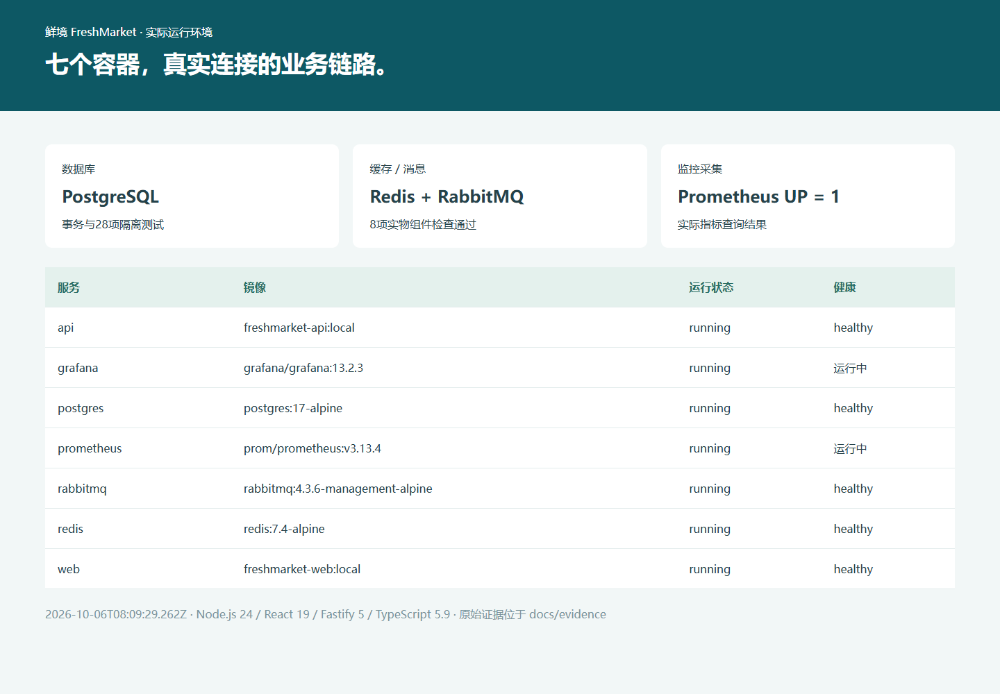
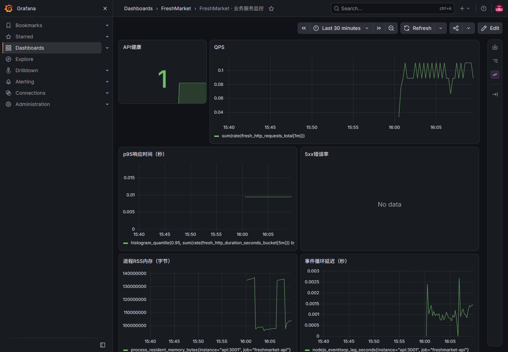
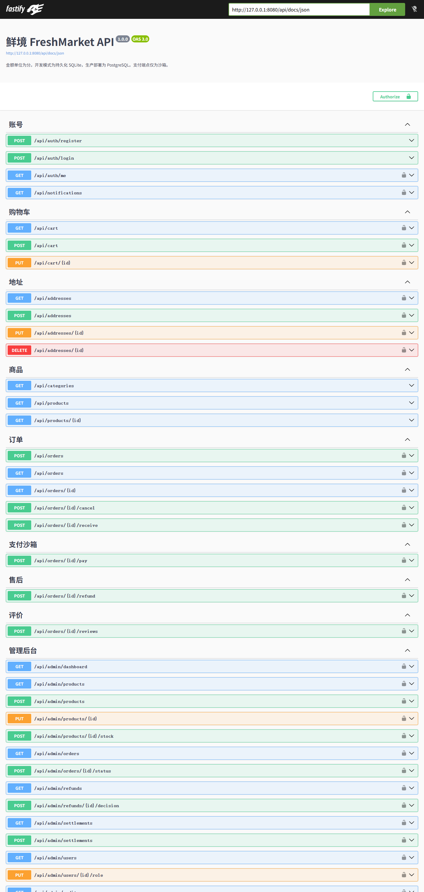
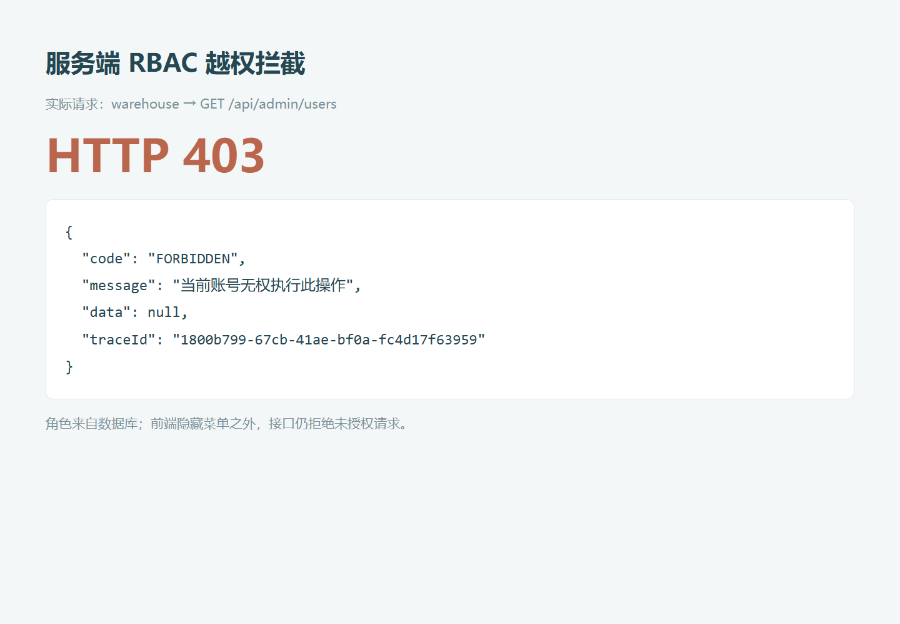

# 鲜境 FreshMarket 测试报告

## 1. 测试范围与环境

日期：2026-10-06。Windows Node.js v24.14.1，154.0.4258.53版Edge，React/Fastify/TypeScript精确版本见依赖证据；Docker Linux环境采用PostgreSQL17、Redis7.4与RabbitMQ4.3.6。SQLite测试使用内存数据库；PostgreSQL每项创建独立schema，测试结束删除。

最终代码完成类型检查、生产构建、锁文件审计、两种数据库上的业务自动测试、桌面/手机E2E，以及真实Redis/RabbitMQ链路验证。GitHub Actions配置已提交到源码，尚未声称远端工作流实际运行。

| 项目 | 最终结果 | 证据 |
| --- | --- | --- |
| SQLite后端测试 | 28/28通过 | evidence/backend-tests.txt |
| PostgreSQL后端测试 | 28/28通过 | evidence/postgres-tests.txt |
| SQLite代码覆盖率 | 行 87.02%、分支 80.63%、函数 83.13% | Node实验性coverage报告 |
| PostgreSQL代码覆盖率 | 行 88.2%、分支 80.89%、函数 79.87% | 独立报告，不能直接相加 |
| 本机与Docker浏览器测试 | 两个环境各5/5通过，Docker最终失败数 0 | evidence/e2e-local-results.json、e2e-docker-results.json |
| 真实数据库/缓存/队列检查 | 8/8通过 | evidence/infra-smoke.json |
| 类型检查/构建 | 通过 | evidence/typecheck.txt、build.txt；另有docker-build.txt与镜像启动 |
| 联网依赖审计 | 0项已知依赖告警 | evidence/dependency-audit.json；不等同全面安全审计 |
| 容器与采集 | 七个容器运行；API数据库/缓存/队列连接；Prometheus target UP=1 | docker-services.json、health.json、prometheus-target.json |

## 2. 后端业务用例

| 编号 | 场景 | SQLite | PostgreSQL |
| --- | --- | --- | --- |
| T01 | 密码哈希与随机盐 | 通过 | 通过 |
| T02 | 登录/JWT/错误密码 | 通过 | 通过 |
| T03 | 注册角色注入与固定会员 | 通过 | 通过 |
| T04 | RBAC身份与职能拦截 | 通过 | 通过 |
| T05 | 分页边界/排序枚举/SQL参数化 | 通过 | 通过 |
| T06 | 购物车修改与库存溢出 | 通过 | 通过 |
| T07 | 下单金额/地址/价格快照 | 通过 | 通过 |
| T08 | 满99元免配送费 | 通过 | 通过 |
| T09 | 8次并发幂等下单 | 通过 | 通过 |
| T10 | 不同请求同key冲突 | 通过 | 通过 |
| T11 | 多商品失败事务回滚 | 通过 | 通过 |
| T12 | 两个会员争抢最后3件 | 通过 | 通过 |
| T13 | 6次重复支付只记一笔 | 通过 | 通过 |
| T14 | 付款与取消状态竞争 | 通过 | 通过 |
| T15 | 重复取消只归还一次 | 通过 | 通过 |
| T16 | 过期拒付与自动回库存 | 通过 | 通过 |
| T17 | 订单读取/支付/取消/退款越权 | 通过 | 通过 |
| T18 | 履约顺序与确认收货 | 通过 | 通过 |
| T19 | 售后冻结履约/退款幂等 | 通过 | 通过 |
| T20 | 已配送生鲜退款不回库存 | 通过 | 通过 |
| T21 | 收货后评价/重复与未购商品限制 | 通过 | 通过 |
| T22 | 售后冻结结算/重复结算跳过 | 通过 | 通过 |
| T23 | Outbox失败重试/消费去重 | 通过 | 通过 |
| T24 | 旧JWT权限撤销即时生效 | 通过 | 通过 |
| T25 | 库存调整不能为负/审计 | 通过 | 通过 |
| T26 | 地址手机号/归属/默认地址 | 通过 | 通过 |
| T27 | 经营概览/OpenAPI/健康/指标/脱敏 | 通过 | 通过 |
| T28 | 登录限流防暴力尝试 | 通过 | 通过 |

重点断言：库存不能负数；部分扣减失败全回滚；付款/取消竞争只有一个状态转换有效；订单快照不随商品价格更新变化；角色变更使旧JWT权限立即失效；售后与结算锁定同一订单。

## 3. 端到端用例与截图

| 编号 | 场景 | 验证 |
| --- | --- | --- |
| E01 | 桌面商城→搜索→详情 | 12条商品分页、食材图片decode成功、存储信息、无页面JS错误 |
| E02 | 390×844手机商城 | 无页面横向溢出；商品加购控制可用 |
| E03 | 注册→地址→下单→付款→仓库履约→收货→评价→结算 | 真实API持久化；重复结算不生成记录；会员后台拦截 |
| E04 | 顾客售后→客服审核→管理员概览与审计 | 退款实际通过；audit包含refund.decision |
| E05 | 仓库权限 | 库存/履约可见；成员权限/财务菜单隐藏；直接访问成员页被拒绝 |

## 4. 实物组件与运维证据

隔离命名空间验证Redis真实连接、缓存TTL、共享版本失效、PostgreSQL下单、RabbitMQ发布确认、消费者提交后ack、重复事件去重、取消库存归还与消息投递。验证资源结束后清理，不使用内存假实现替代真实组件。

## 5. 商品接口短时HTTP测量

范围：本机单实例SQLite API，无Redis；GET /api/products?pageSize=12&sort=default。并发 10，请求 200，总时长 0.168秒。这是短时突发测量，反映本机运行结果，不宣称长期稳态或生产最大容量。

| 指标 | 实测 |
| --- | --- |
| QPS | 1193.47 |
| 平均RT | 7.56 ms |
| p50 | 6.53 ms |
| p95 | 17.34 ms |
| p99 | 25.36 ms |
| 错误数 / 错误率 | 0 / 0.00% |
| HTTP状态 | {"200": 200} |

原始数据：evidence/load-test.json，测量时间 2026-10-06T07:50:25.611Z。本轮p95满足需求中本地500ms目标；200请求总时长很短，不能据此判断跨网访问、数据库增长、持续峰值、容灾或多节点SLA。限流开启时频繁重复压测可能收到429，这属于限流而不是数据一致性故障。

## 6. 修复与回归

首次浏览器E2E售后流程失败于登录按钮定位歧义；限定header元素后通过。Docker构建联网审计识别Swagger UI关联静态路由漏洞；升级@fastify/swagger-ui至6.1.1后重新构建，并回归SQLite、PostgreSQL与浏览器流程，最终审计告警为0。没有通过删掉失败断言来获得通过结果。

## 7. 验证边界与复现

没有执行真实资金支付、真实骑手配送、跨区域容灾、主从故障切换、长期压力、生产渗透或覆盖全部浏览器。备份与恢复/回滚脚本已交付，尚未以破坏现有演示数据方式演练恢复。所有通过结果仅对应本报告列明的范围。

复现：npm ci → npm run typecheck → npm test → npm run build → npm run dev → npm run test:e2e → npm run load。Docker：docker compose --env-file .env.docker up -d --build；随后 scripts/e2e-docker.ps1、compose.test.yaml和scripts/infra-smoke.mjs提供完整环境验证入口。
